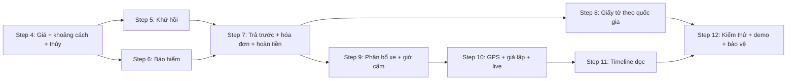

# Bộ prompt cho Antigravity: Step 4 → Step 12

Bộ prompt để giao từng Step còn lại trong `docs/dinh-huong-phat-trien-sau-review.md` cho agent Antigravity. Step 1–3 đã xong.

## Cấu trúc

```
docs/antigravity-prompts/
├── README.md                                   ← file này
├── _COMMON.md                                  ← bối cảnh + quy tắc chung, mọi prompt đều bắt đọc
├── step-04-khoang-cach-bang-gia-duong-thuy/PROMPT.md
├── step-05-van-chuyen-khu-hoi/PROMPT.md
├── step-06-bao-hiem-theo-muc-do/PROMPT.md
├── step-07-thanh-toan-ngay-hoa-don-hoan-tien/PROMPT.md
├── step-08-giay-to-theo-quoc-gia/PROMPT.md
├── step-09-phan-bo-xe-tram-gan-nhat-gio-cam/PROMPT.md
├── step-10-gps-gia-lap-live-tracking/PROMPT.md
├── step-11-timeline-tien-do-doc/PROMPT.md
└── step-12-kiem-thu-demo-bao-ve/PROMPT.md
```

Mỗi `PROMPT.md` có cùng bố cục: vai trò và mục tiêu, file bắt buộc đọc, điều kiện tiên quyết, phạm vi làm/không làm, thiết kế dữ liệu (migration), hàm thuần và công thức, API (request/response, mã lỗi, phân quyền), frontend, test bắt buộc, tài liệu cần cập nhật, tiêu chí hoàn thành, bẫy thường gặp.

## Thứ tự chạy



- Chạy **lần lượt theo số**. Step 5 và Step 6 có thể chạy song song trên 2 branch khác nhau rồi gộp, nhưng chạy tuần tự sẽ ít xung đột hơn (cả hai đều sửa phần báo giá và bảo hiểm).
- Step 8 và Step 9 độc lập với nhau sau Step 7.
- Mỗi prompt tự kiểm tra điều kiện tiên quyết và **dừng lại báo cáo** nếu Step trước chưa làm.

## Cách dùng với Antigravity (mỗi Step một phiên)

1. Tạo branch riêng từ `dev` (hoặc từ branch đang làm), ví dụ `feature/step-04-pricing`.
2. Mở phiên agent mới trong Antigravity ở thư mục gốc repo.
3. Dán câu sau (thay đúng tên thư mục):

   > Đọc và thực hiện đầy đủ `docs/antigravity-prompts/step-04-khoang-cach-bang-gia-duong-thuy/PROMPT.md`. Trước khi code, đọc `docs/antigravity-prompts/_COMMON.md` và mọi file trong mục "Bắt buộc đọc trước". Làm theo đúng trình tự, chạy các lệnh kiểm tra, không commit, kết thúc bằng báo cáo theo mẫu.

   Hoặc dán **toàn bộ nội dung** `_COMMON.md` rồi đến `PROMPT.md` của Step đó, nếu Antigravity không tự đọc file trong repo.
4. Agent kết thúc bằng báo cáo theo mẫu ở `_COMMON.md` mục 9. Đọc kỹ:
   - kết quả `npm test`, tsc, eslint, build;
   - phần "Khác với prompt" và "Sửa ngoài module chính";
   - danh sách migration và kịch bản thử tay.
5. Tự chạy migration (`cd backend && npm run migrate:all`) và thử tay theo kịch bản agent đưa.
6. Review diff (`git diff`, `git status`), rồi mới commit theo các commit agent đề xuất (prompt cấm agent tự commit/push).
7. Sang Step tiếp theo.

## Một số lưu ý

- **Tiến độ thực tế quan trọng hơn prompt.** Prompt được viết dựa trên code sau Step 3 (ngày 23/11/2026). Nếu Step trước làm khác kế hoạch (ghi ở dòng "Trạng thái" trong file định hướng hoặc trong báo cáo của agent), hãy nhắc agent ở đầu phiên, ví dụ: *"Lưu ý: Step 5 đã thêm trạng thái `return_pending`; Step 7 không cần thêm lại."*
- **Số migration** trong prompt là dự kiến (031 → 037). Agent được dặn lấy số kế tiếp thực tế.
- **Dữ liệu pháp lý** (giờ cấm xe, yêu cầu giấy tờ theo quốc gia, giá cước, bảo hiểm) đều là **dữ liệu demo**, phải đối chiếu nguồn chính thức trước khi dùng thật; prompt yêu cầu ghi rõ điều này trên giao diện cấu hình.
- Các file bạn đang sửa dở (`frontend/package.json`, `frontend/package-lock.json`, `filethongtin.md`) được dặn là không đụng, trừ Step 6 được phép sửa đúng mục 5.1 của `filethongtin.md` và phải báo lại.
- Step 7 là Step lớn nhất. Nếu agent bị hết ngữ cảnh giữa chừng, mở phiên mới và yêu cầu: *"Tiếp tục Step 7 từ giai đoạn 7.x; đọc lại PROMPT.md và kiểm tra những gì đã có trong code trước khi làm tiếp."*
