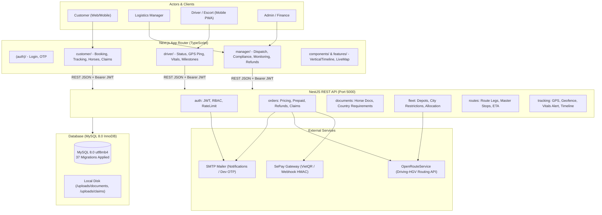
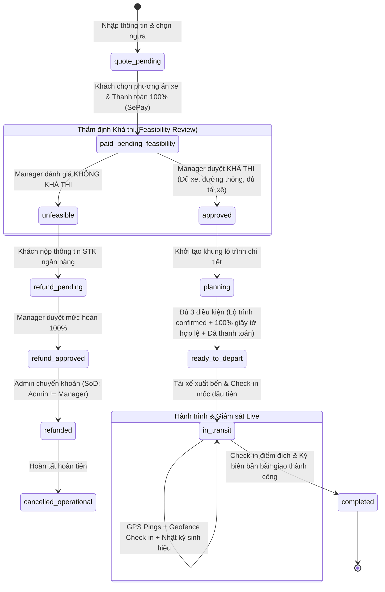

# TÀI LIỆU NGUỒN BẢO VỆ ĐỒ ÁN TỐT NGHIỆP: HỆ THỐNG VẬN CHUYỂN NGỰA ĐUA EQUITRANSIT

Tài liệu này tổng hợp toàn bộ cơ sở lý luận, giải pháp kiến trúc, công thức tính toán và kịch bản đối thoại để trình bày và bảo vệ đồ án trước Hội đồng chấm thi tốt nghiệp (Đồng bộ toàn bộ 12 nhóm góp ý G1 đến G12).

---

## 1. Bảng Đối chiếu Góp ý Hội đồng (G1 – G12)

| Mã | Góp ý của Hội đồng | Giải pháp kỹ thuật đã triển khai | Vị trí trong Source Code & DB | Kịch bản Demo |
|---|---|---|---|---|
| **G1** | Gom 3 actor nội bộ thành 1 | Hợp nhất `TRANSPORT_SPECIALIST` và `FLEET_ROUTE_COORDINATOR` vào **`LOGISTICS_MANAGER`** ("Quản lý vận hành"). Chuẩn hóa redirect route và menu 3 phân hệ. | Frontend: `/manager/*` Backend: `auth.types.ts`, `RolesGuard` DB: `migration/028_merge_internal_roles.sql` | **Kịch bản 8** |
| **G2** | Bỏ giới tính, BD; lưu giấy tờ vào con ngựa | Bỏ `gender`, `birth_date`. Thêm cờ `requires_private_stall`. Quản lý giấy tờ (hộ chiếu, vắc-xin, Coggins...) tập trung theo từng cá thể ngựa, tự động tái sử dụng. | Frontend: `customer/horses/*` Backend: `horse-documents.*`, `horses.*` DB: bảng `horse_document`, `horse` | **Kịch bản 2, 8** |
| **G3** | Thêm đường thủy; chuẩn hóa hàng không | Thêm phương thức `sea` (ferry ≤ 12h, vessel cảng ≤ 400km). Chuẩn hóa đường hàng không (`air`) theo IATA Live Animals Regulations (jet stall 3 ngựa). | Backend: `pricing.service.ts`, `pricing-policy.ts` DB: bảng `pricing_tariff` (mode `sea`, `air`) | **Kịch bản 2, 3** |
| **G4** | Tính tiền tự động theo khoảng cách & thanh toán ngay | Tích hợp OpenRouteService (HGV profile) + fallback Haversine. Khóa giá 30 phút trong snapshot. Cước tính theo bậc khoảng cách và trọn gói xe, loại bỏ nhập cước thủ công. | Frontend: `customer/requests/new` Backend: `distance.service.ts`, `pricing.service.ts` DB: `shipment_quote`, `pricing_snapshot` | **Kịch bản 1, 2** |
| **G4a**| Hóa đơn điện tử PDF | Tự động phát hành hóa đơn VAT điện tử (snapshot bất biến) và hóa đơn điều chỉnh bổ sung, in/tải PDF trực tiếp có mã tra cứu. | Frontend: `customer/orders/[id]/invoice` Backend: `orders.service.ts` DB: `shipment_invoice` | **Kịch bản 2** |
| **G4b**| Form hoàn tiền khi không khả thi | Trạng thái `paid_pending_feasibility`. Nếu Manager đánh giá không khả thi (`unfeasible`), hệ thống mở form nhận tài khoản ngân hàng và hoàn 100% qua SoD. | Frontend: `customer/requests/[id]`, `manager/refunds` Backend: `orders-ops.*` DB: `shipment_refund_record` | **Kịch bản 4** |
| **G4c**| Giấy tờ theo nước đến & tái sử dụng | Cấu hình danh mục giấy tờ pháp lý/kiểm dịch theo 7 quốc gia và 3 phương thức. Đối chiếu tự động và tái sử dụng giấy tờ còn hạn trong kho ngựa. | Frontend: `customer/requests/new` (Step 2) Backend: `compliance.service.ts` DB: `country_document_requirement` | **Kịch bản 2** |
| **G5** | Vận chuyển khứ hồi & Chính sách No-Show | Đơn khứ hồi (`round_trip`) chiết khấu -10% chặng về. Bắt buộc đồng ý chính sách hủy/đổi ngày và cửa sổ chờ 120 phút. Báo cáo No-show có ảnh chụp hiện trường. | Frontend: `customer/requests/new`, `driver/status` Backend: `return-policy.ts`, `orders.service.ts` DB: `shipment` (cột `trip_type`, `return_*`) | **Kịch bản 2, 6** |
| **G6** | Gói bảo hiểm % & bồi thường theo mức độ M1–M4 | Bảng quyền lợi bồi thường bằng tiền thật theo 4 mức độ M1-M4 (Nhẹ, Trung bình, Nặng, Tử vong). Khách nộp claim trong 72h. Phê duyệt SoD (≥20M duyệt kép). | Frontend: `customer/requests/[id]`, `manager/claims` Backend: `insurance-claim.*`, `insurance-policy.ts` DB: `insurance_claim`, `insurance_payout_rule` | **Kịch bản 2, 7** |
| **G7** | Quản lý trạm xe & trạm đối tác ngoại | Bảng `depot` (4 trạm VN, 3 trạm đối tác nước ngoài). Điều xe từ trạm gần nhất. Chặng giao nước ngoài dùng bảng giá đối tác `PARTNER`. | Backend: `depots.service.ts`, `quote-allocation.service.ts` DB: bảng `depot`, `vehicle.depot_id` | **Kịch bản 1, 2** |
| **G8** | GPS Check-in, Geofence & Giả lập Live | Nhận vị trí GPS từ app tài xế; kiểm tra vùng tròn Geofence tại trạm dừng; cảnh báo ngoài luồng. Có chế độ giả lập (`simulation_enabled`) do Admin kiểm soát. | Frontend: `driver/status`, `customer/tracking` Backend: `tracking.service.ts`, `geofence-policy.ts` DB: `vehicle_position_ping`, `system_setting` | **Kịch bản 5** |
| **G9** | Giờ cấm xe tải nội đô HCM, HN & ETA có nghỉ | Cấu hình vùng tròn cấm xe tải nặng tại Hà Nội & TP.HCM. Tự động dời giờ xuất bến ra ngoài khung cấm (sang 22h đêm) + phụ phí đêm. ETA chèn điểm nghỉ theo EU 1/2005. | Frontend: `customer/requests/new` Backend: `city-restriction-policy.ts`, `journey-time-policy.ts` DB: `city_restriction_rule` | **Kịch bản 1** |
| **G10**| Loại bỏ hoàn toàn ghép chuyến | Xóa bỏ hoàn toàn hình thức `shared_stall` và các chuyến xe ghép. 100% đơn hàng là bao nguyên xe chuyên dụng (Dedicated Charter) để phòng ngừa dịch tễ. | Frontend: toàn bộ UI tạo đơn & báo giá Backend: `booking-policy.ts`, `capacity-policy.ts` | **Kịch bản 1, 8** |
| **G11**| Sức chứa xe & Báo giá tối đa 3 phương án | Quản lý sức chứa xe (1, 2, 4, 6 khoang). Phân bổ xe tự động trả về 3 phương án: Rẻ nhất · Ít xe nhất · Đến sớm nhất (hoặc chia ngày khi thiếu xe). | Frontend: `customer/requests/new` (Step 3) Backend: `allocation-policy.ts`, `quote-allocation.service.ts` DB: `vehicle_reservation` | **Kịch bản 1** |
| **G12**| Timeline giao hàng dạng line tiến độ dọc | Xây dựng component `VerticalTimeline` chuẩn hóa hiển thị đồng bộ cho 3 bên (Khách hàng, Tài xế, Quản lý) với cơ chế ẩn danh dữ liệu nội bộ. | Frontend: `features/tracking/timeline/*` Backend: `GET /tracking/shipments/:id/timeline` UI: `customer/tracking`, `driver/status`, `manager` | **Kịch bản 5** |

---

## 2. Kiến trúc Hệ thống Tổng quan

---

## 3. Vòng đời Đơn hàng & State Machine

---

## 4. Công thức Tính cước & Cơ chế Bảo hiểm

### 4.1. Công thức Tính Cước Đường Bộ (Dedicated Charter)
$$\text{Total Road Freight} = \text{Opening Fee} + \sum_{i} (\text{Distance Tier}_i \times \text{Rate}_i) + (\text{Deadhead Km} \times \text{Deadhead Rate}) + \text{Night Surcharge}$$
- **Opening Fee:** Cước mở bến cố định theo loại xe (ví dụ: xe 4 khoang = 3.500.000 VNĐ).
- **Distance Tiers:** Cước lũy tiến theo khoảng cách:
  - Bậc 1 (≤ 100 km): 45.000 VNĐ/km.
  - Bậc 2 (101 – 500 km): 35.000 VNĐ/km.
  - Bậc 3 (> 500 km): 28.000 VNĐ/km.
- **Deadhead Km:** Khoảng cách xe rỗng chạy từ Depot đến điểm đón khách: 15.000 VNĐ/km.
- **Night Surcharge:** Phụ phí nếu phải xuất phát trong khung giờ đêm (22:00 – 06:00) do tránh giờ cấm: +1.000.000 VNĐ/xe.
- **Làm tròn cước:** Luôn làm tròn lên (`Math.ceil`) hàng 1.000 VNĐ gần nhất.

### 4.2. Bảng Quyền lợi Bảo hiểm (M1 – M4) và Ví dụ Ngựa 2 tỷ VNĐ
Khách hàng khai báo giá trị cá thể ngựa = **2.000.000.000 VNĐ (2 tỷ đồng)**:

| Mức độ sự cố | Định nghĩa chuyên môn & Bằng chứng | Gói Cơ bản (0% - Free) | Gói Tiêu chuẩn (1.5% = 30M) | Gói Toàn diện (3.0% = 60M) |
|---|---|---|---|---|
| **M1** (Nhẹ) | Trầy xước, mất nước nhẹ, hồi phục < 7 ngày. Bằng chứng: Ảnh bàn giao, sinh hiệu. | Chi phí thực tế ≤ 5.000.000 đ | Chi phí thực tế ≤ 1% giá trị (tối đa 20.000.000 đ) | Chi phí thực tế ≤ 2% giá trị (tối đa 40.000.000 đ) |
| **M2** (Trung bình) | Chấn thương cơ/khớp, điều trị 7-30 ngày. Bằng chứng: Kết luận thú y, hóa đơn. | Chi phí thực tế ≤ 10.000.000 đ | 15% giá trị khai báo (= **300.000.000 đ**) | 30% giá trị khai báo (= **600.000.000 đ**) |
| **M3** (Nặng / Mất khả năng đua) | Điều trị > 30 ngày hoặc mất khả năng thi đấu vĩnh viễn (Loss of Use). Bằng chứng: Hội đồng thú y độc lập. | 20% giá trị, trần 50M (= **50.000.000 đ**) | 50% giá trị khai báo (= **1.000.000.000 đ**) | 80% giá trị khai báo (= **1.600.000.000 đ**) |
| **M4** (Tử vong / An tử) | Tử vong hoặc an tử nhân đạo trong chuyến đi hoặc 72h sau bàn giao. Bằng chứng: Giám định pháp y thú y. | 100% giá trị, trần 50M (= **50.000.000 đ**) | 80% giá trị khai báo (= **1.600.000.000 đ**) | 100% giá trị khai báo (= **2.000.000.000 đ**) |
| **Thú y khẩn cấp trên đường** | Chi phí cấp cứu thú y phát sinh đột xuất khi đang chạy xe. | Không hỗ trợ | Tối đa 20.000.000 đ | **Toàn bộ chi phí thực tế phát sinh** |

---

## 5. Thuật toán Phân bổ Xe và Giờ cấm Đô thị

### Quy trình 5 bước phân bổ xe tự động:
1. **Tính tổng khoang yêu cầu:** $\text{Total Stalls} = \text{Ngựa thường} + (\text{Ngựa chuồng riêng} \times 2)$.
2. **Lọc xe khả dụng tại các Trạm (Depot):**
   - Tìm trạm thuộc hệ thống gần điểm đón nhất (ví dụ: đón tại TP.HCM -> chọn Depot Thủ Đức).
   - Kiểm tra lịch bảo trì và trạng thái giữ chỗ (`vehicle_reservation`) trong khung giờ đón.
3. **Sinh tập hợp phương án xe:**
   - *Phương án 1 (Xe đơn tối ưu):* Tìm 1 xe có sức chứa vừa vặn hoặc lớn hơn gần nhất (ví dụ 3 ngựa -> xe 4 chỗ).
   - *Phương án 2 (Đa xe nhỏ):* Kết hợp nhiều xe nhỏ (ví dụ 3 xe 1 chỗ hoặc 1 xe 2 chỗ + 1 xe 1 chỗ) nếu không có xe 4 chỗ.
   - *Phương án 3 (Chia ngày / Trạm phụ):* Điều xe từ trạm lân cận hoặc gợi ý chia ngày vận chuyển khi trạm chính hết xe.
4. **Kiểm tra Giờ cấm đô thị (City Restriction Curfew):**
   - Xác định tọa độ điểm đón/trả có nằm trong bán kính cấm xe tải nặng tại Hà Nội / TP.HCM không.
   - Nếu thời gian đón rơi vào khung cấm (06:00 – 22:00), tự động dời thời gian đón sang **22:00**, cộng phụ phí đêm.
5. **Chèn điểm nghỉ ETA theo quy chuẩn EU 1/2005:**
   - Lái xe liên tục tối đa 8 giờ -> bắt buộc chèn 1 điểm nghỉ tối thiểu 60 phút để cho ngựa uống nước và nghỉ ngơi.
   - Tổng hành trình vượt 24 giờ -> bắt buộc dừng tại Trạm trung chuyển/Quarantine Station 24 giờ trước khi tiếp tục.

---

## 6. An toàn Bảo mật & Tách nhiệm vụ (Segregation of Duties - SoD)

- **Nguyên tắc Tách nhiệm vụ tài chính (Financial SoD):**
  - Người phê duyệt mức tiền hoàn hoặc bồi thường (`approved_by` thuộc vai trò Logistics Manager) **tuyệt đối không được phép** thực hiện lệnh giải ngân chuyển khoản (`transferred_by`).
  - Kiểm tra cứng tại tầng backend: nếu `transferred_by == approved_by` -> ném lỗi `403 Forbidden`.
  - Khoản tiền hoàn hoặc bồi thường **≥ 20.000.000 VNĐ** bắt buộc phải có **phê duyệt kép (Dual-Approval)** từ 2 Quản lý độc lập (`approved_by != second_approved_by`).
- **Cô lập dữ liệu khách hàng (Tenant Isolation):**
  - Mọi câu truy vấn dữ liệu đơn hàng, hồ sơ ngựa, tracking, báo giá và hóa đơn đều kiểm tra chặt chẽ `WHERE customer_id = user.id`. Khách hàng A không thể xem hay chỉnh sửa tài nguyên của Khách hàng B (xác thực bằng 171 bài kiểm thử tự động).
- **Audit Log Append-Only:**
  - Lịch sử thay đổi lộ trình, sự cố, thẩm định hồ sơ và sinh hiệu ngựa được lưu dạng bất biến, chỉ ghi thêm (`append-only`), không cho phép sửa đè hoặc xóa bản ghi cũ.

---

## 7. Giới hạn Kỹ thuật & Giả định Mô hình

1. **Dữ liệu demo:** Các quy định giờ cấm xe tải và quy chuẩn giấy tờ kiểm dịch các nước trong đồ án là dữ liệu mô phỏng dựa trên văn bản pháp lý hiện hành, cần được đối chiếu văn bản quy phạm pháp luật gốc trước khi ứng dụng thực tế.
2. **Quota dịch vụ bản đồ:** OpenRouteService sử dụng gói miễn phí dành cho nghiên cứu (hạn mức 2.000 request/ngày). Hệ thống đã xây dựng sẵn cơ chế cache bộ đệm 24h và thuật toán Fallback Haversine thông minh để đảm bảo hệ thống không bao giờ bị dừng hoạt động khi hết quota API.
3. **Thanh toán SePay:** Tích hợp chuyển khoản thực tế qua VietQR và Webhook HMAC-SHA256 bảo mật. Trong môi trường bảo vệ offline, hệ thống hỗ trợ kịch bản mô phỏng giao dịch ngân hàng thành công qua script kiểm thử tích hợp.

---

## 8. Hạn chế Đã biết & Hướng Phát triển Tương lai

- **Hạn chế hiện tại:**
  - Chưa tích hợp trực tiếp qua API hệ thống đặt chỗ bay hàng hóa của các hãng hàng không quốc tế (hiện tại thông tin chặng bay được Quản lý vận hành nhập đối soát thủ công).
  - Cảm biến sinh hiệu (IoT) hiện đang được nhập qua giao diện Web di động của Bác sĩ thú y thay vì truyền trực tiếp từ vòng đeo thông minh của ngựa.
- **Hướng phát triển:**
  - Kết nối giao thức IoT MQTT để thu nhận nhịp tim, thân nhiệt ngựa theo thời gian thực từ vòng cổ chuyên dụng.
  - Tích hợp cổng Dịch vụ công Quốc gia (Một cửa ASEAN) để tự động ký số và truyền hồ sơ kiểm dịch điện tử (e-Phyto).

---

## 9. Bộ 12 Câu hỏi Phản biện Thường gặp & Câu trả lời Chuẩn xác

#### Q1: Vì sao hệ thống lại thu tiền trả trước 100% trước khi Quản lý duyệt khả thi?
> **Trả lời:** Vận chuyển ngựa đua đòi hỏi đặt cọc giữ chỗ phương tiện chuyên dụng và chi phí chuẩn bị chuồng đệm sinh học rất lớn. Việc thanh toán trước giúp xác thực cam kết thực tế của chủ ngựa, loại bỏ tình trạng đơn ảo giữ chỗ làm tê liệt đội xe. Nếu sau đó Quản lý đánh giá không khả thi (ví dụ: đường sạt lở hoặc tài xế ốm đột xuất), hệ thống cam kết hoàn tiền 100% tự động qua quy trình SoD minh bạch.

#### Q2: Nếu dịch vụ OpenRouteService (ORS) bị sập hoặc mất mạng, hệ thống có báo giá được không?
> **Trả lời:** Có. Hệ thống sở hữu cơ chế dự phòng kép: bộ đệm (cache) lưu khoảng cách đã tính trong 24 giờ. Nếu điểm mới mà ORS lỗi kết nối hoặc timeout quá 5 giây, backend tự động chuyển sang công thức tính khoảng cách hình học Haversine nhân với hệ số uốn lượn đường bộ (hệ số 1.25), đảm bảo báo giá vẫn trả về sau chưa đầy 1 giây.

#### Q3: Nếu hai khách hàng cùng đặt một xe duy nhất vào cùng một ngày thì hệ thống xử lý ra sao?
> **Trả lời:** Hệ thống áp dụng cơ chế khóa phân tán trong CSDL (`vehicle_reservation`). Khách hàng nào hoàn tất tạo đơn trước sẽ giữ chỗ xe độc quyền. Khách hàng thứ hai sẽ nhận được phản hồi lỗi `409 Conflict`, đồng thời hệ thống gợi ý phương án điều xe từ trạm khác hoặc gợi ý 3 ngày gần nhất có xe trống trong vòng 14 ngày.

#### Q4: Vì sao hệ thống kiên quyết loại bỏ hoàn toàn tính năng ghép chuyến (Shared Ride)?
> **Trả lời:** Ngựa đua là tài sản thể thao có giá trị hàng tỷ đồng và cực kỳ nhạy cảm với dịch tễ (như cúm ngựa, bệnh thiếu máu truyền nhiễm Coggins). Việc ghép chung xe với ngựa của chủ khác tiềm ẩn rủi ro lây nhiễm chéo cực cao và nguy cơ xung đột khi ngựa đực giống gặp nhau. Vì vậy, theo khuyến nghị của Hội đồng, 100% đơn hàng là bao nguyên xe chuyên dụng (Dedicated Charter).

#### Q5: Vận chuyển ngựa bằng đường thủy (Ferry) có đảm bảo an toàn cho ngựa đua không?
> **Trả lời:** Hệ thống giới hạn nghiêm ngặt: vận chuyển đường thủy dạng phà (`ferry`) chỉ áp dụng cho hải trình ngắn dưới 12 giờ (ví dụ: Rạch Giá - Phú Quốc), xe tải chuyên dụng chạy thẳng lên phà nên ngựa không bị di chuyển chuồng. Nếu là tàu biển chở súc vật dài ngày (`vessel`), hệ thống tự động đưa ra khuyến cáo sức khỏe và giới hạn khoảng cách đường bộ nối cảng không quá 400 km.

#### Q6: Với gói bảo hiểm Toàn diện, nếu ngựa không may bị chết trong lúc vận chuyển thì đền bù bao nhiêu?
> **Trả lời:** Theo bảng quyền lợi M4, gói Toàn diện bồi thường **100% giá trị khai báo** của cá thể ngựa (ví dụ: ngựa khai báo 2 tỷ đồng sẽ được bồi thường đúng 2 tỷ đồng). Ngoài ra, toàn bộ chi phí cấp cứu thú y phát sinh trên đường cũng được bảo hiểm chi trả thực tế 100%.

#### Q7: Ai là người có quyền phê duyệt và thực hiện hoàn tiền cho khách hàng?
> **Trả lời:** Tuân thủ nguyên tắc Segregation of Duties (SoD): Logistics Manager là người thẩm định lý do và phê duyệt mức hoàn tiền. Nhưng người thực hiện lệnh chuyển khoản và tải chứng từ ngân hàng bắt buộc phải là Admin / Kế toán. Hai vai trò này bắt buộc phải là 2 tài khoản người dùng khác nhau trên hệ thống.

#### Q8: Chế độ giả lập định vị GPS có nguy cơ làm sai lệch dữ liệu thật của các chuyến xe đang chạy không?
> **Trả lời:** Hoàn toàn không. Cờ giả lập (`simulation_enabled`) được bảo vệ nghiêm ngặt: chỉ tài khoản Admin mới có quyền bật/tắt trong cấu hình hệ thống. Trên môi trường vận hành thực tế, cờ này luôn tắt và tài xế bắt buộc phải lấy tọa độ GPS từ chip định vị của thiết bị di động.

#### Q9: Làm thế nào hệ thống kiểm soát được việc tài xế "check-in khống" khi chưa đến điểm dừng?
> **Trả lời:** Mỗi điểm dừng đều được cấu hình vùng Geofence hình tròn (bán kính từ 300m đến 1.000m). Khi tài xế bấm check-in, ứng dụng tự động đính kèm tọa độ GPS thực tế. Nếu khoảng cách vượt bán kính geofence, hệ thống bắt buộc tài xế phải nhập lý do ngoại lệ và chụp ảnh hiện trường; đồng thời chuyến đi bị gắn cờ cảnh báo (`flagged = 1`) để Quản lý kiểm tra.

#### Q10: Nếu chặng về khách không xuất hiện giao ngựa thì xử lý như thế nào?
> **Trả lời:** Tài xế chặng về bắt buộc phải kích hoạt đồng hồ chờ tại điểm hẹn tối thiểu 120 phút. Nếu sau 120 phút vẫn không liên lạc được với khách, tài xế chụp ảnh hiện trường và lập biên bản No-Show. Chuyến đi được đóng, hệ thống giữ lại 100% cước chặng về để chi trả chi phí điều xe rỗng và công tài xế theo đúng hợp đồng vận chuyển.

#### Q11: Việc gộp 3 vai trò Manager, Specialist, Coordinator thành 1 có làm giảm tính kiểm soát nội bộ không?
> **Trả lời:** Không làm giảm kiểm soát mà giúp tối ưu hóa luồng vận hành cho doanh nghiệp vừa và nhỏ. Thay vì 3 người chuyền tay nhau một đơn hàng gây chậm trễ, Logistics Manager chịu trách nhiệm tổng thể từ kiểm duyệt pháp lý đến điều phối xe. Các điểm kiểm soát trọng yếu như Hai Cổng an toàn (Gate 1 - Gate 2) và Tách nhiệm vụ tài chính (SoD) vẫn được kiểm tra tự động và ghi log bất biến bởi hệ thống.

#### Q12: Hệ thống đã được kiểm thử với khối lượng như thế nào để đảm bảo chất lượng?
> **Trả lời:** Hệ thống sở hữu bộ kiểm thử tự động toàn diện gồm **171 bài kiểm thử (100% pass)** kiểm tra sâu từ logic định giá, kiểm duyệt giấy tờ, phân bổ xe, giờ cấm đô thị, đến ma trận phân quyền 25 Controller. Mọi hành vi truy cập chéo dữ liệu của khách hàng khác đều bị chặn đứng và xác thực tự động trước khi triển khai.
