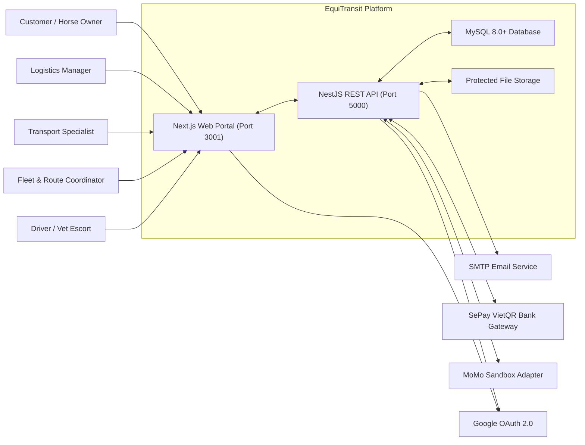

# Context Diagram

> **Cập nhật sau review 11/2026:** Transport Specialist và Fleet & Route Coordinator đã gộp vào **Logistics Manager** (xem `docs/actors-and-roles.md`). Trong tài liệu này, mọi chỗ ghi Specialist/Coordinator được hiểu là Logistics Manager; role `TRANSPORT_SPECIALIST`/`FLEET_ROUTE_COORDINATOR` chỉ còn để tương thích dữ liệu cũ.

The system coordinates horse owners (customers), internal operations staff, drivers/escorts, and external services including email delivery, payment gateways, and quarantine/customs compliance storage.

External integrations are encapsulated behind adapters so local development can use sandboxed gateways while preserving auditability.
