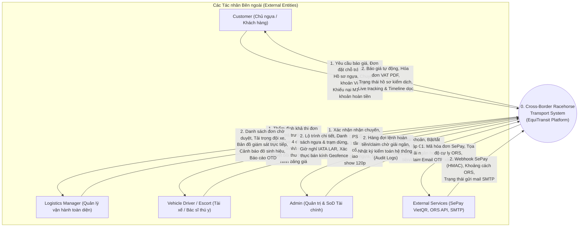

# Context Diagram - EquiTransit Platform (v2.0 Post-Review & Hot-Fix)

> **Cập nhật sau review hội đồng & hot-fix (11/2026):**
> 1. **Gộp Actor (G1):** Ba vai trò vận hành nội bộ (*Logistics Manager*, *Transport Specialist*, *Fleet & Route Coordinator*) đã được gộp thành một tác nhân duy nhất: **Logistics Manager (Quản lý vận hành toàn diện)**.
> 2. **Bổ sung Actor Admin:** Thực thi giải ngân chuyển khoản hoàn tiền và bồi thường bảo hiểm theo nguyên tắc *Segregation of Duties* (SoD: `transferred_by != approved_by`), quản trị tài khoản và bật/tắt GPS giả lập.
> 3. **Bổ sung Cổng thanh toán & Dịch vụ ngoài:** SePay VietQR (Webhook đối soát tự động), OpenRouteService (ORS API tính cự ly tự động), SMTP Email Service (gửi OTP và thông báo).

Tệp sơ đồ nguồn Draw.io có thể mở và chỉnh sửa trực tiếp trên [diagrams.net](https://app.diagrams.net/):
- **Đường dẫn tệp Draw.io riêng:** [`docs/context-diagram-equitransit.drawio`](file:///c:/Users/ttrrang/Documents/GitHub/SWP391_GROUP1/docs/context-diagram-equitransit.drawio) (hoặc tệp gốc tại thư mục dự án: [`context-diagram-equitransit.drawio`](file:///c:/Users/ttrrang/Documents/GitHub/SWP391_GROUP1/context-diagram-equitransit.drawio)).
- **Tệp Draw.io tích hợp 2 tab (Use Case + Context):** [`use-case-diagram-equitransit.drawio`](file:///c:/Users/ttrrang/Documents/GitHub/SWP391_GROUP1/use-case-diagram-equitransit.drawio).
- **Ảnh xem trước độ phân giải cao:** [`docs/context-diagram-preview.png`](file:///c:/Users/ttrrang/Documents/GitHub/SWP391_GROUP1/docs/context-diagram-preview.png).

---

## 1. Sơ đồ Ngữ cảnh DFD Mức 0 (Mermaid Diagram)

---

## 2. Bảng Ma trận Luồng Dữ liệu (Data Flow Matrix)

| Tác nhân (Entity) | Hướng luồng | Tên luồng dữ liệu | Chi tiết nghiệp vụ trao đổi với Hệ thống EquiTransit |
|---|:---:|---|---|
| **Customer** *(Chủ ngựa)* | In $\rightarrow$ | Dữ liệu đầu vào của Khách | - Thông tin tài khoản & danh mục cá thể ngựa (vi chip, cờ chuồng riêng). - Yêu cầu báo giá cước tự động & lựa chọn gói bảo hiểm. - Đơn đặt chỗ vận chuyển & chấp nhận điều khoản chặng về. - Hồ sơ kiểm dịch nộp vào kho ngựa (hộ chiếu, xét nghiệm Coggins). - Xác nhận chuyển khoản thanh toán VietQR. - Yêu cầu hủy/dời ngày đón chặng về. - Hồ sơ bồi thường bảo hiểm M1–M4 & bằng chứng tổn thất. - Thông tin số tài khoản ngân hàng nhận hoàn tiền 100%. - Ký nhận biên bản nghiệm thu bàn giao hoặc khởi tạo khiếu nại. |
| | Out $\leftarrow$ | Phản hồi của Hệ thống | - Báo giá cước vận tải & phí bảo hiểm khóa 30 phút. - Hóa đơn điện tử PDF kèm mã VietQR động đối soát tự động. - Kết quả thẩm định hồ sơ kiểm dịch & cảnh báo thiếu/hết hạn. - Vị trí xe trực tiếp trên bản đồ vệ tinh & Timeline dọc ẩn danh. - Quyết định phê duyệt hoàn tiền hoặc bồi thường bảo hiểm. |
| **Logistics Manager** *(Quản lý vận hành)* | In $\rightarrow$ | Chỉ đạo & Quyết định Vận hành | - Quyết định duyệt khả thi (`feasible`) hoặc từ chối (`unfeasible`). - Đánh giá checklist 4 tiêu chí hồ sơ kiểm dịch của ngựa. - Thiết lập khung chiến lược Road/Air/Sea, hãng bay, sân bay. - Dựng chặng (Legs), trạm dừng nghỉ IATA LAR (Stops). - Phân bổ xe từ trạm gần nhất, gán tài xế & bác sĩ thú y áp tải. - Phê duyệt xuất bản lộ trình (Khóa Gate 1). - Ghi đè mốc hành trình & xác nhận lý do trễ miễn trừ (48h). - Thẩm định và duyệt hồ sơ bồi thường bảo hiểm M1–M4. - Cấu hình bảng giá đa phương thức, trạm xe & giờ cấm đô thị. |
| | Out $\leftarrow$ | Báo cáo & Cảnh báo Vận hành | - Danh sách đơn hàng trả trước chờ thẩm định khả thi. - Hồ sơ pháp lý ngựa cần rà soát & trạng thái phê duyệt cơ quan. - Sức chứa, tải trọng xe và tình trạng sẵn sàng của nhân sự. - Bản đồ giám sát toàn bộ chuyến đi & Cảnh báo đỏ sinh hiệu (Red Alert). - Báo cáo tài chính, chi phí thực tế và tỷ lệ đúng giờ (OTD %). - Báo cáo sự cố khẩn cấp trên đường & hồ sơ khiếu nại bàn giao. |
| **Vehicle Driver / Escort** *(Tài xế / Áp tải)* | In $\rightarrow$ | Dữ liệu Thực địa Hiện trường | - Xác nhận nhận chuyến vận chuyển (`confirmed`) hoặc từ chối. - Check-in mốc hành trình định vị GPS trong bán kính Geofence. - Nhật ký theo dõi thân nhiệt, nhịp tim định kỳ (áp tải thú y). - Báo cáo sự cố khẩn cấp trên đường kèm tọa độ và ảnh chụp hiện trường. - Biên bản bàn giao cá thể ngựa, đánh giá thể trạng & đối soát CCCD. - Biên bản vắng mặt đón chặng về (No-show) sau 120 phút chờ đợi. |
| | Out $\leftarrow$ | Hướng dẫn & Giám sát Chuyến đi | - Lộ trình di chuyển chi tiết, danh sách ngựa phụ trách & điểm dừng. - Phản hồi xác thực vị trí GPS trong bán kính Geofence hợp lệ. - Định mức thời gian lái xe tối đa và thời gian nghỉ bắt buộc. - Phương án đổi tuyến đường/chuyển viện cấp cứu khi có sự cố. |
| **Admin** *(Quản trị & SoD)* | In $\rightarrow$ | Quản trị & Giải ngân Tài chính | - Khởi tạo tài khoản nhân sự nội bộ và phân quyền RBAC. - Bật/tắt chế độ giả lập GPS hành trình (`simulation_enabled`). - Cấu hình mức độ hiển thị sinh hiệu cho khách hàng. - Thực thi lệnh chuyển khoản hoàn tiền/bồi thường bảo hiểm & tải ủy nhiệm chi (SoD: `transferred_by != approved_by`). |
| | Out $\leftarrow$ | Hàng đợi & Dữ liệu Kiểm toán | - Hàng đợi các lệnh hoàn tiền/bồi thường bảo hiểm đã được duyệt. - Toàn bộ nhật ký kiểm toán hệ thống (Audit Logs & Security Traces). |
| **External Services** *(SePay, ORS, SMTP)* | In $\rightarrow$ | Phản hồi từ Dịch vụ Ngoài | - Webhook ngân hàng SePay gửi xác nhận giao dịch thành công (HMAC SHA-256). - Khoảng cách đường bộ (km) & thời gian lái xe từ OpenRouteService. - Trạng thái gửi email xác thực và mã OTP thành công từ SMTP. |
| | Out $\leftarrow$ | Yêu cầu Giao tiếp Ngoài | - Thông tin hóa đơn, mã đơn hàng & số tiền gửi tới cổng VietQR. - Cặp tọa độ điểm đón và điểm trả gửi tới ORS tính toán cự ly. - Nội dung email gửi mã OTP kích hoạt và thông báo trạng thái đơn. |
