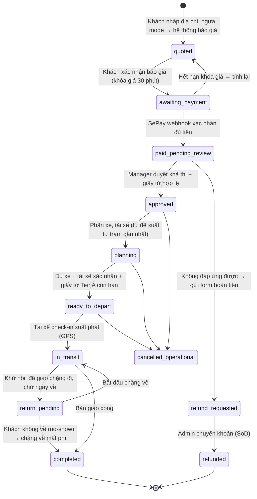
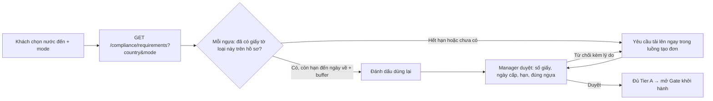
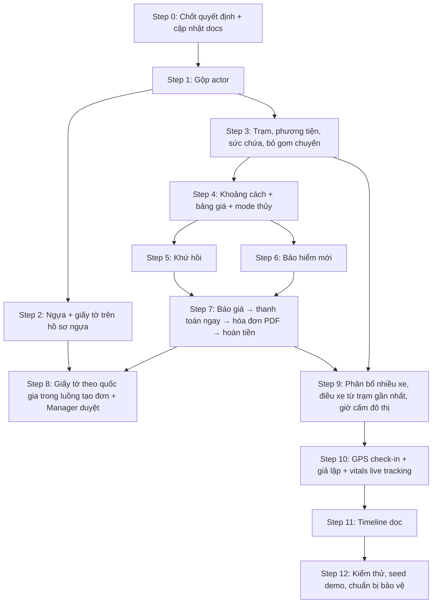

# ĐỊNH HƯỚNG PHÁT TRIỂN EQUITRANSIT SAU BUỔI REVIEW HỘI ĐỒNG

> **Dự án:** Cross-Border Racehorse Transport Management System (SWP391 - Nhóm 1)
> **Ngày lập:** 23/11/2026
> **Đầu vào:** góp ý của hội đồng đồ án, `filethongtin.md`, `docs/requirements.md`, `docs/actors-and-roles.md`, `docs/erd.md`, `docs/flows/*`, schema `database/schema.mysql.sql` và mã nguồn hiện tại.
> **Cách dùng:** làm **lần lượt từng Step**. Mỗi Step là **một branch, một PR nhỏ**, có tiêu chí hoàn thành riêng. Không gộp nhiều Step vào một lần làm.

---

## MỤC LỤC

- [Phần A. Tóm tắt góp ý và cách hiểu](#phần-a-tóm-tắt-góp-ý-và-cách-hiểu)
- [Phần B. Kết quả nghiên cứu thực tế và các nền tảng tương tự](#phần-b-kết-quả-nghiên-cứu-thực-tế-và-các-nền-tảng-tương-tự)
- [Phần C. Kiến trúc nghiệp vụ mục tiêu](#phần-c-kiến-trúc-nghiệp-vụ-mục-tiêu)
- [Phần D. Lộ trình triển khai theo Step](#phần-d-lộ-trình-triển-khai-theo-step)
- [Phần E. Các quyết định nhóm cần chốt](#phần-e-các-quyết-định-nhóm-cần-chốt)
- [Phần F. Rủi ro và cách phòng tránh](#phần-f-rủi-ro-và-cách-phòng-tránh)
- [Phần G. Nguồn tham khảo](#phần-g-nguồn-tham-khảo)

---

## PHẦN A. TÓM TẮT GÓP Ý VÀ CÁCH HIỂU

| # | Góp ý của hội đồng | Cách hiểu để triển khai | Tác động lên hệ thống hiện tại |
|---|---|---|---|
| G1 | Gom 3 actor Manager, Specialist, Coordinator thành 1 | Chỉ còn một vai trò vận hành nội bộ là **Quản lý vận hành** (giữ mã `LOGISTICS_MANAGER`). Actor còn lại: Customer, Manager, Driver/Escort, Admin | Hợp nhất 3 portal frontend, sửa `@Roles(...)` ở backend, migrate user role 3, 4 sang 1, viết lại RACI |
| G2 | Ngựa bỏ giới tính, BD; cho lưu giấy tờ vào con ngựa | Bỏ **giới tính** và **ngày sinh** (BD = Birth Date) khỏi form. Giấy tờ (hộ chiếu, tiêm phòng, xét nghiệm...) lưu **trên hồ sơ ngựa**, dùng lại cho nhiều đơn | Bảng `horse`, module `horses`, `documents`; trang `customer/horses` |
| G3 | Thêm đường thủy; nghiên cứu lại đường hàng không | Thêm mode `sea`. Đường hàng không **khả thi và là chuẩn quốc tế** (xem Phần B) | Enum `transport_mode`, `regulation.transport_mode`, `geo-corridors.ts` |
| G4 | Nhập địa chỉ đi, đến → tính khoảng cách → tính tiền theo khung giá bộ, không, thủy → báo giá và thanh toán luôn | **Báo giá tự động tức thì** từ bảng giá cấu hình sẵn; khách thanh toán ngay khi tạo đơn | Thay đổi lớn: Manager **không nhập cước tay** nữa; đổi state machine (thanh toán trước khi duyệt) |
| G4a | Thanh toán xong thì có hóa đơn dạng PDF | Trang hóa đơn in được và tải PDF | `features/orders`, snapshot `shipment_invoice` |
| G4b | Thanh toán xong mà không đáp ứng được thì gửi form để hoàn tiền | Trạng thái mới `refund_requested`; khách điền form thông tin ngân hàng; hoàn 100% | Tận dụng `shipment_refund_record` sẵn có |
| G4c | Chọn nước đến thì hiện giấy tờ cần nộp; cấu hình sẵn theo quốc gia; Manager duyệt, kiểm tra thời hạn | Danh mục giấy tờ theo quốc gia + phương thức; khách nộp ngay trong luồng tạo đơn; tái sử dụng giấy tờ còn hạn trên hồ sơ ngựa | Mở rộng `regulation`, `transport_document` |
| G5 | Vận chuyển khứ hồi; chặng về khách không về thì mất tiền | Đơn có `trip_type = round_trip`; chặng về trả trước; chính sách **no-show** rõ ràng | `shipment` thêm cột, giá, hủy, hoàn |
| G6 | Mua bảo hiểm theo %; làm rõ từng gói thu bao nhiêu, đền bù bao nhiêu theo mức độ sự cố | Thiết kế lại gói bảo hiểm + **bảng mức độ sự cố M1-M4** + % bồi thường | `insurance-policy.ts`, migration 017 |
| G7 | Quản lý trạm xe, điều xe ở trạm gần khách nhất; cả khi giao ở nước ngoài | Bảng `depot` (trạm), xe thuộc trạm; tìm trạm gần nhất theo khoảng cách; trạm đối tác ở nước ngoài | Module `fleet` |
| G8 | Check-in các mốc bằng GPS của tài xế, có giả lập; nhập sức khỏe, nhịp tim → live tracking | Geolocation trình duyệt + kiểm tra bán kính (geofence); chế độ giả lập có cấu hình; vitals gắn với check-in | Module `tracking`, trang `driver/status`, `customer/tracking` |
| G9 | Xe thùng trong trung tâm HCM, HN: khung giờ nào được chạy | Bảng **giới hạn khung giờ theo đô thị** cấu hình được; lập lịch đón/giao tránh giờ cấm | Lập lịch trong `routes`/`fleet` |
| G10 | Bỏ gom chuyến | Xóa lựa chọn `shared_stall`, bỏ `road_trip` ghép; mỗi đơn đi xe riêng | `booking-policy.ts`, `road-trips.*`, UI chọn chuyến ghép |
| G11 | Mỗi xe, máy bay, tàu chở tối đa bao nhiêu ngựa; 3 ngựa mà xe chỉ chở 1 thì sao | Sức chứa theo **loại phương tiện**; thuật toán **phân bổ nhiều xe** và đưa phương án cho khách chọn | `capacity-policy.ts`, `vehicle` |
| G12 | Timeline giao hàng dạng line tiến độ dọc | Component `VerticalTimeline` dùng chung | `features/tracking` |

> **Lưu ý về G2:** nếu "BD" trong ghi chú có nghĩa khác "ngày sinh", chỉ cần chỉnh Step 2.1. Ngoài thực tế, ngựa đực giống (stallion) thường phải xếp chuồng riêng. Vì đã bỏ giới tính, cần thêm cờ **"Cần chuồng riêng / tính khí mạnh"** để thuật toán xếp xe vẫn đúng (xem Step 2.1).

> **Mâu thuẫn tài liệu cần sửa khi làm Step 6:** `filethongtin.md` ghi gói bảo hiểm Basic/Comprehensive/Premium với 0.5% / 1.2% / 2.5%, còn `docs/requirements.md` và code (`insurance-policy.ts`) dùng `basic`/`standard`/`premium` với 0% / 1.5% / 3%. Sau Step 6 chỉ giữ **một** nguồn sự thật.

---

## PHẦN B. KẾT QUẢ NGHIÊN CỨU THỰC TẾ VÀ CÁC NỀN TẢNG TƯƠNG TỰ

### B1. Đường hàng không: có vận chuyển ngựa được không?

**Có. Đây là phương thức chuẩn để vận chuyển ngựa đua quốc tế.**

- Ngựa bay trong **jet stall**: container chuyên dụng chứa **3 ngựa trưởng thành** (hoặc 5 ngựa con). Khách trả thêm có thể chọn 2 ngựa hoặc 1 ngựa một stall để rộng hơn.
- Một **Boeing 747 chở hàng** tối đa khoảng **87 ngựa** khi dùng toàn bộ sàn chính, 3 ngựa mỗi stall (IATA và Flight Safety Australia).
- Có các hãng chuyên ngành như **IRT** (chỉ làm đường hàng không, công bố lịch bay để khách đặt chỗ) và **Peden Bloodstock** (đại lý trọn gói từ năm 1947). Các hãng bay như **Emirates SkyCargo** và **Etihad Cargo** có sản phẩm riêng cho ngựa.
- Quy định áp dụng: **IATA Live Animals Regulations (LAR)**. WOAH Terrestrial Code cũng để phần đường hàng không tham chiếu IATA LAR.

**Áp dụng cho Việt Nam và cho đồ án:**

- Việt Nam không có tuyến bay chở ngựa định kỳ, nên thực tế phải **thuê chuyến (charter)** hoặc **mua chỗ stall** trên chuyến hàng qua đại lý. Thời gian chuẩn bị tính bằng tuần.
- Trong hệ thống: chặng bay = **mua chỗ stall từ hãng bay**. Đây không phải "gom chuyến" của công ty, nên không mâu thuẫn với G10.
- Đơn giá chặng bay tính **theo ngựa** (theo slot trong stall), có tùy chọn "stall riêng".
- Đơn đường hàng không luôn gồm 3 đoạn: **xe bộ từ nơi đón ra sân bay → bay → xe bộ từ sân bay đến nơi giao** (dùng trạm đối tác ở nước đến, xem Step 9.2).
- Thời gian tối thiểu từ lúc đặt đến ngày bay nên cấu hình được, đề xuất mặc định **14 ngày** cho quốc tế (vì còn kiểm dịch).

### B2. Đường thủy: có nên làm không, làm thế nào?

**Khả thi nhưng ít dùng cho ngựa đua.** Nên làm với ràng buộc rõ:

- Tàu chở gia súc (livestock carrier) chủ yếu dùng cho bò và cừu. Ngựa đua đi biển dài ngày dễ mất nước và sụt cân. Một thư gửi Thoroughbred Daily News mô tả ngựa đi tàu hàng đến Puerto Rico sụt 50-75 pound, và có trường đua phạt chủ ngựa chọn tàu hàng.
- Chương 7.2 của WOAH Terrestrial Code (vận chuyển bằng đường biển) yêu cầu lập kế hoạch theo loại tàu, quãng đường, thời tiết, điều kiện biển và số người chăm sóc.

**Đề xuất cho hệ thống: 2 dạng đường thủy**

| Dạng | Mô tả | Khi nào dùng | Giới hạn trong hệ thống |
|---|---|---|---|
| `sea_ferry` (RoRo) | Ngựa **ở nguyên trên xe của công ty**, xe lên phà hoặc tàu RoRo | Ra đảo (ví dụ Phú Quốc), chặng biển ngắn | Thời gian trên biển ≤ 12 giờ; sức chứa = sức chứa xe |
| `sea_vessel` | Ngựa đi trong container hoặc ô chuồng trên tàu chở gia súc | Quốc tế đường dài, chi phí thấp, không gấp | Hiện cảnh báo rủi ro; bắt buộc chứng nhận sức khỏe bổ sung; chỉ mở cho cặp cảng đã cấu hình |

Giao diện phải hiện rõ: *"Đường thủy rẻ hơn nhưng lâu hơn và rủi ro sức khỏe cao hơn. Khuyến nghị đường hàng không cho ngựa đua thi đấu."*

### B3. Sức chứa phương tiện

| Loại phương tiện | Sức chứa tham khảo | Nguồn hoặc ghi chú |
|---|---|---|
| Xe kéo rơ-moóc nhỏ | 1-2 ngựa | Thông dụng cho chủ ngựa cá nhân |
| Xe tải ngựa 7,5 tấn | 2-3 ngựa | Tin rao bán HorseQuest UK |
| Xe tải ngựa 18 tấn | 4 ngựa | Tin rao bán HorseQuest UK |
| Xe tải ngựa 26 tấn | 6-7 ngựa | Tin rao bán HorseQuest UK |
| Rơ-moóc gooseneck | 6-8 ngựa | Wikipedia (Horsebox) |
| Jet stall (máy bay) | 3 ngựa / stall (2 hoặc 1 nếu mua chỗ rộng) | IRT, Emirates SkyCargo |
| Boeing 747F | tối đa khoảng 87 ngựa | IATA, Flight Safety Australia |
| Tàu RoRo / phà | = sức chứa xe trên phà | Ngựa ở nguyên trên xe |
| Tàu gia súc | Theo hợp đồng thuê chỗ | Cấu hình số ô thuê được |

Khoang chứa phải cao hơn vai ngựa ít nhất **75 cm** (Wikipedia, Horsebox).

### B4. Thời gian di chuyển và nghỉ (để tính ETA và chèn điểm dừng)

Theo **EU Regulation 1/2005** (chuẩn tham khảo phổ biến):

- Giới hạn cơ bản cho ngựa là **8 giờ**.
- Với xe đạt chuẩn cao hơn: tối đa **24 giờ**, cho uống nước (và ăn nếu cần) **mỗi 8 giờ**.
- Hết thời gian tối đa: dỡ ngựa xuống, cho ăn uống và nghỉ **ít nhất 24 giờ**.

→ Đưa thành **tham số cấu hình** (`max_drive_hours_before_rest`, `max_journey_hours`, `mandatory_rest_hours`), không hard-code.

### B5. Khung giờ cấm xe tải trong đô thị Việt Nam

> **Quy định thay đổi thường xuyên.** Hệ thống phải lưu dạng **dữ liệu cấu hình**, không hard-code. Trước khi demo, phải đối chiếu với quyết định gốc của UBND và Sở Giao thông Vận tải.

| Đô thị | Thông tin tìm được (cần kiểm tra lại) |
|---|---|
| Hà Nội | Quyết định 01/2026/QĐ-UBND ngày 04/01/2026 về hoạt động phương tiện đường bộ, quy định cấm xe tải vào nội đô **có hiệu lực từ 15/01/2026** (theo Thư viện Pháp luật). Quy định cũ: xe tải trên 10 tấn chỉ được vào nội thành từ 21h đến 6h |
| TP.HCM | Xe tải nặng thường bị cấm vào nội đô **6h-22h**, có hành lang riêng ra vào cảng và khu công nghiệp. Dự thảo đề xuất hạ ngưỡng xuống xe tải 1 tấn |
| Dịp lễ | Có lịch cấm riêng (ví dụ 30/4/2025 cấm 4h00-11h30) → cần bảng **ngoại lệ theo ngày** |

Xe chở ngựa thường là xe tải từ 7,5 tấn trở lên, nên **mặc định chỉ đón hoặc giao trong nội đô HN và HCM vào ban đêm** (ví dụ 22h-6h), trừ khi cấu hình nói khác.

### B6. Bảng giá: tham chiếu thị trường

- **uShip**: chuyến dưới 100 dặm trung bình **2,55 USD/dặm**, dưới 1.000 dặm khoảng **1,10 USD/dặm**.
- Hướng dẫn của Farmhouse Tack (01/2026): vận chuyển chuyên nghiệp bằng đường bộ khoảng **1,25-3,75 USD/dặm**. Chuyến **xe riêng 1 ngựa 3,00-3,75 USD/dặm**, chưa gồm phụ phí.
- Quy đổi: 3,00-3,75 USD/dặm ≈ **1,9-2,3 USD/km ≈ 47.000-58.000 VNĐ/km mỗi xe**. Bảng giá đề xuất ở Phần C3 (28.000-45.000 VNĐ/km theo bậc, nhân hệ số loại xe) nằm trong khoảng hợp lý cho thị trường Việt Nam.
- Các yếu tố thường tính thêm: phí đón (hook-up), chạy rỗng đến điểm đón, phí qua đêm, số ngựa, loại xe → đưa hết vào công thức.

### B7. Bảo hiểm ngựa: tham chiếu thị trường

- Bảo hiểm tử vong (mortality) thường có phí **khoảng 2,5-4% giá trị ngựa mỗi năm**.
- Bảo hiểm vận chuyển (transit) thường bán **theo chuyến** hoặc theo năm. Hợp đồng tử vong tiêu chuẩn thường **không gồm vận chuyển hàng không và quốc tế**, phải mua mở rộng.
- Ngựa đã lên xe thì **không mua bảo hiểm được nữa** → hệ thống phải **khóa thay đổi gói bảo hiểm khi đơn đã `in_transit`**.
- Phí theo % giá trị khai báo **cho mỗi chuyến** (Phần C4) là mô hình đơn giản hóa, phù hợp phạm vi đồ án.

### B8. Các nền tảng tương tự và bài học rút ra

| Nền tảng | Điểm mạnh | Bài học cho EquiTransit |
|---|---|---|
| **uShip** (Horses) | Báo giá online, theo dõi chuyến dễ dàng, hồ sơ nhà vận chuyển có lịch sử giao và thông tin bảo hiểm | **Báo giá tức thì** theo quãng đường, có tracking cho khách → đúng góp ý G4, G8 |
| **IRT** | Chỉ làm đường hàng không; công bố **lịch bay** ("Find Flight"); form báo giá | Chặng bay nên cho khách **chọn chuyến bay có sẵn** (ngày bay cố định, số slot còn lại) |
| **Peden Bloodstock** | Đại lý trọn gói: giấy tờ, kiểm dịch, vận chuyển đến tận nơi | Gom giấy tờ + vận chuyển trong một luồng → đúng góp ý G4c |
| **Emirates SkyCargo / Etihad Cargo** | Sản phẩm riêng cho ngựa, stall chuyên dụng | Mô hình sức chứa theo stall cho mode `air` |

**Khác biệt của EquiTransit so với các nền tảng trên:** gộp báo giá tức thì (kiểu uShip), giấy tờ theo quốc gia (kiểu Peden) và **live tracking kèm sinh hiệu ngựa** trong cùng một hệ thống, có tính đến **giờ cấm xe đô thị Việt Nam**.

---

## PHẦN C. KIẾN TRÚC NGHIỆP VỤ MỤC TIÊU

### C1. Actor sau khi gộp

| Actor | Phạm vi |
|---|---|
| **Customer** | Quản lý ngựa và giấy tờ của ngựa; tạo đơn, nhận báo giá tự động, thanh toán, nộp giấy tờ, theo dõi, ký nhận, yêu cầu hoàn tiền |
| **Quản lý vận hành** (`LOGISTICS_MANAGER`) | Toàn bộ việc của Manager + Specialist + Coordinator cũ: duyệt đơn và giấy tờ, cấu hình bảng giá, quốc gia, trạm, xe, giờ cấm; điều xe và tài xế; giám sát; xử lý sự cố; phê duyệt hoàn tiền |
| **Driver / Escort** | Nhận chuyến, check-in GPS, nhập sinh hiệu, báo sự cố, bàn giao |
| **Admin** | Tài khoản, cấu hình hệ thống, **thực hiện chuyển khoản hoàn tiền** (giữ SoD: người chuyển khác người duyệt) |

> Gộp actor làm mất SoD kiểu "Coordinator dựng tuyến, Manager duyệt". **Chỉ giữ lại SoD tài chính** (Manager duyệt hoàn, Admin chuyển) và ghi lý do này vào `docs/actors-and-roles.md`.

### C2. Vòng đời đơn hàng mới (thanh toán trước, duyệt sau)



**Nguyên tắc chuyển đổi trạng thái:**

1. Tận dụng các trạng thái đang có (`approved`, `planning`, `ready_to_depart`, `in_transit`, `completed`, `cancelled_operational`). Chỉ **thêm** trạng thái mới, không đổi tên trạng thái cũ, để không làm vỡ dữ liệu.
2. `requested` và `change_requested` cũ được ánh xạ thành dữ liệu lịch sử; đơn mới không dùng nữa.
3. Gate 2 mới = **đủ xe + tài xế xác nhận + giấy tờ Tier A duyệt và còn hạn** (đã thanh toán từ trước).
4. Giá **luôn do server tính** và snapshot vào đơn; không tin số tiền từ trình duyệt (giữ nguyên tắc hiện có).

### C3. Công thức tính giá (cấu hình được, giá trị là đề xuất demo)

Mọi số tiền dùng **số nguyên VNĐ**, làm tròn lên bội 1.000 ở bước cuối.

**C3.1. Khoảng cách**

| Mode | Cách tính khoảng cách |
|---|---|
| `road` | Khoảng cách **đường đi thực tế** qua OpenRouteService (profile xe tải `driving-hgv`, miễn phí khoảng 7.000 request/ngày, gọi từ **backend**, key trong `.env`). Dự phòng khi API lỗi: Haversine × 1,3 (hệ số đường vòng), đánh dấu `distance_source = 'estimated'` |
| `air` | Haversine giữa 2 sân bay (đã có `geo-corridors.ts`) + 2 chặng bộ ra, vào sân bay |
| `sea` | Bảng khoảng cách cảng đến cảng cấu hình sẵn (hải lý → km) + 2 chặng bộ ra, vào cảng |

**C3.2. Bảng giá đường bộ (theo xe)**

| Tham số | Giá trị đề xuất |
|---|---|
| Phí mở chuyến | 2.000.000 / xe |
| Bậc 0-100 km | 45.000 / km / xe |
| Bậc 101-500 km | 35.000 / km / xe |
| Bậc > 500 km | 28.000 / km / xe |
| Hệ số loại xe | 1-2 chỗ: ×1,0; 3-4 chỗ: ×1,3; 6 chỗ: ×1,6 |
| Phụ phí chăm sóc, bốc xếp | 500.000 / ngựa |
| Chạy rỗng từ trạm đến điểm đón | 15.000 / km / xe |
| Phụ phí ca đêm (khi buộc phải đón hoặc giao trong giờ cho phép ban đêm) | 1.000.000 / xe |
| Phí qua cửa khẩu đường bộ | 3.000.000 / cửa khẩu |

```text
Cước_bộ = Σ_xe [ Phí_mở + Bậc_km(quãng_đường) × Hệ_số_xe + Chạy_rỗng × km_từ_trạm + Phụ_phí_đêm ]
        + Số_ngựa × Phí_chăm_sóc + Số_cửa_khẩu × Phí_cửa_khẩu
```

**C3.3. Bảng giá đường hàng không (theo ngựa)**

| Tham số | Giá trị đề xuất |
|---|---|
| Phí cơ bản | 60.000.000 / ngựa |
| Theo khoảng cách bay | 25.000 / km / ngựa |
| Phí xử lý sân bay | 5.000.000 / ngựa |
| Stall riêng (1 ngựa / stall) | +50% phần phí bay của ngựa đó |

`Cước_không = Σ_ngựa (Phí_cơ_bản + km_bay × đơn_giá + Phí_sân_bay) × hệ_số_stall + Cước_bộ(ra sân bay) + Cước_bộ(từ sân bay)`

**C3.4. Bảng giá đường thủy (theo ngựa)**

| Tham số | `sea_ferry` | `sea_vessel` |
|---|---|---|
| Phí cơ bản | 3.000.000 / xe (vé phà cho xe) | 15.000.000 / ngựa |
| Theo khoảng cách | 0 (đã gồm trong vé) | 8.000 / km / ngựa |
| Chặng bộ | tính như đường bộ trên toàn tuyến | ra cảng + từ cảng |

**C3.5. Khứ hồi**: chặng về tính như chặng đi (đảo điểm đầu và điểm cuối), **giảm 10%**, thanh toán cùng lúc.

**C3.6. Bảo hiểm**: cộng riêng (xem C4). **Tổng = Cước + Phí bảo hiểm**. Snapshot toàn bộ tham số giá và phiên bản bảng giá (`tariff_version`) vào đơn.

**Ví dụ 1 (đường bộ, 3 ngựa, trạm chỉ có xe 1 chỗ và xe 4 chỗ)**: đón ở Quận 7 TP.HCM, giao ở Đà Lạt khoảng 300 km; trạm Thủ Đức cách điểm đón 20 km.

| Phương án | Cách tính | Cước |
|---|---|---|
| A. 1 xe 4 chỗ | 2.000.000 + (100×45.000 + 200×35.000)×1,3 + 3×500.000 + 20×15.000 = 2.000.000 + 14.950.000 + 1.500.000 + 300.000 | **18.750.000** |
| B. 3 xe 1 chỗ | 3×(2.000.000 + 11.500.000 + 300.000) + 1.500.000 | **42.900.000** |
| C. 1 xe 1 chỗ đi 3 lượt (3 ngày) | 3 × (2.000.000 + 11.500.000 + 300.000 + 500.000) | **42.900.000** + chạy rỗng quay đầu giữa các lượt, giao chậm 2 ngày |

→ Hệ thống **đề xuất A** (rẻ nhất), vẫn cho khách xem B, C. Nếu đón trong nội đô HCM vào giờ cấm thì gợi ý khung 22h-6h, cộng phụ phí đêm.

**Ví dụ 2 (hàng không, 2 ngựa, TP.HCM → Singapore)**: bay khoảng 1.090 km; mỗi ngựa 60.000.000 + 1.090×25.000 + 5.000.000 = 92.250.000 → 2 ngựa 184.500.000, cộng 2 chặng bộ ngắn ra, vào sân bay.

### C4. Bảo hiểm mới: thu bao nhiêu, đền bao nhiêu

**C4.1. Mức độ sự cố** (gắn với đánh giá lúc bàn giao `healthy / minor_injury / sick / critical` và kết luận thú y)

| Mức | Tên | Định nghĩa | Bằng chứng bắt buộc |
|---|---|---|---|
| **M1** | Nhẹ | Trầy xước, căng thẳng, mất nước nhẹ; hồi phục dưới 7 ngày; không ảnh hưởng thi đấu | Ảnh bàn giao + nhật ký sinh hiệu |
| **M2** | Trung bình | Chấn thương hoặc bệnh cần điều trị 7-30 ngày; tạm nghỉ thi đấu | Giấy khám thú y + hóa đơn điều trị |
| **M3** | Nặng | Điều trị trên 30 ngày hoặc **mất khả năng thi đấu vĩnh viễn** (Loss of Use) | Kết luận của bác sĩ thú y độc lập |
| **M4** | Tử vong | Tử vong hoặc an tử nhân đạo theo chỉ định thú y trong lúc vận chuyển, hoặc trong 72 giờ sau bàn giao do nguyên nhân vận chuyển | Biên bản + kết luận thú y |

**C4.2. Gói bảo hiểm** (phí tính **mỗi chuyến** trên giá trị khai báo của từng ngựa; khứ hồi tính 2 lần × 0,9)

| Gói | Phí | M1 | M2 | M3 | M4 | Chi phí thú y khẩn cấp trên đường |
|---|---|---|---|---|---|---|
| **Cơ bản** (mặc định) | 0% | Chi phí thú y thực tế tối đa 5.000.000 | Tối đa 10.000.000 | 20% giá trị, tối đa 50.000.000 | 100% giá trị, **tối đa 50.000.000** | Không |
| **Tiêu chuẩn** | 1,5% (tối thiểu 1.000.000) | Chi phí thú y thực tế tối đa 1% giá trị | 15% giá trị | 50% giá trị | 80% giá trị | Tối đa 20.000.000 |
| **Toàn diện** | 3% (tối thiểu 2.000.000) | Chi phí thú y thực tế tối đa 2% giá trị | 30% giá trị | 80% giá trị | **100% giá trị** | Toàn bộ chi phí thực tế |

**Ví dụ:** ngựa khai báo 2 tỷ, mua gói Tiêu chuẩn → phí **30.000.000**. Nếu M3 (mất khả năng thi đấu) → đền **1 tỷ**. Nếu M4 → đền **1,6 tỷ**.

**C4.3. Quy tắc**

- Loại trừ: bệnh có sẵn đã ghi trong hồ sơ, khai sai giá trị hoặc giấy tờ, sự cố do người của khách gây ra, chặng không do công ty vận chuyển.
- Thời hạn khiếu nại: **72 giờ** sau bàn giao (hiện Flow 6 là 24 giờ → đổi thành tham số, mặc định 72 giờ cho bảo hiểm, 24 giờ cho tranh chấp bàn giao).
- Không đổi gói khi đơn đã `in_transit`.
- Hủy trước khởi hành: hoàn 100% phí bảo hiểm (giữ quy tắc hiện tại).
- Khoản bồi thường **≥ 20.000.000** cần duyệt kép và Admin chuyển (tái sử dụng SoD hoàn tiền).

### C5. Chính sách khứ hồi và no-show

| Tình huống chặng về | Xử lý |
|---|---|
| Khách hủy chặng về **≥ 7 ngày** trước ngày về | Hoàn 80% cước chặng về |
| Hủy **từ 72 giờ đến dưới 7 ngày** | Hoàn 50% |
| Hủy **dưới 72 giờ** | Hoàn 0% |
| **No-show**: xe đến điểm đón chặng về, chờ quá thời gian chờ tối đa (mặc định 2 giờ), khách không giao ngựa | **Mất 100% cước chặng về**; đơn chuyển `completed` với cờ `return_no_show = true` |
| Công ty không thực hiện được chặng về | Hoàn 100% cước chặng về + phí bảo hiểm chặng về |
| Đổi ngày về | Miễn phí nếu ≥ 7 ngày và còn xe; dưới 7 ngày thu 10% cước chặng về |

Toàn bộ chính sách phải **hiển thị và bắt khách tick đồng ý** trước khi thanh toán; snapshot vào đơn.

### C6. Giấy tờ theo quốc gia và hồ sơ ngựa



- Giấy tờ thuộc về **ngựa** (`transport_document.horse_id` đã có), có **loại giấy tờ** chuẩn hóa từ danh mục `document_type`.
- Yêu cầu theo quốc gia nằm ở `regulation` (đã có `country`, `border_gate`, `transport_mode`, `doc_tier`, `lead_time_days`, `min_validity_buffer_hours`) → thêm `document_type_code`, `max_issue_age_days` (ví dụ giấy chứng nhận sức khỏe phải cấp trong vòng 10 ngày trước khởi hành) và mode `sea`.
- Kiểm tra hạn: `expiry_date ≥ ngày đến dự kiến (hoặc ngày về nếu khứ hồi) + min_validity_buffer_hours`.
- Dữ liệu mẫu quốc gia (VN, Campuchia, Lào, Thái Lan, Singapore, Malaysia, Hồng Kông) là **dữ liệu demo**, phải ghi rõ trên giao diện cấu hình và đối chiếu với cơ quan chính thức. Phía Việt Nam tham chiếu **Thông tư 25/2016/TT-BNNPTNT** về kiểm dịch động vật trên cạn. Có nguồn cho biết thông tư này đã được thay bằng **01/2026/TT-BNNMT**, nên phải kiểm tra hiệu lực.

---

## PHẦN D. LỘ TRÌNH TRIỂN KHAI THEO STEP

### D0. Thứ tự và phụ thuộc



**Quy ước cho mọi Step:**

- Branch tạo từ `dev`: `git switch dev && git pull origin dev && git switch -c feature/<tên-step>`.
- Mỗi sub-step là một commit `<scope>: <mô tả>`.
- Có migration mới thì đánh số tiếp theo (028, 029...), **viết chạy lại được (idempotent)** như các migration hiện có; **không DROP cột có dữ liệu** ở giai đoạn này.
- Cập nhật tài liệu theo `AGENTS.md`: flow tương ứng, `api-documentation.md`, `erd.md`, `actors-and-roles.md`, `.env.example`.
- Kiểm tra sau mỗi Step: `npm run build` (hoặc typecheck) cho cả backend và frontend, test liên quan, chạy tay luồng chính.

---

### STEP 0. Chốt quyết định và chuẩn bị tài liệu (0,5 ngày)

**Mục tiêu:** cả nhóm thống nhất trước khi code.

- [ ] 0.1 Chốt các mục ở [Phần E](#phần-e-các-quyết-định-nhóm-cần-chốt) (giá, % bảo hiểm, no-show, actor).
- [ ] 0.2 Thêm mục "Thay đổi sau review" vào `docs/requirements.md` (liệt kê G1-G12, trỏ về file này).
- [ ] 0.3 Đánh dấu các phần sẽ bị thay thế trong `filethongtin.md` (gom chuyến, 3 actor, báo giá tay) là **"Đã thay đổi sau review 11/2026"**.

**Hoàn thành khi:** có bản quyết định được cả nhóm đồng ý; docs không còn mâu thuẫn bảo hiểm.

---

### STEP 1. Gộp 3 actor thành Quản lý vận hành (2-3 ngày)

> **Trạng thái: đã triển khai (23/11/2026)**, chưa commit. Migration `028_merge_internal_roles.sql`, test `backend/test/merge-actors.test.cjs`.

> Làm trước vì ảnh hưởng mọi module. Làm xong thì các Step sau chỉ còn một portal nội bộ.

**1.1 Backend: quyền**
- [ ] Tìm mọi `@Roles(` có `TRANSPORT_SPECIALIST` hoặc `FLEET_ROUTE_COORDINATOR`, đổi thành `LOGISTICS_MANAGER` (giữ `ADMIN` nếu đã có).
- [ ] Giữ hằng số role cũ trong enum nhưng đánh dấu `@deprecated`, để token cũ không làm crash.
- [ ] Bỏ các kiểm tra SoD "người dựng tuyến ≠ người duyệt tuyến". **Giữ SoD hoàn tiền** (`transferred_by != approved_by`).
- [ ] Notifications: thông báo trước gửi cho Specialist hoặc Coordinator → gửi cho Manager.

**1.2 Database: migration `028_merge_internal_roles.sql`**
- [ ] `UPDATE user SET role_id = <id Logistics Manager> WHERE role_id IN (<Specialist>, <Coordinator>)`.
- [ ] Đổi `description` của 2 role cũ thành "Deprecated - merged into Logistics Manager" (không xóa, vì có thể còn khóa ngoại).
- [ ] Đổi tên hiển thị role 1 thành "Quản lý vận hành / Operations Manager".

**1.3 Frontend: hợp nhất portal**
- [ ] Chuyển trang từ `app/specialist/*` và `app/coordinator/*` vào `app/manager/*`:
  - `manager/compliance/` (gồm regulations, documents, approval, missing)
  - `manager/fleet/` (vehicles, depots ở Step 3)
  - `manager/dispatch/` (routes, schedule)
  - `manager/monitoring/` (monitoring, alerts)
- [ ] Sidebar Manager chia nhóm: **Đơn hàng · Giấy tờ · Đội xe & Trạm · Điều phối · Giám sát · Tài chính · Báo cáo · Cấu hình**.
- [ ] Route cũ `/specialist/*` và `/coordinator/*` → redirect sang trang mới (để link trong thông báo cũ không chết).
- [ ] Sửa `auth-redirect.ts` để role cũ đăng nhập vẫn vào `/manager`.

**1.4 Docs**: viết lại `actors-and-roles.md` (4 actor, RACI mới, lý do bỏ SoD vận hành) và `use-case-diagram.md`.

**Hoàn thành khi:** đăng nhập tài khoản Specialist hoặc Coordinator cũ vào thẳng `/manager`; Manager làm được mọi thao tác của 3 vai trò cũ; Customer và Driver không bị ảnh hưởng; build pass.

**Commit gợi ý:** `refactor(auth): merge specialist and coordinator into logistics manager`, `feat(frontend): unify manager portal`, `docs(roles): update actors after review`.

---

### STEP 2. Hồ sơ ngựa và kho giấy tờ của ngựa (2 ngày)

> **Trạng thái: đã triển khai (23/11/2026)**, chưa commit. Migration `029_horse_profile_after_review.sql`, test `backend/test/horse-documents.test.cjs`. Ngoài kế hoạch: thêm 3 mã `vaccination_certificate`, `quarantine_certificate`, `customs_declaration` (đã dùng trong preset quy định) để giấy tờ cũ khớp danh mục; giữ ô "Tuổi" (nhập tay, 1–35) thay cho tuổi tự tính từ ngày sinh.

**2.1 Bỏ giới tính, ngày sinh; thêm cờ chuồng riêng**
- [ ] Frontend: bỏ ô `gender`, `date_of_birth` khỏi form thêm, sửa ngựa và khỏi thẻ hiển thị.
- [ ] Backend DTO: 2 trường thành optional và bị bỏ qua khi tạo mới (không xóa cột, tránh mất dữ liệu cũ).
- [ ] Migration `029_horse_profile_after_review.sql`: thêm `requires_private_stall BOOLEAN DEFAULT FALSE`, `temperament ENUM('calm','normal','difficult') DEFAULT 'normal'`.
- [ ] Giữ: tên, giống, màu, cân nặng, microchip, số hộ chiếu, ảnh, tình trạng y tế, yêu cầu đặc biệt.

**2.2 Danh mục loại giấy tờ `document_type`**
- [ ] Bảng `document_type(code PK, name_vi, name_en, default_validity_days, is_identity BOOLEAN)`.
- [ ] Seed: `horse_passport`, `microchip_certificate`, `vaccination_influenza`, `vaccination_tetanus`, `eia_coggins_test`, `health_certificate`, `export_quarantine_certificate`, `import_permit`, `ownership_certificate`.

**2.3 Giấy tờ gắn với ngựa, dùng lại cho nhiều đơn**
- [ ] `transport_document`: thêm `document_type_code` (FK), cho `regulation_id` được NULL (giấy tờ chung như hộ chiếu không thuộc riêng quy định nào).
- [ ] API: `GET/POST /horses/:id/documents`, `GET /horses/:id/documents/:docId/file` (stream có kiểm tra chủ sở hữu, giữ magic-bytes check).
- [ ] Giữ nguyên quy tắc append-only: tải bản mới thì bản cũ `is_archived = true` và có `superseded_by_document_id`.
- [ ] Trạng thái hạn tính khi đọc: `valid`, `expiring_soon` (< 30 ngày), `expired`.

**2.4 Frontend `customer/horses/[id]`**
- [ ] Tab **"Giấy tờ"**: danh sách theo loại, badge hạn (xanh, vàng, đỏ), tải lên, xem, lịch sử phiên bản.

**Hoàn thành khi:** khách tải hộ chiếu một lần và thấy nó trên hồ sơ ngựa; Customer khác không xem được (test 403); form ngựa không còn giới tính, ngày sinh.

---

### STEP 3. Trạm xe, loại phương tiện, sức chứa; bỏ gom chuyến (3 ngày)

> **Trạng thái: đã triển khai (23/11/2026)**, chưa commit. Migration `030_depots_vehicle_classes.sql`, test `backend/test/depots-capacity.test.cjs`. Khác kế hoạch: bảng `road_trip` vẫn được dùng nội bộ (mỗi chặng đường bộ của đơn mới tự tạo một chuyến riêng), chỉ chặn việc ghép; RoadTripPicker và lựa chọn hình thức chỉ còn hiện cho đơn ghép cũ để điều phối nốt. Số jet stall cho chặng bay (3 ngựa/stall) để lại Step 9.

**3.1 Bảng trạm `depot`**
- [ ] `depot(depot_id, name, country, city, address, lat, lng, type ENUM('own','partner'), is_active)`.
  - `partner` = trạm đối tác ở nước ngoài, dùng cho chặng giao cuối.
- [ ] `vehicle.depot_id` (FK, NULL cho xe cũ) + seed: Thủ Đức (HCM), Long Biên (HN), Đà Nẵng, Cần Thơ + đối tác Phnom Penh, Bangkok, Singapore.
- [ ] Trang `manager/fleet/depots`: CRUD trạm, bản đồ Leaflet (đã có trong project), danh sách xe theo trạm.

**3.2 Loại phương tiện và sức chứa**
- [ ] Bảng `vehicle_class(code, mode ENUM('road','air','sea'), name, horse_capacity, price_coefficient, is_heavy_truck BOOLEAN)`:
  - `truck_1` (1 chỗ, ×1,0), `truck_2` (2 chỗ, ×1,0), `truck_4` (4 chỗ, ×1,3), `truck_6` (6 chỗ, ×1,6)
  - `jet_stall` (3 slot, mode air), `ferry_slot` (theo xe), `vessel_pen` (1 ngựa / ô)
- [ ] `vehicle.vehicle_class_code`; `capacity` lấy theo class (giữ cột cũ để tương thích).
- [ ] Ngựa có `requires_private_stall` chiếm **2 chỗ** (hoặc 1 jet stall riêng) khi tính sức chứa.

**3.3 Bỏ gom chuyến**
- [ ] Frontend: bỏ lựa chọn "Ghép chuyến / Shared" và `RoadTripPicker`.
- [ ] Backend: đơn mới luôn `booking_type = 'dedicated_charter'`; endpoint tạo `road_trip` trả `410 Gone` hoặc ẩn khỏi Swagger; dữ liệu cũ giữ để xem lại.
- [ ] Bỏ logic che giấu dữ liệu chuyến ghép trong UI mới (giữ ở backend cho đơn cũ).
- [ ] Docs: `flow-3-route-planning.md`, `booking-options-delivery.md` ghi "Đã bỏ sau review".

**Hoàn thành khi:** mỗi xe thuộc một trạm; xem được sức chứa theo loại; tạo đơn không còn lựa chọn ghép chuyến.

---

### STEP 4. Khoảng cách, bảng giá cấu hình, thêm đường thủy (4 ngày)

> **Trạng thái: đã triển khai (23/11/2026)**, chưa commit (tuân thủ quy tắc không tự commit). Đã hoàn thành toàn bộ migration 031, policy tính giá thuần, DistanceService ORS/Haversine cache 24h, API quotes/pricing, khóa giá snapshot bất biến, 104 unit test pass, UI báo giá tự động 30m countdown, Manager settings pricing và snapshot breakdown.

**4.1 Thêm mode `sea`**
- [x] Migration: `shipment.transport_mode` và `regulation.transport_mode` thêm `'sea'`; bảng `seaport(port_id, name, country, lat, lng)` và `sea_route(from_port, to_port, distance_km, sea_mode ENUM('ferry','vessel'), typical_hours, is_active)`.
- [x] Seed: Rạch Giá ↔ Phú Quốc (ferry), Cát Lái ↔ Singapore, Cát Lái ↔ Laem Chabang (vessel), là dữ liệu demo.

**4.2 Dịch vụ khoảng cách (backend, module `routes`)**
- [x] `DistanceService.getRoadDistance(from, to)`: gọi OpenRouteService `driving-hgv`, cache kết quả 24 giờ theo cặp tọa độ đã làm tròn; timeout 5 giây; lỗi thì dùng Haversine × 1,25 và gắn `distance_source='estimated'`.
- [x] `.env.example`: `ORS_API_KEY=`, `ORS_BASE_URL=https://api.openrouteservice.org`, `DISTANCE_FALLBACK_FACTOR=1.25`.
- [x] Chuyển phần tính toán chính sang backend (frontend hiển thị và countdown), bảo đảm **giá luôn do server tính**.
- [x] Geocoding địa chỉ: frontend gửi tọa độ và địa chỉ; **backend nhận tọa độ và tự kiểm tra lại**.

**4.3 Bảng giá `pricing_tariff`**
- [x] `pricing_tariff(tariff_id, version, mode, params JSON, effective_from, is_active, created_by)`. `params` chứa toàn bộ hằng số ở C3; mỗi lần sửa tạo **version mới** (không sửa đè).
- [x] `pricing-policy.ts` trong `orders`: hàm thuần `calculateFreight(input, tariff)`, trả **chi tiết từng dòng** (breakdown) để hiển thị và in hóa đơn.
- [x] Trang `manager/settings/pricing`: sửa tham số, xem trước giá với một tuyến mẫu, lịch sử version.

**4.4 API báo giá**
- [x] `POST /quotes` (Customer): đầu vào gồm điểm đón, điểm giao (tọa độ + địa chỉ), ngày đi, mode, seaMode, danh sách ngựa, bảo hiểm. Đầu ra gồm danh sách **phương án**, breakdown, tổng, `quote_id`, `expires_at`.
- [x] Bảng `shipment_quote` lưu snapshot (input, tariff_version, breakdown, total, expires_at). Đơn chỉ được tạo từ `quote_id` còn hạn; Manager duyệt không ghi đè thủ công.

**4.5 Unit test** cho `pricing-policy.ts`: biên các bậc km 100/101/500/501, ví dụ C3, làm tròn 1.000, air và sea.

**Hoàn thành khi:** nhập 2 địa chỉ thì ra giá đúng công thức cho cả 3 mode; đổi bảng giá không làm đổi giá của báo giá cũ.

---

### STEP 5. Vận chuyển khứ hồi (2 ngày)

> **Trạng thái: đã triển khai (23/11/2026)**, chưa commit. Migration `032_round_trip.sql`, unit test `backend/test/round-trip.test.cjs` (9/9 pass).

- [x] 5.1 Migration: `032_round_trip.sql` thêm `shipment.trip_type`, `return_departure_at`, `return_wait_minutes`, `return_policy_snapshot`, `return_status`, `return_cancelled_at`, `return_reschedule_fee`, `return_no_show`, `shipment_return_change` table, `route_leg.direction`, `route_stop.direction`.
- [x] 5.2 Báo giá: thêm chặng về (đảo chiều, −10%), bảo hiểm 2 chặng nhân ưu đãi 0.9.
- [x] 5.3 Route: sinh 2 nhóm chặng `direction ENUM('outbound','return')` trong `route_leg` và `route_stop`.
- [x] 5.4 `return-policy.ts` (hàm thuần): tính % hoàn khi hủy chặng về theo C5; unit test các mốc 168h, 72h và 0h (`backend/test/round-trip.test.cjs`).
- [x] 5.5 Driver đánh dấu **no-show** tại điểm đón chặng về sau thời gian chờ tối thiểu 120 phút (`POST /tracking/shipments/:id/return/no-show`). Hệ thống đóng đơn `completed`, ghi audit.
- [x] 5.6 UI tạo đơn: toggle "Khứ hồi", chọn ngày về, **hộp chính sách no-show bắt buộc tick**.
- [x] 5.7 Docs: `flow-1-request-approval.md`, `flow-3-route-planning.md`, `flow-4-status-tracking.md`, `api-documentation.md` thêm mục khứ hồi và no-show.

**Hoàn thành khi:** đơn khứ hồi có giá 2 chiều; hủy chặng về ra đúng % hoàn; no-show đóng đơn và không hoàn.

---

### STEP 6. Bảo hiểm mới theo % và mức độ sự cố (2 ngày)

> **Trạng thái: đã triển khai (23/11/2026)**. Migration `033_insurance_payout_claims.sql`, chính sách `equine-v2`, phí tối thiểu (Standard 1tr, Premium 2tr), khứ hồi giảm 10%, bảng mức độ sự cố M1–M4 cấu hình động trong DB, API claim 72h và duyệt kép SoD tài chính, UI so sánh gói bảo hiểm thời gian thực theo giá trị khai báo, Manager claim review console. Test suite `insurance-v2.test.cjs` 8/8 pass (tổng test backend 121/121 pass).

- [x] 6.1 Viết lại `orders/insurance-policy.ts` theo bảng C4.2 (giữ tên mã `basic`/`standard`/`premium` để không vỡ dữ liệu; đổi tên hiển thị thành Cơ bản / Tiêu chuẩn / Toàn diện). Tăng `insurance_policy_version` (`equine-v2`).
- [x] 6.2 Bảng `insurance_payout_rule(package, severity ENUM('M1','M2','M3','M4'), payout_type ENUM('percent_of_value','vet_cost_capped'), payout_percent_bps, cap_vnd)`: cấu hình được, không hard-code.
- [x] 6.3 Bảng `insurance_claim(claim_id, shipment_horse_id, severity, description, requested_amount, approved_amount, status ENUM('submitted','under_review','approved','rejected','paid'), reviewed_by, reviewed_at, reason)` và `insurance_claim_event`.
- [x] 6.4 API `POST /orders/:id/horses/:shId/claims` (Customer, trong 72 giờ sau bàn giao); Manager duyệt; hệ thống **tự gợi ý số tiền** theo rule; ≥ 20 triệu thì duyệt kép, Admin chuyển.
- [x] 6.5 UI chọn gói lúc tạo đơn: **bảng so sánh 3 gói** (phí của chính con ngựa đó, đền bao nhiêu cho mỗi mức M1-M4 tính bằng tiền thật theo giá trị khai báo).
- [x] 6.6 Cập nhật `docs/equine-insurance-delivery.md`, `requirements.md` (xóa mâu thuẫn ở Phần A), `filethongtin.md` mục 5.1.

**Hoàn thành khi:** khách thấy rõ "ngựa 2 tỷ, gói Tiêu chuẩn: phí 30 triệu; chết đền 1,6 tỷ"; Manager xử lý được một claim từ đầu đến cuối.

---

### STEP 7. Báo giá → thanh toán ngay → hóa đơn PDF → hoàn tiền khi không đáp ứng (4 ngày)

> Step lớn nhất về luồng. Chia nhỏ commit theo 7.1 → 7.5.

**7.1 State machine mới**
- [x] Migration: thêm vào `shipment.status` các giá trị `awaiting_payment`, `paid_pending_review`, `refund_requested`, `refunded`, `return_pending`.
- [x] Một file `order-state-machine.ts` duy nhất khai báo các cặp chuyển trạng thái hợp lệ; mọi service gọi qua đây, ghi audit (actor, thời điểm, lý do). Chuyển sai trả `409`.

**7.2 Thanh toán ngay sau báo giá**
- [x] Tạo đơn từ `quote_id` → `awaiting_payment`, **phát hành hóa đơn ngay** (`shipment_invoice` snapshot breakdown) và trả mã VietQR SePay (tái sử dụng `sepay-payment.*`).
- [x] Webhook đủ tiền → `paid_pending_review`, giữ chỗ ngựa (`horse.status = in_transit` như quy tắc hiện tại).
- [x] Hết hạn thanh toán (cấu hình, mặc định 30 phút cho QR, 24 giờ cho đơn) → đơn quay về `cancelled`; nhả ngựa; hóa đơn void.
- [x] Gỡ bỏ việc Manager nhập `transport_cost` bằng tay (giữ endpoint cũ cho dữ liệu cũ, ẩn khỏi UI).

**7.3 Hóa đơn dạng PDF**
- [x] Trang `customer/requests/[id]/invoice`: logo, mã hóa đơn, thông tin khách, tuyến, ngựa, breakdown cước, bảo hiểm, chính sách khứ hồi và hủy, mã giao dịch SePay, thời điểm thanh toán (ghi múi giờ UTC+7).
- [x] CSS `@media print` + nút **"Tải PDF"** dùng `window.print()` (đúng quyết định hiện tại: không xuất PDF ở backend).
- [x] Dữ liệu chỉ lấy từ **snapshot hóa đơn** (không tính lại).

**7.4 Manager duyệt khả thi**
- [x] Màn `manager/requests` lọc `paid_pending_review`: xem tuyến, ngựa, giấy tờ (Step 8), phương án xe (Step 9).
- [x] Nút **Duyệt** → `approved` (hoặc `planning`). Nút **Không đáp ứng được** (bắt buộc chọn lý do: hết xe, tuyến không hỗ trợ, trạm quá tải, thời tiết...) → `refund_requested`.

**7.5 Form hoàn tiền**
- [x] Khi `refund_requested`: gửi thông báo và email có link đến form `customer/requests/[id]/refund`: tên ngân hàng, số tài khoản, chủ tài khoản, xác nhận số tiền (**100% gồm bảo hiểm**, do lỗi công ty), ghi chú.
- [x] Lưu vào `shipment_refund_record` (đã có): Manager duyệt, **Admin chuyển** (SoD), tải ủy nhiệm chi → `refunded`, khách nhận thông báo kèm chứng từ.
- [x] Hạn xử lý (SLA) hoàn tiền hiển thị cho khách (3-5 ngày làm việc qua `addBusinessDays`).

**Hoàn thành khi:** demo được 2 kịch bản: (a) báo giá → trả tiền → in hóa đơn → được duyệt; (b) trả tiền → Manager từ chối → khách điền form → Admin chuyển → `refunded`. Người chuyển trùng người duyệt bị `403`.

---

### STEP 8. Giấy tờ theo quốc gia ngay khi tạo đơn và Manager duyệt (3 ngày)

> **Trạng thái: đã hoàn thành (23/11/2026)**. Migration `035_country_document_requirements.sql`, test `backend/test/country-requirements.test.cjs` (8/8 pass, tổng backend 151/151).

- [x] 8.1 Migration: `regulation` thêm `document_type_code`, `max_issue_age_days`, mode `sea`; seed yêu cầu demo cho 7 quốc gia × mode.
- [x] 8.2 API `GET /compliance/requirements?country=&mode=&horseIds=&departDate=&returnDate=`: trả mỗi ngựa × mỗi giấy tờ yêu cầu gồm `status: reusable | expiring | expired | missing`, `tier`, `lead_time_days`, hạn nộp.
- [x] 8.3 Luồng tạo đơn (wizard): sau bước "Điểm đến" thêm bước **"Giấy tờ cần chuẩn bị"**: dùng lại giấy còn hạn (tick), tải lên giấy thiếu. Cho phép **nộp sau** với Tier B và Tier A còn trong `lead_time_days` (hiện hạn nộp rõ ràng).
- [x] 8.4 Cảnh báo trước khi thanh toán: nếu ngày đi < hôm nay + `lead_time_days` lớn nhất → báo "Không kịp chuẩn bị giấy tờ cho [quốc gia], chọn ngày từ dd/mm".
- [x] 8.5 Manager: màn `manager/compliance` duyệt từng giấy (đối chiếu số microchip và số hộ chiếu với ngựa, ngày cấp, hạn), từ chối bắt buộc lý do; lưu `document_approval` (người duyệt, thời điểm, lý do). Giữ thứ tự trạng thái `submitted → approved/rejected → expired`.
- [x] 8.6 Job hằng ngày: đánh dấu `expired`, gửi nhắc trước 30, 7, 1 ngày; nếu đơn đã `ready_to_depart` mà giấy hết hạn thì quay về `planning` (giữ quy tắc runtime hiện có cho `in_transit`).
- [x] 8.7 Docs: viết lại `flow-2-legal-quarantine.md` theo luồng mới.

**Hoàn thành khi:** chọn "Singapore + air" thì hiện đúng danh sách; ngựa đã có hộ chiếu còn hạn thì không phải nộp lại; giấy hết hạn trước ngày về bị chặn.

---

### STEP 9. Phân bổ nhiều xe, điều xe từ trạm gần nhất, giờ cấm đô thị (4 ngày)

> **Trạng thái: đã triển khai (23/11/2026)**, chưa commit. Migration `036_allocation_city_restrictions.sql`, test `backend/test/allocation-city-ban.test.cjs` (10/10 pass, tổng backend 143/143). Khác kế hoạch: phương án nhiều xe chạy thành đoàn — kế hoạch chi tiết gắn một xe dẫn đầu mỗi chặng, sức chứa tính theo tổng các xe đã giữ chỗ; Manager đổi xe qua `POST /fleet/shipments/:id/reservations/swap` hoặc nhập `allocationOverrideReason` trên chặng. Phụ phí đêm chỉ cộng khi điểm đón/giao nằm trong vùng cấm và giờ chạy rơi vào khung đêm. Không có phương án thì không lưu báo giá (`quoteId: null`).

**9.1 Thuật toán phân bổ xe (`fleet/allocation-policy.ts`, hàm thuần, có unit test)**

```text
Đầu vào : N ngựa (ngựa cần chuồng riêng tính 2 chỗ), điểm đón, khoảng thời gian chuyến
Bước 1  : Lấy các trạm own có xe rảnh trong khoảng thời gian, sắp theo khoảng cách đến điểm đón
Bước 2  : Với từng trạm (gần → xa), sinh các tổ hợp xe phủ đủ N chỗ
          (bin-packing nhỏ: N ≤ 12 nên duyệt tổ hợp được)
Bước 3  : Tính giá mỗi tổ hợp bằng pricing-policy (gồm chạy rỗng từ trạm)
Bước 4  : Trả tối đa 3 phương án: Rẻ nhất · Ít xe nhất · Sớm nhất
          (nếu thiếu xe: phương án "chia nhiều ngày" hoặc "ghép xe từ 2 trạm")
Bước 5  : Không có phương án → báo khách "Chưa đủ xe ngày này", gợi ý ngày gần nhất có đủ
```

- [x] Trả lời trực tiếp câu hỏi "xe chỉ chở 1 con mà khách đặt 3 con": hệ thống **tự đề xuất** 1 xe 4 chỗ, hoặc 3 xe 1 chỗ, hoặc chia 3 ngày, kèm giá từng phương án (Ví dụ 1 ở C3). Khách chọn lúc báo giá.
- [x] Air: số jet stall = ⌈slot cần / 3⌉ (ngựa stall riêng chiếm cả stall). Sea vessel: số ô = N.
- [x] Khóa xe khi tạo đơn: giữ cơ chế lock `vehicle_id ASC` đang có để chống đặt trùng.

**9.2 Điều xe theo trạm**
- [x] Chặng đón: trạm own gần điểm đón nhất.
- [x] Chặng giao ở nước ngoài (sau sân bay hoặc cảng): trạm `partner` gần điểm giao nhất. Giá chặng này theo bảng giá đối tác (`pricing_tariff` mode road + `region`).
- [x] Manager vẫn có thể đổi xe hoặc trạm bằng tay (ghi lý do).

**9.3 Khung giờ cấm xe đô thị**
- [x] Bảng `city_truck_restriction(id, city, center_lat, center_lng, radius_km, applies_to_heavy_truck BOOLEAN, banned_from TIME, banned_to TIME, days_of_week, legal_reference, effective_from, effective_to)` + `city_restriction_exception(date, city, banned_from, banned_to, note)` cho ngày lễ.
- [x] Seed HN và HCM theo B5, ghi `legal_reference`; giao diện cấu hình hiện cảnh báo "Cần đối chiếu văn bản gốc".
- [x] Khi lập lịch: nếu điểm đón hoặc giao nằm trong vùng và giờ dự kiến rơi vào giờ cấm → **dời giờ** đến khung hợp lệ gần nhất, cộng phụ phí đêm; hiện cho khách khung giờ đón hợp lệ trong date-time picker.
- [x] Tính ETA có chèn nghỉ theo B4 (tham số `max_drive_hours_before_rest` v.v.).

**Hoàn thành khi:** đơn 3 ngựa ra 3 phương án đúng giá; đón ở Quận 1 lúc 9h sáng được gợi ý dời sang 22h; giao ở Singapore dùng trạm đối tác Singapore.

---

### STEP 10. Check-in GPS, giả lập vị trí, sinh hiệu → live tracking (4 ngày)

**10.1 Check-in bằng GPS (Driver)**
- [ ] Trang `driver/status`: nút "Check-in mốc" lấy `navigator.geolocation.getCurrentPosition` (cần HTTPS hoặc `localhost`).
- [ ] Backend kiểm tra **geofence**: khoảng cách từ vị trí đến tọa độ điểm dừng ≤ `geofence_radius_m` (theo loại điểm: trạm, nghỉ 300 m; sân bay, cửa khẩu, cảng 1.000 m).
  - Ngoài bán kính: từ chối, hoặc cho **check-in thủ công bắt buộc nhập lý do + ảnh**, gắn cờ để Manager xem.
- [ ] `route_stop_update` thêm `lat`, `lng`, `accuracy_m`, `location_source ENUM('gps','simulated','manual')`, `distance_to_stop_m`. **Append-only**, không sửa event cũ.

**10.2 Giả lập vị trí (phục vụ demo)**
- [ ] `.env.example`: `TRACKING_SIMULATION_ENABLED=false`; Admin bật hoặc tắt trong cấu hình hệ thống.
- [ ] Khi bật: Driver có dropdown **"Giả lập: đang ở [điểm dừng X]"** hoặc nút **"Chạy giả lập"**, xe tự di chuyển theo polyline tuyến (nội suy mỗi 5 giây).
- [ ] Mọi bản ghi giả lập lưu `location_source='simulated'`, UI Manager hiện badge "Giả lập" (không lẫn với dữ liệu thật).

**10.3 Vị trí liên tục và sinh hiệu**
- [ ] Bảng `vehicle_position_ping(shipment_id, vehicle_id, lat, lng, speed_kmh, recorded_at, source)`; Driver app gửi mỗi 30-60 giây khi `in_transit` (lưu tạm local khi mất mạng, gửi bù với `is_backdated`, giữ quy tắc offline hiện có).
- [ ] Tại mỗi điểm nghỉ **bắt buộc nhập sinh hiệu** từng ngựa: thân nhiệt, nhịp tim, (nhịp thở tùy chọn), hành vi, ảnh. Tái sử dụng `vitals-policy.ts` (3 tầng xanh, vàng, đỏ, leo thang sau 2 lần vàng trong 6 giờ).
- [ ] Đỏ → thông báo ngay cho Manager và khách (khách thấy thông điệp trung tính, không hiện số liệu gây hoảng nếu nhóm muốn).

**10.4 Live tracking cho Customer và Manager**
- [ ] `customer/tracking/[id]`: bản đồ Leaflet có marker xe (cập nhật bằng polling 15 giây, hoặc SSE `GET /tracking/:id/stream` của NestJS nếu kịp), tuyến đã đi và chưa đi, ETA còn lại, thẻ sinh hiệu mới nhất của từng ngựa.
- [ ] `manager/monitoring`: bản đồ tất cả chuyến `in_transit`, lọc theo cảnh báo.

**Hoàn thành khi:** bật giả lập, chạy một chuyến từ đầu đến cuối; khách thấy xe chạy trên bản đồ, các mốc tự tick, sinh hiệu cập nhật; check-in sai vị trí bị chặn hoặc gắn cờ.

---

### STEP 11. Timeline tiến độ dạng line dọc (1,5 ngày)

- [ ] 11.1 Component dùng chung `frontend/src/features/tracking/VerticalTimeline.tsx`:
  - Mỗi mốc: icon theo loại (đón, nghỉ, cửa khẩu, sân bay, cảng, giao), tên, **giờ dự kiến và giờ thực tế**, badge trễ hoặc sớm, chip sinh hiệu, ảnh nhỏ, nguồn vị trí (GPS hoặc giả lập).
  - Trạng thái: `done` (đường nối tô màu đầy), `current` (chấm **nhấp nháy** + đường nối tô dần theo % quãng đường), `upcoming` (nét đứt, mờ).
  - Có nhóm **"Chặng đi"** và **"Chặng về"** cho khứ hồi; mốc thanh toán, duyệt, giấy tờ ở đầu timeline.
  - Responsive: trên điện thoại timeline chiếm toàn chiều rộng; dark mode; animation tắt khi `prefers-reduced-motion`.
- [ ] 11.2 Dùng ở: `customer/tracking`, chi tiết đơn của Customer, `manager/monitoring`, `driver/trips/[id]`.
- [ ] 11.3 Thay các timeline ngang hoặc bảng hiện có bằng component này (chỉ ở các trang trên).

**Hoàn thành khi:** cả 3 actor xem cùng một chuyến bằng cùng component, tiến độ khớp với check-in thực tế.

---

### STEP 12. Kiểm thử, dữ liệu demo, chuẩn bị bảo vệ (2-3 ngày)

- [ ] 12.1 Seed demo: 4 trạm VN + 3 trạm đối tác, 12 xe đủ loại, bảng giá v1, 7 quốc gia, ngựa có giấy tờ còn hạn, hết hạn và thiếu.
- [ ] 12.2 Kịch bản demo (mỗi kịch bản dưới 3 phút):
  1. Nội địa HCM → Đà Lạt, 3 ngựa, xe 1 chỗ hay 4 chỗ, đón trong giờ cấm → dời 22h.
  2. Quốc tế HCM → Singapore bằng máy bay, khứ hồi, gói Toàn diện, dùng lại hộ chiếu, nộp chứng nhận sức khỏe.
  3. Đường thủy Rạch Giá → Phú Quốc (ferry).
  4. Thanh toán xong nhưng không đáp ứng được → form hoàn tiền → Admin chuyển.
  5. Live tracking giả lập, sinh hiệu vàng 2 lần → cảnh báo đỏ.
  6. No-show chặng về.
  7. Claim bảo hiểm M3.
- [ ] 12.3 Test: unit test cho mọi `*-policy.ts` (giá, bảo hiểm, khứ hồi, phân bổ xe, geofence, giờ cấm); test phân quyền (Customer A không xem được đơn, ngựa, giấy tờ của B; Driver không check-in chuyến không được phân công).
- [ ] 12.4 Rà docs: `requirements.md`, `actors-and-roles.md`, `api-documentation.md`, `erd.md`, `flows/*`, `.env.example`, Swagger.
- [ ] 12.5 Slide bảo vệ: bảng "Góp ý → Đã làm → Ở đâu" (dùng bảng Phần A làm khung).

---

### D-Tổng. Ước lượng

| Step | Nội dung | Ước lượng |
|---|---|---|
| 0 | Chốt quyết định | 0,5 ngày |
| 1 | Gộp actor | 2-3 ngày |
| 2 | Ngựa + giấy tờ | 2 ngày |
| 3 | Trạm, xe, bỏ gom chuyến | 3 ngày |
| 4 | Khoảng cách, bảng giá, đường thủy | 4 ngày |
| 5 | Khứ hồi | 2 ngày |
| 6 | Bảo hiểm | 2 ngày |
| 7 | Thanh toán ngay, hóa đơn, hoàn tiền | 4 ngày |
| 8 | Giấy tờ theo quốc gia | 3 ngày |
| 9 | Phân bổ xe, trạm, giờ cấm | 4 ngày |
| 10 | GPS, giả lập, live tracking | 4 ngày |
| 11 | Timeline dọc | 1,5 ngày |
| 12 | Kiểm thử, demo | 2-3 ngày |
| | **Tổng** | **khoảng 34-36 ngày công** (chia cho số thành viên; Step 2 và 3 làm song song được, Step 5 và 6 làm song song được) |

**Nếu thiếu thời gian, ưu tiên theo thứ tự:** 1 → 3 → 4 → 7 → 8 → 9 → 10 → 11 → 6 → 5 → 2. Không bỏ hẳn Step nào vì đều là góp ý trực tiếp của hội đồng; có thể làm bản tối giản (ví dụ Step 10 chỉ có giả lập và check-in, chưa có ping liên tục).

---

## PHẦN E. CÁC QUYẾT ĐỊNH NHÓM CẦN CHỐT

| Mã | Câu hỏi | Đề xuất mặc định trong tài liệu này |
|---|---|---|
| Q1 | Tên hiển thị actor gộp | "Quản lý vận hành", giữ mã `LOGISTICS_MANAGER` |
| Q2 | "BD" có đúng là ngày sinh không | Có; bỏ giới tính và ngày sinh, thêm cờ chuồng riêng |
| Q3 | Bảng giá v1 | Theo C3 (giá trị demo, sửa được trong cấu hình) |
| Q4 | % bảo hiểm và % đền bù | Theo C4.2 |
| Q5 | Chính sách no-show và hủy chặng về | Theo C5 |
| Q6 | Thời gian khóa giá báo giá và hạn thanh toán | 30 phút khóa giá; QR hết hạn 30 phút |
| Q7 | Có làm `sea_vessel` quốc tế hay chỉ `sea_ferry` | Làm cả 2, `sea_vessel` có cảnh báo rủi ro |
| Q8 | Polling hay SSE cho live tracking | Polling 15 giây trước, SSE nếu còn thời gian |
| Q9 | Bán kính geofence | 300 m (trạm, điểm nghỉ), 1.000 m (sân bay, cửa khẩu, cảng) |
| Q10 | Đơn cũ (trạng thái `requested`, chuyến ghép) xử lý thế nào | Giữ để xem lại, không tạo mới theo luồng cũ |

---

## PHẦN F. RỦI RO VÀ CÁCH PHÒNG TRÁNH

| Rủi ro | Ảnh hưởng | Phòng tránh |
|---|---|---|
| Đổi state machine (thanh toán trước) làm vỡ Gate và báo cáo cũ | Cao | Chỉ **thêm** trạng thái; một file state machine duy nhất; test chuyển trạng thái; cập nhật `reports-calculator.ts` để tính trạng thái mới |
| API khoảng cách lỗi hoặc hết quota khi demo | Trung bình | Cache 24 giờ + Haversine dự phòng + seed sẵn tuyến demo |
| Gộp actor làm mất phân quyền | Cao | Test 403 cho Customer và Driver; giữ SoD tài chính |
| Giờ cấm và quy định kiểm dịch thay đổi | Trung bình | Lưu dạng cấu hình có `legal_reference`, `effective_from`; ghi rõ "dữ liệu demo" |
| Geolocation không chạy khi không có HTTPS | Trung bình | Demo trên `localhost` hoặc HTTPS; luôn có chế độ giả lập |
| Migration xóa dữ liệu | Cao | Không DROP cột; migration idempotent; backup DB trước khi chạy |
| Làm quá nhiều trong một PR | Cao | Mỗi Step một branch, mỗi sub-step một commit; review trước khi merge vào `dev` |

---

## PHẦN G. NGUỒN THAM KHẢO

**Đường hàng không và sức chứa**
- [Air Horse One: flying to the Melbourne Cup – Flight Safety Australia](https://www.flightsafetyaustralia.com/2016/11/air-horse-one-flying-to-the-melbourne-cup/)
- [IATA – Value Horses](https://www.iata.org/contentassets/62bae061c05b429ea508cb0c49907c4c/value-horses.pdf)
- [Emirates SkyCargo – Equine leaflet](https://www.skycargo.com:443/media/1772/eskc_equine_dl_leaflet.pdf)
- [How elite horses travel to one of the world's biggest racing events – AOL](https://www.aol.com/news/elite-horses-travel-one-world-081832897.html)
- [65 horses head to Hong Kong – SCMP](https://www.scmp.com/native/news/hong-kong/topics/airborne-horses/article/3305857/65-horses-head-hong-kong-glimpse-logistics-transporting-valuable-animals)
- [IRT – International Racehorse Transport](https://www.irt.com/)
- [The company that usually has a horse in the air every hour of every day – Thoroughbred Racing](https://www.thoroughbredracing.com/articles/company-usually-has-horse-air-every-hour-every-day)
- [German Horse Center – International horse shipping](https://www.germanhorsecenter.com/transport.html)

**Đường thủy**
- [WOAH Terrestrial Code – Transport of animals by sea](https://woah.org/fileadmin/Home/eng/Health_standards/tahc/2024/en_chapitre_aw_sea_transpt.htm)
- [WOAH ad hoc group – Chapter 7.2 draft, Dec 2025](https://www.woah.org/app/uploads/2026/03/a-ahg-chapter-7.2-aw-during-transport-dec2025.pdf)
- [Letter to the editor: shipping horses by cargo – Thoroughbred Daily News](https://www.thoroughbreddailynews.com/letter-to-the-editor-shipping-horses-by-cargo/)
- [Horse Transport at Sea – The Horse](https://thehorse.com/135530/horse-transport-at-sea/)
- [Livestock carrier – Wikipedia](https://www.Wikipedia.com/wiki/Livestock_carrier)
- [Shipping farm livestock and horses – DAERA](https://www.daera-ni.gov.uk/publications/shipping-farm-livestock-and-horses-containers)

**Phương tiện đường bộ và thời gian vận chuyển**
- [Horsebox – Wikipedia](https://www.wikipedia.org/wiki/Horsebox)
- [HorseQuest UK – Horseboxes over 7.5 tonne](https://www.horsequest.co.uk/18/transport/163/horseboxes-over-7-5-tonne/484/horseboxes-over-7-5-tonne-trade-advertisers)
- [Council Regulation (EC) No 1/2005 – Annex I Chapter V](https://legislation.gov.uk/eur/2005/1/annex/I/chapter/V)
- [Commercial animal transport guidance – gov.scot](https://gov.scot/publications/commercial-animal-transport-guidance/pages/main-requirements)
- [Transport and care of horses – Agriculture Victoria](https://agriculture.vic.gov.au/livestock-and-animals/horses/health-and-welfare/transport-and-care-of-horses)

**Giờ cấm xe tải đô thị Việt Nam**
- [Các tuyến đường và khung giờ cấm xe tải tại TPHCM, Hà Nội, Đà Nẵng – VOH](https://voh.com.vn/giao-thong/cac-tuyen-duong-va-khung-gio-cam-xe-tai-tai-tphcm-ha-noi-da-nang-383705.html)
- [Giờ cấm xe tải vào nội thành Hà Nội từ 15/01/2026 – Thư viện Pháp luật](https://thuvienphapluat.vn/hoi-dap-phap-luat/gio-cam-xe-tai-vao-noi-thanh-ha-noi-tu-ngay-15012026-la-tu-may-gio-den-may-gio-138077827.html)
- [Hà Nội cấm xe tải 2 tấn vào nội đô từ 15/01/2026 – Thư viện Pháp luật](https://thuvienphapluat.vn/phap-luat-nha-dat/ha-noi-cam-xe-tai-2-tan-vao-noi-do-tu-15012026-theo-khung-gio-nao-14237.html)
- [Giờ cấm tải TP.HCM – GHN](https://ghn.vn/blogs/thong-tin-giao-hang/gio-cam-tai-tphcm)
- [Đề xuất cấm xe tải trên 1 tấn vào nội thành 6h-22h – Tuổi Trẻ](https://tuoitre.vn/cam-xe-tai.html)
- [TPHCM cấm xe tải dịp lễ 30/4 – VOH](https://voh.com.vn/tin-tp-ho-chi-minh/tphcm-cam-xe-tai-vao-noi-do-nhieu-khung-gio-trong-dip-le-304-591042.html)

**Giá cước và nền tảng tương tự**
- [uShip – Horse Transportation](https://www.uship.com/horses/)
- [uShip – How much does it cost to ship a horse](https://www.uship.com/cost-to-ship/horses-and-livestock/horses/)
- [Horse transportation guide – Farmhouse Tack](https://www.farmhousetack.com/blogs/barn-blog/horse-transportation-guide-how-to-ship-horse)
- [Best horse transport companies – FreightWaves Ratings](https://ratings.freightwaves.com/best-horse-transport-companies/)
- [Horse Transportation Costs – Emotrans](https://www.emotrans-global.com/blog/horse-transport-cost/)

**Bảo hiểm ngựa**
- [Equine Mortality – Marshall + Sterling](https://www.marshallsterling.com/node/73)
- [Horse insurance costs NZ – Equine Insurance](https://equineinsurance.co.nz/blog/horse-insurance-costs-nz)
- [Horse mortality – Markel](https://markel.com/us/industries/horse-and-farm/horse-mortality)
- [Understanding your bloodstock policy – Howden](https://www.howdengroup.com/au-en/news-insights/bloodstock-policy-essential-insights)

**Kiểm dịch Việt Nam**
- [Thông tư 25/2016/TT-BNNPTNT – Thư viện Pháp luật](https://thuvienphapluat.vn/van-ban/Linh-vuc-khac/Thong-tu-25-2016-TT-BNNPTNT-kiem-dich-dong-vat-san-pham-dong-vat-tren-can-kiem-dich-dong-vat-2016-317657.aspx)
- [Thông tư 25/2016/TT-BNNPTNT – LuatVietnam](https://luatvietnam.vn/nong-nghiep/thong-tu-25-2016-tt-bnnptnt-bo-nong-nghiep-va-phat-trien-nong-thon-106925-d1.html)

**Bản đồ và khoảng cách**
- [OpenRouteService](https://openrouteservice.org/?p=928)
- [OpenRouteService – OSM Wiki](https://wiki.openstreetmap.org/wiki/OpenRouteService)
- [OSM for commercial truck routing – OSM Help](https://help.openstreetmap.org/questions/74336/osm-for-commercial-truck-routing)

> Số liệu thị trường (giá cước, % bảo hiểm, giờ cấm) lấy từ nguồn công khai, có thể khác nhau theo quốc gia và thời điểm. Trong hệ thống, toàn bộ đều là **tham số cấu hình**; giá trị trong tài liệu này là **giá trị demo** để nhóm chốt ở Step 0.
