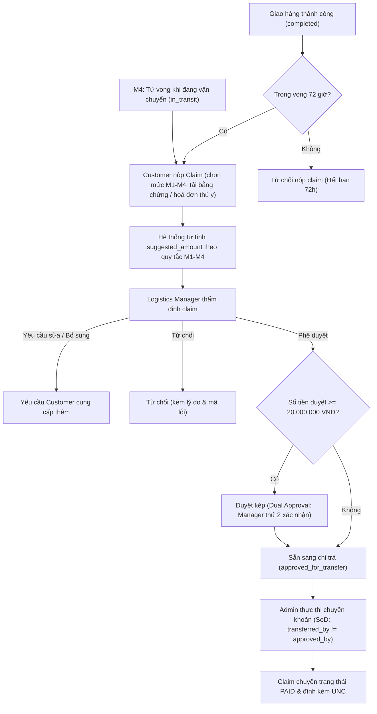

# Giá trị ngựa và bảo hiểm vận chuyển (Phiên bản equine-v2)

> Cập nhật Step 6 ngày 23/11/2026: Nâng cấp chính sách bảo hiểm vận chuyển ngựa đua lên phiên bản `equine-v2` theo định hướng phát triển sau buổi review hội đồng. Hệ thống bổ sung bảng tính phí theo tỷ lệ % có áp dụng mức tối thiểu, bảng quy tắc đền bù theo 4 mức độ sự cố M1–M4 cấu hình động trong DB, quy trình nộp & thẩm định claim trong 72 giờ, và cơ chế duyệt kép/phân tách trách nhiệm (SoD) khi chi trả bồi thường.

---

## 1. Các gói bảo hiểm và công thức tính phí (v2)

Khách hàng khai báo giá trị ngựa (VNĐ hoặc USD quy đổi) và chọn một trong 3 gói bảo hiểm cho từng cá thể ngựa khi tạo yêu cầu vận chuyển:

| Gói bảo hiểm | Mã hệ thống | Tỷ lệ phí (% giá trị khai báo) | Mức phí tối thiểu / ngựa | Hạn mức bồi thường tối đa | Hỗ trợ cấp cứu thú y |
|---|---|---|---|---|---|
| **Cơ bản** | `basic` | 0% (miễn phí) | 0 VNĐ | 50.000.000 VNĐ | Không |
| **Tiêu chuẩn** | `standard` | 1,5% (150 bps) | 1.000.000 VNĐ | 80% giá trị khai báo | Không |
| **Toàn diện** | `premium` | 3,0% (300 bps) | 2.000.000 VNĐ | 100% giá trị khai báo | Có (chi trả 100% hóa đơn cấp cứu) |

### Quy tắc tính toán:
1. **Phí bảo hiểm đơn vị**:
   - `basic`: `0 VNĐ`
   - `standard`: `MAX(1.000.000, declared_value * 1,5%)` làm tròn đến hàng đơn vị VNĐ.
   - `premium`: `MAX(2.000.000, declared_value * 3,0%)` làm tròn đến hàng đơn vị VNĐ.
2. **Khứ hồi (Round-trip)**: Nếu đơn hàng là khứ hồi (`trip_type = 'round_trip'`), phí bảo hiểm cả chuyến bằng:
   $$\text{Phí khứ hồi} = \text{Phí 1 chiều} \times 2 \times 0,9 \quad (\text{giảm } 10\% \text{ cho cả 2 lượt})$$
3. **Đơn có nhiều ngựa**: Phí tính riêng cho từng cá thể ngựa (đơn vị), sau đó nhân với số lượng `quantity`.
4. **Bảo toàn đơn cũ**: Các đơn hàng tạo trước Step 6 lưu snapshot phiên bản `equine-v1` được giữ nguyên vẹn toàn bộ phí và hạn mức cũ, không bị tính lại phí theo quy tắc v2.

---

## 2. Bảng phân loại mức độ sự cố và quy tắc đền bù (M1 – M4)

Quy tắc đền bù được lưu tại bảng `insurance_payout_rule` trong MySQL, có thể cấu hình linh hoạt mà không cần sửa code backend:

| Mức độ | Định nghĩa sự cố | Gói Cơ bản (`basic`) | Gói Tiêu chuẩn (`standard`) | Gói Toàn diện (`premium`) |
|---|---|---|---|---|
| **M1** | Thương tích nhẹ, trầy xước, sốt nhẹ, đau bụng nhẹ hồi phục được; chỉ phát sinh chi phí thú y. | Chi phí thú y thực tế, tối đa 50.000.000 VNĐ | Chi phí thú y thực tế, tối đa 100.000.000 VNĐ | Chi trả 100% chi phí thú y thực tế |
| **M2** | Thương tật vĩnh viễn nhẹ (vết sẹo lớn, tổn thương gân nhẹ làm giảm 30% giá trị thương mại/thi đấu). | 0 VNĐ (Không đền bù thương tật) | Đền bù 30% giá trị khai báo | Đền bù 30% giá trị khai báo |
| **M3** | Thương tật vĩnh viễn nặng (gãy xương chân, mù một mắt, mất hoàn toàn khả năng thi đấu). | 0 VNĐ (Không đền bù thương tật) | Đền bù 50% giá trị khai báo | Đền bù 50% giá trị khai báo |
| **M4** | Tử vong trên đường vận chuyển hoặc buộc phải tiêu hủy nhân đạo theo chỉ định thú y do tai nạn. | Tối đa 50.000.000 VNĐ | Đền bù 80% giá trị khai báo | Đền bù 100% giá trị khai báo |

---

## 3. Quy trình nộp và thẩm định claim bảo hiểm

### Các ràng buộc nghiệp vụ:
1. **Cửa sổ nộp claim**:
   - Khách hàng chỉ được nộp claim trong vòng **72 giờ** kể từ thời điểm đơn hàng chuyển sang `completed`.
   - Ngoại lệ: Sự cố mức **M4** (tử vong / tiêu hủy nhân đạo) được phép nộp ngay khi đơn hàng còn đang `in_transit`.
2. **Quyền sở hữu và đơn lẻ**:
   - Chỉ chính chủ đơn hàng (`CUSTOMER`) mới có quyền nộp claim.
   - Tại một thời điểm, mỗi con ngựa chỉ được có 1 claim đang xử lý (`submitted` hoặc `under_review`). Không được nộp chồng claim thứ hai khi claim đầu chưa có quyết định cuối cùng.
3. **Thẩm định và trần đền bù**:
   - Quản lý vận hành (Logistics Manager) thẩm định hồ sơ, chứng từ thú y và quyết định số tiền `approved_amount`.
   - Số tiền phê duyệt **không được vượt quá trần quy định** của gói bảo hiểm và mức sự cố đã mua (`maxAllowed`). Nếu nhập vượt trần, backend trả về lỗi `400 Bad Request`.
   - Nếu duyệt số tiền khác với mức hệ thống tự gợi ý (`suggested_amount`), Manager **bắt buộc phải ghi rõ lý do** vào trường giải trình.
4. **Phân tách trách nhiệm (SoD) và Duyệt kép**:
   - Khi Manager phê duyệt, hệ thống tự động sinh bản ghi `shipment_refund_record` loại `insurance_claim`.
   - Nếu số tiền duyệt $\ge 20.000.000$ VNĐ, bản ghi yêu cầu **Duyệt kép (Dual Approval)**: cần một Logistics Manager khác (hoặc Admin) xác nhận lần 2 trước khi chuyển sang bước chuyển tiền.
   - **SoD tài chính**: Admin thực hiện chuyển khoản ngân hàng và tải chứng từ ủy nhiệm chi. Quy tắc cứng ở tầng cơ sở dữ liệu và controller: `transferred_by != approved_by` và `transferred_by != second_approved_by` (nếu vi phạm bị chặn với `403 Forbidden`).
   - Khi Admin hoàn tất chuyển tiền, trạng thái claim tự động cập nhật sang `paid` và lưu sự kiện vào `insurance_claim_event`.

---

## 4. Kiểm chứng và Tự động hóa

- Bộ test suite `backend/test/insurance-v2.test.cjs` bao quát 8/8 kịch bản trọng yếu:
  1. Tính đúng phí Standard 1,5% min 1tr và Premium 3% min 2tr.
  2. Gói Cơ bản Basic không tính phí tối thiểu, trần tối đa 50tr.
  3. Đơn khứ hồi áp dụng công thức giảm 10% phí 2 chiều ($2 \times 0,9$).
  4. Chặn claim nộp quá 72 giờ (`ConflictException`), chặn khách khác chủ đơn (`ForbiddenException`), chặn claim đồng thời.
  5. Chặn duyệt vượt trần chính sách (`BadRequestException`), bắt buộc lý do khi duyệt khác gợi ý hoặc khi từ chối.
  6. Phê duyệt $\ge 20$ triệu tự động kích hoạt cờ `requires_dual_approval = true`.
  7. Chặn nhảy bước trạng thái sai quy trình (`ConflictException`).
  8. Khả năng tương thích ngược hoàn hảo với các snapshot phiên bản `equine-v1`.
- Toàn bộ 121 unit tests backend và Next.js production build đều vượt qua thành công.
