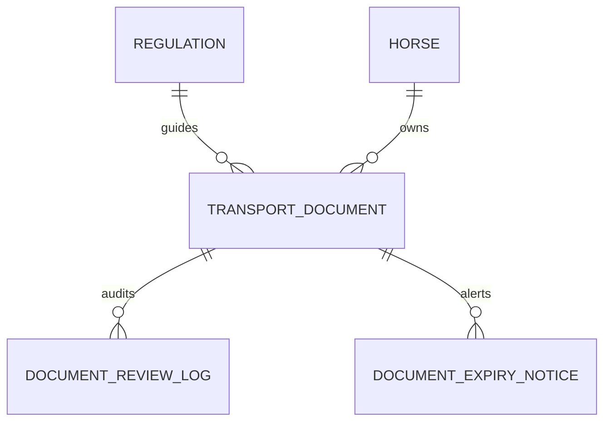
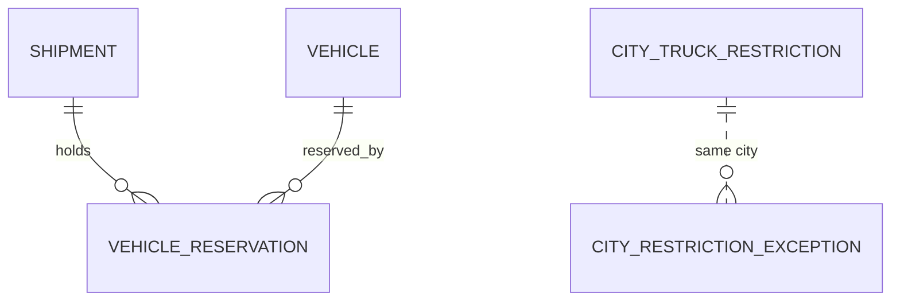
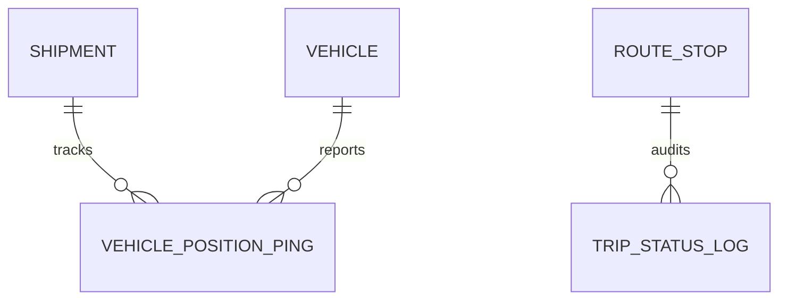

# Entity Relationship Design

The executable schema is `database/schema.mysql.sql` and targets MySQL 8.0+ with InnoDB and utf8mb4.

## Core entities

- `role`, `user`, `otp_verification`
- `horse`
- `regulation`, `document_type`, `transport_document`, `document_approval`
- `shipment`, `shipment_horse`, `shipment_quote`, `pricing_tariff`, `seaport`, `sea_route`
- `depot`, `vehicle_class`, `vehicle`, `shipment_vehicle`, `route`, `route_stop`, `shipment_assignment`
- `route_stop_update`, `horse_condition_log`, `attachment`
- `incident_report`, `shipment_change_request`, `delivery_handover`
- `notification`

## Important relationships

- **Trạm xe, loại phương tiện, sức chứa (migration `030_depots_vehicle_classes.sql`, Step 3)**:
  - `depot(depot_id, code UNIQUE, name, country, city, address, lat, lng, type ENUM('own','partner'), is_active)`. Seed demo: Thủ Đức, Long Biên, Đà Nẵng, Cần Thơ (own) và Phnom Penh, Bangkok, Singapore (partner).
  - `vehicle_class(code PK, mode ENUM('road','air','sea'), name_vi, name_en, horse_capacity NULL, price_coefficient, is_heavy_truck, sort_order)`.
  - `vehicle.depot_id` là FK nullable tới `depot`; xe đường bộ cũ được gán Trạm Thủ Đức. `vehicle.vehicle_class_code` là FK nullable tới `vehicle_class`, backfill theo `capacity`. `vehicle.capacity` được giữ để tương thích và luôn lấy theo loại khi tạo hoặc đổi loại. Cột `vehicle.current_location` có trong schema (trước đây chỉ được thêm lúc backend khởi động).
  - Số chỗ chuồng của đơn = tổng `shipment_horse.quantity` × (2 nếu `horse.requires_private_stall`, ngược lại 1). `route_leg.stalls_booked` lưu số chỗ này.
  - `shipment.booking_type` mặc định đổi sang `dedicated_charter`; giá trị `shared_stall` giữ trong ENUM cho đơn cũ. Bảng `road_trip` được giữ: mỗi chặng đường bộ của đơn mới vẫn có một `road_trip` riêng.

- A customer owns one or more horses and creates transport orders.
- `horse.status` uses `ENUM('active','in_transit','retired','deceased')` (`'delivered'` is not used): `'in_transit'` means the horse is currently held/reserved by a non-terminal shipment (`requested` through `in_transit`) and returns to `'active'` upon removal during `change_requested` or terminal shipment states (`cancelled`, `rejected`, `cancelled_operational`, `completed`).
- An order contains one or more horses and can become one transport plan/trip.
- A horse has a document set whose required documents depend on destination country and border gate.
- **Hồ sơ ngựa sau review 11/2026 (migration `029_horse_profile_after_review.sql`)**:
  - `horse.gender` và `horse.date_of_birth` ngừng dùng. Cột được giữ để không mất dữ liệu cũ, nhưng API không đọc/ghi nữa.
  - Thêm `horse.requires_private_stall BOOLEAN DEFAULT FALSE` và `horse.temperament ENUM('calm','normal','difficult') DEFAULT 'normal'` để xếp ngựa lên phương tiện.
  - `document_type(code PK, name_vi, name_en, default_validity_days, is_identity, sort_order)` là danh mục loại giấy tờ.
  - `transport_document.document_type_code` là FK nullable tới `document_type.code`. `transport_document.regulation_id` cho phép NULL: giấy tờ chung của ngựa (hộ chiếu, vi mạch...) không thuộc riêng quy định nào và được dùng lại cho nhiều đơn.
  - Giấy tờ vẫn append-only: tải bản mới thì bản cũ cùng loại có `is_archived = TRUE` và `superseded_by_document_id` trỏ sang bản mới.
- A trip uses a route made of ordered legs and stops, and has assigned vehicle/capacity and staff.

- **Báo giá, bảng giá cấu hình, đường thủy và khoảng cách (migration `031_pricing_distance_sea.sql`, Step 4)**:
  - `seaport(port_id PK, code UNIQUE, name, country, city, lat, lng, is_active)`. Seed demo: Rạch Giá, Bãi Vòng (Phú Quốc), Cát Lái (VN), Pasir Panjang (Singapore), Laem Chabang (Thái Lan).
  - `sea_route(sea_route_id PK, from_port_id FK, to_port_id FK, sea_mode ENUM('ferry','vessel'), distance_km, typical_hours, is_active, notes)`. Tuyến 2 chiều (VN-RGI <-> VN-PQC ferry, VN-CLI <-> SG-PSA vessel, VN-CLI <-> TH-LCB vessel).
  - `pricing_tariff(tariff_id PK, mode ENUM('road','air','sea'), region, version, params JSON, effective_from, is_active, notes, created_by FK)`. Bảng giá có phiên bản; mỗi mode/region có 1 bản `is_active = TRUE`. Tạo version mới tắt version cũ trong 1 transaction; không bao giờ UPDATE params cũ.
  - `shipment_quote(quote_id PK, customer_id FK, transport_mode, sea_mode, input_json JSON, result_json JSON, tariff_versions_json JSON, freight_total BIGINT, insurance_total BIGINT, total BIGINT, status ENUM('active','used','expired'), expires_at, used_by_shipment_id FK)`. Báo giá có hạn 30 phút, lưu snapshot kết quả.
  - `shipment`: thêm `quote_id FK`, `pricing_snapshot JSON`, `distance_km`, `distance_source ENUM('ors','estimated','table')`, `origin_lat`, `origin_lng`, `destination_lat`, `destination_lng`, `sea_mode ENUM('ferry','vessel')`. Mở rộng `shipment.transport_mode` thành `ENUM('road','air','sea')`, `regulation.transport_mode` thành `ENUM('road','air','sea','both')`.

- **Vận chuyển khứ hồi và chính sách no-show (migration `032_round_trip.sql`, Step 5)**:
  - `shipment`: mở rộng `status` thêm `return_pending`. Thêm `trip_type ENUM('one_way','round_trip')`, `return_departure_at`, `return_wait_minutes DEFAULT 120`, `return_status ENUM('not_applicable','scheduled','in_progress','cancelled','no_show','completed')`, `return_no_show BOOLEAN`, `return_freight BIGINT`, `return_insurance_fee BIGINT`, `return_policy_snapshot JSON`, `return_policy_accepted_at`, `return_cancelled_at`, `return_cancel_reason`, `return_reschedule_fee`.
  - `route_leg` & `route_stop`: thêm `direction ENUM('outbound','return') NOT NULL DEFAULT 'outbound'`.
  - `shipment_quote`: thêm `trip_type ENUM('one_way','round_trip') NOT NULL DEFAULT 'one_way'`.
  - `shipment_return_change(change_id PK, shipment_id FK, old_return_departure_at, new_return_departure_at, reschedule_fee, requested_by FK, created_at)`. Lưu vết lịch sử đổi lịch chặng về.

- **Báo giá, bảng giá cấu hình, đường thủy và khoảng cách (migration `031_pricing_distance_sea.sql`, Step 4)**:
  - `seaport(port_id PK, code UNIQUE, name, country, city, lat, lng, is_active)`. Seed demo: Rạch Giá, Bãi Vòng (Phú Quốc), Cát Lái (VN), Pasir Panjang (Singapore), Laem Chabang (Thái Lan).
  - `sea_route(sea_route_id PK, from_port_id FK, to_port_id FK, sea_mode ENUM('ferry','vessel'), distance_km, typical_hours, is_active, notes)`. Tuyến 2 chiều (VN-RGI <-> VN-PQC ferry, VN-CLI <-> SG-PSA vessel, VN-CLI <-> TH-LCB vessel).
  - `pricing_tariff(tariff_id PK, mode ENUM('road','air','sea'), region, version, params JSON, effective_from, is_active, notes, created_by FK)`. Bảng giá có phiên bản; mỗi mode/region có 1 bản `is_active = TRUE`. Tạo version mới tắt version cũ trong 1 transaction; không bao giờ UPDATE params cũ.
  - `shipment_quote(quote_id PK, customer_id FK, transport_mode, sea_mode, input_json JSON, result_json JSON, tariff_versions_json JSON, freight_total BIGINT, insurance_total BIGINT, total BIGINT, status ENUM('active','used','expired'), expires_at, used_by_shipment_id FK)`. Báo giá có hạn 30 phút, lưu snapshot kết quả.
  - `shipment`: thêm `quote_id FK`, `pricing_snapshot JSON`, `distance_km`, `distance_source ENUM('ors','estimated','table')`, `origin_lat`, `origin_lng`, `destination_lat`, `destination_lng`, `sea_mode ENUM('ferry','vessel')`. Mở rộng `shipment.transport_mode` thành `ENUM('road','air','sea')`, `regulation.transport_mode` thành `ENUM('road','air','sea','both')`.

- **Vận chuyển khứ hồi và chính sách no-show (migration `032_round_trip.sql`, Step 5)**:
  - `shipment`: mở rộng `status` thêm `return_pending`. Thêm `trip_type ENUM('one_way','round_trip')`, `return_departure_at`, `return_wait_minutes DEFAULT 120`, `return_status ENUM('not_applicable','scheduled','in_progress','cancelled','no_show','completed')`, `return_no_show BOOLEAN`, `return_freight BIGINT`, `return_insurance_fee BIGINT`, `return_policy_snapshot JSON`, `return_policy_accepted_at`, `return_cancelled_at`, `return_cancel_reason`, `return_reschedule_fee`.
  - `route_leg` & `route_stop`: thêm `direction ENUM('outbound','return') NOT NULL DEFAULT 'outbound'`.
  - `shipment_quote`: thêm `trip_type ENUM('one_way','round_trip') NOT NULL DEFAULT 'one_way'`.
  - `shipment_return_change(change_id PK, shipment_id FK, old_return_departure_at, new_return_departure_at, reschedule_fee, requested_by FK, created_at)`. Lưu vết lịch sử đổi lịch chặng về.

- Tracking events and horse health logs belong to a trip and record their author and timestamp.
- Incidents can create route-change and additional-cost approval records linked to the trip.
- Handover records close a trip only after the required horse/document checklist is confirmed.

The database schema is the executable source of truth; this document explains ownership and relationships at a business level.

## Official transport invoice

`shipment_invoice` (migration `016_route_payment_gate.sql`) belongs to `orders` billing. It references `shipment`, the confirmed `route`, and the paying customer (`user`). `route_id` is unique: repeated confirmations reuse the issued invoice. `amount` is a positive integer VND value; `snapshot` retains the customer, route and scheduled legs at issue time. `issued_at` is the server timestamp. Existing SePay receipts and sandbox history remain separate and unchanged.

## Equine insurance (migration 017 & migration 033 v2)

- `shipment_horse`: `declared_value DECIMAL(15,2)`, `declared_currency`, `exchange_rate DECIMAL(18,6)`, `declared_value_vnd DECIMAL(15,2)`, `insurance_package`, per-horse `insurance_fee DECIMAL(15,2)`, `max_compensation DECIMAL(15,2)`, `emergency_vet_covered`, `insurance_policy_version`. The existing quantity multiplies premiums, not the declared unit value or unit compensation cap.
- `shipment`: `transport_cost DECIMAL(15,2) NULL` distinguishes pending freight from zero freight; `insurance_fee DECIMAL(15,2)` stores the sum of unit premiums multiplied by quantities. Existing `total_cost` becomes the combined quoted total after approval.
- `shipment_insurance_revision`: append-only `previous_snapshot` (JSON), shipment, changing customer, reason and server timestamp. It preserves policy data across pre-approval resubmissions without creating new horse identities.
- **Chính sách bảo hiểm equine-v2 & bồi thường theo mức độ sự cố M1–M4 (migration `033_insurance_payout_claims.sql`, Step 6)**:
  - `insurance_package_config(package PK, display_name, rate_bps, min_fee_vnd, max_compensation_fixed_vnd, is_active, notes)`: Cấu hình gói bảo hiểm động trong DB. Basic: 0%, trần cố định 50.000.000 VNĐ, không có phí tối thiểu. Standard: 1,5% (150 bps), phí tối thiểu 1.000.000 VNĐ/ngựa, trần 80% giá trị khai báo. Premium: 3,0% (300 bps), phí tối thiểu 2.000.000 VNĐ/ngựa, trần 100% giá trị khai báo + hỗ trợ cấp cứu thú y.
  - `insurance_payout_rule(rule_id PK, package, severity ENUM('M1','M2','M3','M4'), payout_type ENUM('percent_of_value','vet_cost_capped'), payout_percent_bps, cap_vnd, description, is_active)`: Bảng quy tắc đền bù theo 4 mức độ:
    - M1 (Thương tích nhẹ/bệnh vãng lai): chi phí thú y thực tế, Basic tối đa 50tr; Standard tối đa 100tr; Premium chi trả 100% hóa đơn thú y.
    - M2 (Thương tật vĩnh viễn nhẹ, giảm 30% giá trị thi đấu): Standard đền 30% giá trị khai báo; Premium đền 30% giá trị khai báo (Basic: 0).
    - M3 (Thương tật vĩnh viễn nặng, mất khả năng thi đấu hoàn toàn): Standard đền 50% giá trị; Premium đền 50% giá trị (Basic: 0).
    - M4 (Tử vong hoặc buộc phải tiêu hủy nhân đạo): Basic tối đa 50tr; Standard đền 80% giá trị khai báo; Premium đền 100% giá trị khai báo.
  - `insurance_claim(claim_id PK, shipment_horse_id FK, shipment_id FK, customer_id FK, severity ENUM('M1','M2','M3','M4'), description, vet_cost_vnd, requested_amount, suggested_amount, approved_amount, status ENUM('submitted','under_review','approved','rejected','paid'), evidence_urls JSON, refund_record_id FK, rejection_code, rejection_reason, review_notes, reviewed_by FK, reviewed_at, created_at, updated_at)`: Quản lý vòng đời yêu cầu bồi thường (claim). Cửa sổ nộp claim là 72 giờ sau khi đơn `completed` (hoặc đang `in_transit` đối với mức tử vong M4).
  - `insurance_claim_event(event_id PK, claim_id FK, action, actor_id FK, note, payload JSON, created_at)`: Audit log append-only theo dõi mọi biến động trạng thái của claim.
  - Tích hợp tài chính SoD: Khi duyệt claim, hệ thống tự động tạo bản ghi `shipment_refund_record` loại `insurance_claim`. Duyệt số tiền `>= 20.000.000 VNĐ` kích hoạt duyệt kép (`requires_dual_approval = true`). Admin thực hiện chuyển khoản, nếu người chuyển trùng người duyệt sẽ bị từ chối 403 Forbidden. Khi Admin hoàn tất chuyển tiền, claim tự động cập nhật trạng thái `paid`.
- Migration 017 is rerunnable. Existing horses default to Basic with no added fee, historical totals remain unchanged, and existing quoted totals are copied to base freight. No prior trip is retrospectively charged insurance. The insurance record remains attached to its original shipment/horse relationship.
- Schema/migration 017 also supply missing nullable horse-profile columns (`color`, `weight`, `medical_status`, `special_requirements`) required by the existing horse selection and order detail API. Existing columns and profile values are preserved.

## Booking type (migration 018)

- `shipment.booking_type ENUM('shared_stall','dedicated_charter') NOT NULL DEFAULT 'shared_stall'` records the service Customer selected. Existing totals are preserved when adding this default to historical orders.
- `shipment.stall_unit_price DECIMAL(15,2) NULL` stores whole-VND unit freight for new shared quotes. Dedicated and legacy total-only quotes keep it null. `transport_cost` remains the total freight; `total_cost = transport_cost + insurance_fee` after approval.
- `shipment_booking_revision`: shipment/user foreign keys, previous/new booking enums, server timestamp and index by shipment/time. Revisions append on changes requested by Manager. They do not modify prior invoice snapshots.
- `shipment_invoice.snapshot` additionally retains booking type/unit price/horse count for the issued quote. Migration 018 is rerunnable and never recalculates historical prices.

## Road-trip capacity (migration 019)

- `road_trip`: vehicle FK, booking enum, origin/destination, booked start/end, creating staff FK and creation time. Trip coordinates/time are immutable through the API. A CHECK enforces arrival after departure.
- `route_leg.road_trip_id`: nullable FK to the road trip. Existing legs are unchanged. Road `stalls_booked` is set from the locked shipment's horse quantity, never the Customer/Coordinator payload.
- Shared membership is the set of road legs linked to a trip through their own routes/shipments. Vehicle row locks serialize all reservation decisions; overlapping different trips or Dedicated occupants are rejected. Completed booking intervals remain recorded; cancelled/rejected orders do not consume slots. No cross-customer membership details are exposed publicly.
- Applying 019 requires the existing Flow 3 schema (migration 010). The base schema declares road_trip; 019 supplies the leg FK after route_leg exists. This follows the project's base-schema-plus-migrations setup.

## Independent transport mode (migration 020)

- `shipment.transport_mode ENUM('road','air') NULL`: the Manager's selected mode. This is independent of `transportation_type` (Domestic/International) and `booking_type` (Shared/Dedicated).
- New approval writes the mode without overwriting geographic scope. Responses and invoice snapshots include the mode. Old rows remain null; older UI note-based inference remains a fallback, with no automatic historical rewrite.

## Prepaid Flow Schema (Migration 034)

- **`shipment`**:
  - Mở rộng ENUM trạng thái: bổ sung `'awaiting_payment'`, `'paid_pending_review'`, `'refund_requested'`, `'refunded'`.
  - Bổ sung `payment_flow ENUM('prepaid', 'postpaid_legacy') NOT NULL DEFAULT 'postpaid_legacy'`.
  - Bổ sung `payment_due_at DATETIME(3) NULL` (SLA thanh toán 24h của đơn trả trước).
  - Bổ sung `cancel_reason_code VARCHAR(50) NULL`.
  - Bổ sung các cột thẩm định khả thi: `feasibility_reviewed_by INT NULL`, `feasibility_reviewed_at DATETIME(3) NULL`, `feasibility_cannot_fulfil_reason VARCHAR(100) NULL`, `feasibility_review_note TEXT NULL`.
- **`shipment_status_history`** (Bảng mới):
  - Lưu vết toàn bộ lịch sử chuyển trạng thái đơn hàng: `history_id`, `shipment_id`, `from_status`, `to_status`, `changed_by_user_id`, `reason`, `metadata`, `created_at`.
- **`shipment_invoice`**:
  - Cột `route_id` sửa thành NULLable (hóa đơn sơ bộ trả trước phát hành ngay khi tạo đơn trước khi có lộ trình).
  - Cột sinh `active_primary_shipment_key` và khóa duy nhất `uq_active_primary_invoice_shipment` ngăn trùng hóa đơn sơ bộ active.
- **`shipment_refund_record`**:
  - Bổ sung thông tin tài khoản thụ hưởng và cam kết SLA: `recipient_bank_name VARCHAR(100) NULL`, `recipient_account_holder VARCHAR(150) NULL`, `customer_note TEXT NULL`, `form_submitted_at DATETIME(3) NULL`, `sla_due_at DATETIME(3) NULL`.

## Country Document Requirements & Compliance Review (Migration 035 — Step 8)

- **`regulation`**:
  - Bổ sung: `document_type_code VARCHAR(50) NULL`, `max_issue_age_days INT NULL`, `is_active BOOLEAN DEFAULT TRUE`, `legal_reference VARCHAR(255) NULL`, `is_demo_data BOOLEAN DEFAULT FALSE`.
  - Cập nhật ENUM `transport_mode` bao gồm `'road', 'air', 'sea', 'both'`.
- **`transport_document`**:
  - Bổ sung: `reviewed_by INT NULL`, `reviewed_at DATETIME(3) NULL` (truy vết người và thời điểm Logistics Manager thực hiện kiểm duyệt).
- **`document_review_log`** (Bảng mới):
  - Lưu toàn bộ lịch sử kiểm duyệt 4 điểm của hồ sơ: `review_id`, `document_id`, `reviewed_by`, `reviewer_role`, `old_status`, `new_status`, `reason`, `checklist_snapshot JSON`, `created_at`.
- **`document_expiry_notice`** (Bảng mới):
  - Ngăn gửi lặp thông báo nhắc hạn: `notice_id`, `document_id`, `notice_type ENUM('days_30', 'days_7', 'days_1', 'expired')`, `sent_at`, `recipient_user_id`.

## Target Schema Extensions (BA Spec v3.1 — `Planned`, Chưa có Migration)

> [!WARNING]
> Các mở rộng bảng và cột dưới đây thuộc **BA Spec v3.1 (`Target Spec`)** chưa được tạo thành SQL migration trong `database/migrations/` hay `database/schema.mysql.sql`. Tài liệu này phản ánh đúng ranh giới giữa schema thực thi hiện tại và thiết kế đích cho Release 1.

1. **`shipment` (Mở rộng trạng thái hủy vận hành, OTD & Runtime Compliance):**
   - Bổ sung `'cancelled_operational'` vào `shipment.status` ENUM.
   - Bổ sung `cancellation_category`, `cancellation_reason` (hủy vận hành); `excused_delay BOOLEAN`, `excused_delay_reason`, `excused_delay_confirmed_by`, `excused_delay_confirmed_at` (khóa sau 48h theo `DEC-02`); `in_transit_compliance_alert BOOLEAN` (`BR-F2-06`).
2. **`regulation` (Mở rộng đa chiều & Lead Time động — Gap G2 / `DEC-03`):**
   - Bổ sung `border_gate VARCHAR(100) NULL`, `transport_mode ENUM('road','air','both')`, `doc_tier ENUM('A','B')`, `lead_time_days INT`, `requires_authority_approval BOOLEAN`, `min_validity_buffer_hours INT`.
3. **`shipment_invoice` (Quản lý cửa sổ thanh toán động, gia hạn & nâng cấp `D - 3`):**
   - Bổ sung `status ENUM('active','void','superseded')`, `invoice_type ENUM('standard','replacement','supplemental')`, `payment_due_at DATETIME(3)`, `grace_due_at DATETIME(3)`, `grace_count TINYINT`, `parent_invoice_id INT NULL`.
4. **`shipment_operating_cost` (Bảng mới — Gap G1 / `DEC-02`):**
   - Lưu chi phí vận hành thực tế theo chuyến/hạng mục: `cost_id`, `shipment_id`, `route_leg_id NULL`, `cost_category ENUM('fuel','toll_border','airline_freight','quarantine_fee','staff_allowance','incident_absorbed','disbursement_absorbed_on_company_fault')`, `amount DECIMAL(15,2)`, `receipt_url`, `recorded_by`, `created_at`.
5. **`shipment_refund_record` (Bảng mới — Hoàn tiền Thủ công & SoD / `DEC-04`):**
   - Lưu chu trình hoàn tiền thủ công ngoài SePay: `refund_id`, `shipment_id`, `payment_id`, `refund_mode ENUM('cash_transfer','credit_30d')`, `amount BIGINT`, `status ENUM('pending_approval','approved_for_transfer','transferred','converted_to_credit','rejected')`, `approved_by`, `approved_at`, `second_approved_by NULL` (Dual-Approval `>= 20M VND`), `transferred_by NULL`, `transferred_at NULL`, `bank_reference`, `transfer_receipt_url`, `credit_expires_at`, ràng buộc nghiệp vụ `transferred_by != approved_by`.
6. **`shipment_disbursement` (Bảng mới — Ứng trước Phí Cơ quan có Biên lai / `BR-F1-09`):**
   - Lưu lệ phí cơ quan nhà nước ứng trước cho từng đơn (`disbursement_id`, `shipment_id`, `authority_name`, `amount BIGINT`, `authority_receipt_url`, `settled_status`, `recorded_by`).
7. **`equine_vital_config` (Bảng mới — Cấu hình Ngưỡng Sinh hiệu 3 Tầng / `DEC-06`):**
   - Tham số hóa ngưỡng `temp_green_min/max`, `temp_amber_low/high`, `hr_green_min/max`, `hr_amber_low/high`, `escalatable_statuses`, `consecutive_alert_window_hours` (mặc định `6`), `updated_by_vet_name`, `calibrated_at`.
8. **`route_stop_update` / `trip_status_log` (Mở rộng Audit Thực địa):**
   - Bổ sung `updated_by_role ENUM('driver','escort','coordinator','manager','admin')` (`DEC-07`) và `is_backdated BOOLEAN` (`BR-F4-05`).

## Allocation, city restrictions, system settings (Migration 036 — Step 9)

- `vehicle_reservation` (N–1 `shipment`, N–1 `vehicle`): giữ chỗ xe theo khung giờ `[start_at, end_at)`, `direction`, `status ENUM('active','released','consumed')`, `released_reason`, `released_at`. Không xóa bản ghi (lịch sử).
- `shipment` thêm `allocation_option_code`, `allocation_snapshot JSON` (phương án đã chọn + lịch sử đổi xe `overrides`), `pickup_at` (giờ đón đã chốt sau khi dời giờ cấm), `night_surcharge_applied`.
- `route_leg` thêm `jet_stall_count` (chặng bay), `allocation_override_reason` (Manager dùng xe khác phương án đã giữ).
- `city_truck_restriction`: vùng tròn (`center_lat`, `center_lng`, `radius_km`) + khung cấm `banned_from`/`banned_to` (giờ địa phương, có thể qua nửa đêm) + `days_of_week` + `legal_reference` + hiệu lực + `is_demo_data`.
- `city_restriction_exception`: lịch cấm riêng theo `(city, exception_date)`, thay thế khung thường ngày đó.
- `system_setting(setting_key PK, value_json)`: cấu hình dùng chung; `journey.rules` (B4).
- `pricing_tariff` seed thêm `road / PARTNER / v1` cho trạm đối tác nước ngoài.

## GPS Tracking, Geofence & Simulation (Migration 037 — Step 10)

- **`vehicle_position_ping`** (Bảng mới):
  - Lưu vệt tọa độ GPS/giả lập của phương tiện: `ping_id PK`, `shipment_id FK`, `vehicle_id FK NULL`, `latitude DECIMAL(10,7)`, `longitude DECIMAL(10,7)`, `speed_kmh DECIMAL(5,2) NULL`, `heading_deg DECIMAL(5,2) NULL`, `accuracy_m DECIMAL(6,2) NULL`, `source ENUM('gps','simulated')`, `is_backdated BOOLEAN DEFAULT FALSE`, `recorded_at DATETIME(3)`, `created_at DATETIME(3)`.
  - Indexes: `idx_vpp_shipment_time(shipment_id, recorded_at)`, `idx_vpp_vehicle_time(vehicle_id, recorded_at)`.
- **`trip_milestones`** & **`route_stop`**:
  - Bổ sung kiểm soát geofence: `geofence_radius_m INT NULL`, `actual_lat DECIMAL(10,7) NULL`, `actual_lng DECIMAL(10,7) NULL`, `gps_accuracy_m DECIMAL(6,2) NULL`, `geofence_passed BOOLEAN NULL`, `checkin_source ENUM('gps','simulated','manual') NULL`.
- **`trip_status_log`**:
  - Bổ sung dấu vết kiểm tra geofence & ngoại lệ thủ công: `geofence_passed BOOLEAN NULL`, `manual_reason TEXT NULL`, `evidence_url VARCHAR(500) NULL`, `flagged BOOLEAN DEFAULT FALSE`.
- **`horse_health_log`**:
  - Bổ sung đo lường sinh hiệu định lượng: `temperature_c DECIMAL(4,2) NULL`, `heart_rate_bpm INT NULL`, `alert_tier ENUM('green','amber_observational','amber_escalatable','red') NULL`, `alert_reason VARCHAR(255) NULL`.
- **`system_setting`**:
  - Cấu hình khóa giám sát: `tracking.simulation_enabled` (`BOOLEAN`), `tracking.customer_vitals_detail` (`BOOLEAN`), `tracking.geofence_default_radius_m` (`INT`), `tracking.geofence_large_site_radius_m` (`INT`).

