# Use Case Diagram - EquiTransit v2.0 (Post-Review & Hot-Fix)

> **Cập nhật sau review hội đồng & hot-fix (11/2026):**
> 1. **Gộp Actor (G1):** Ba actor nội bộ (*Logistics Manager*, *Transport Specialist*, *Fleet & Route Coordinator*) được hợp nhất thành một actor duy nhất: **Logistics Manager (Quản lý vận hành toàn diện)**.
> 2. **Actor Admin (SoD):** Độc lập thực thi giải ngân chuyển khoản hoàn tiền và bồi thường bảo hiểm theo nguyên tắc *Segregation of Duties* (`transferred_by != approved_by`), đồng thời quản trị chế độ giả lập GPS.
> 3. **Actor Thanh toán:** **Payment Service (Cổng SePay VietQR)** xử lý đối soát webhook ngân hàng.
> 4. **Luồng nghiệp vụ nâng cấp:** Báo giá tự động tức thì (UC-31), Đặt chỗ trả trước, Thẩm định khả thi (UC-12/13/14), Kiểm dịch ngựa 4 tiêu chí (UC-19/20/21), Lập tuyến và điều xe (UC-22/23/24), Check-in GPS Geofence kèm sinh hiệu 3 tầng (UC-27/28), Quản lý sự cố (UC-29), Bàn giao cá thể (UC-30), Bồi thường bảo hiểm M1–M4 (UC-34/35), và Báo cáo No-show chặng về (UC-39).

Tệp sơ đồ nguồn Draw.io có thể mở và chỉnh sửa trực tiếp trên [diagrams.net](https://app.diagrams.net/):
- **Đường dẫn tệp Draw.io:** [`docs/use-case-diagram-equitransit.drawio`](file:///c:/Users/ttrrang/Documents/GitHub/SWP391_GROUP1/docs/use-case-diagram-equitransit.drawio) (hoặc tệp gốc tại thư mục dự án: [`use-case-diagram-equitransit.drawio`](file:///c:/Users/ttrrang/Documents/GitHub/SWP391_GROUP1/use-case-diagram-equitransit.drawio)).
- **Ảnh xem trước độ phân giải cao:** [`docs/use-case-diagram-preview.png`](file:///c:/Users/ttrrang/Documents/GitHub/SWP391_GROUP1/docs/use-case-diagram-preview.png).

---

## 1. Sơ đồ Use Case Tổng quan (Mermaid Overview)

```mermaid
flowchart TB
  Customer["Customer / Horse Owner (Chủ ngựa)"]
  Manager["Logistics Manager (Quản lý vận hành)"]
  Driver["Vehicle Driver / Vet Escort (Tài xế / Áp tải)"]
  Admin["Admin (Quản trị & SoD Tài chính)"]
  Payment["Payment Service (SePay VietQR)"]

  subgraph System["Cross-Border Racehorse Transport System"]
    subgraph Auth["Xác thực & Chung"]
      UC01["UC-01: Register Account"]
      UC02["UC-02: Log In"]
      UC03["UC-03: Reset Password"]
      UC09["UC-09: View Notifications"]
    end

    subgraph CustomerFlow["Chủ ngựa & Đơn hàng"]
      UC04["UC-04: Manage Horse Profiles"]
      UC31["UC-31: Get Instant Quote"]
      UC05["UC-05: Create Transport Request"]
      UC06["UC-06: Update / Resubmit Request"]
      UC07["UC-07: Upload Compliance Documents"]
      UC10["UC-10: Pay Invoice by QR"]
      UC11["UC-11: Reconcile Bank Transfer"]
      UC08["UC-08: Track Shipment Status"]
      UC40["UC-40: Cancel or Reschedule Return Leg"]
      UC34["UC-34: File Insurance Claim"]
      UC32["UC-32: Submit Refund Details"]
    end

    subgraph ManagerFlow["Quản lý vận hành"]
      UC12["UC-12: Review Paid Orders"]
      UC13["UC-13: Approve Feasible Order"]
      UC14["UC-14: Mark Order Unfeasible"]
      UC15["UC-15: Request Revision (Legacy)"]
      UC19["UC-19: Review Compliance Documents"]
      UC20["UC-20: Update Clearance Status"]
      UC21["UC-21: Notify Missing Documents"]
      UC22["UC-22: Build Route Plan"]
      UC16["UC-16: Define Strategic Route Framework"]
      UC23["UC-23: Assign Vehicles & Staff"]
      UC24["UC-24: Publish Schedule"]
      UC17["UC-17: Approve Route Plan"]
      UC38["UC-38: Monitor Live Trips"]
      UC35["UC-35: Review Insurance Claim"]
      UC36["UC-36: Configure Pricing & Operations"]
      UC18["UC-18: View Reports"]
    end

    subgraph DriverFlow["Thực thi & Giám sát"]
      UC25["UC-25: View Assigned Trips"]
      UC26["UC-26: Confirm Trip Assignment"]
      UC27["UC-27: Update Journey Status (GPS Check-in)"]
      UC28["UC-28: Record Horse Health Log"]
      UC29["UC-29: Report Incident"]
      UC30["UC-30: Confirm Handover"]
      UC39["UC-39: Report Return No-show"]
    end

    subgraph AdminFlow["Quản trị & SoD"]
      UC33["UC-33: Execute Refund / Claim Transfer"]
      UC37["UC-37: Configure Tracking Settings"]
    end
  end

  %% Quan hệ Actor
  Customer --> UC01
  Customer --> UC02
  Customer --> UC04
  Customer --> UC05
  Customer --> UC07
  Customer --> UC10
  Customer --> UC08
  Customer --> UC40
  Customer --> UC34
  Customer --> UC32
  Customer --> UC09

  Manager --> UC02
  Manager --> UC12
  Manager --> UC19
  Manager --> UC22
  Manager --> UC17
  Manager --> UC38
  Manager --> UC35
  Manager --> UC36
  Manager --> UC18
  Manager --> UC09

  Payment --> UC10
  Payment --> UC11

  Driver --> UC02
  Driver --> UC25
  Driver --> UC26
  Driver --> UC27
  Driver --> UC09

  Admin --> UC02
  Admin --> UC33
  Admin --> UC37
  Admin --> UC09

  %% Quan hệ include & extend
  UC03 -.->|<<extend>>| UC02
  UC05 -.->|<<include>>| UC31
  UC05 -.->|<<include>>| UC04
  UC05 -.->|<<include>>| UC07
  UC06 -.->|<<extend>>| UC05
  UC11 -.->|<<include>>| UC10

  UC13 -.->|<<extend>>| UC12
  UC14 -.->|<<extend>>| UC12
  UC15 -.->|<<extend>>| UC12

  UC19 -.->|<<include>>| UC20
  UC21 -.->|<<extend>>| UC19

  UC22 -.->|<<include>>| UC16
  UC22 -.->|<<include>>| UC23
  UC22 -.->|<<include>>| UC24

  UC27 -.->|<<include>>| UC28
  UC29 -.->|<<extend>>| UC27
  UC30 -.->|<<extend>>| UC27
  UC39 -.->|<<extend>>| UC27
```

---

## 2. Danh mục Use Case Chi tiết (UC-01 đến UC-40)

| Mã UC | Tên Use Case | Tác nhân chính | Loại quan hệ | Mô tả nghiệp vụ |
|---|---|---|---|---|
| **UC-01** | Register Account | Customer | Base | Đăng ký tài khoản khách hàng mới qua email OTP. |
| **UC-02** | Log In | All Roles | Base | Đăng nhập hệ thống theo vai trò được cấp quyền. |
| **UC-03** | Reset Password | Customer / User | `<<extend>>` UC-02 | Đặt lại mật khẩu khi quên qua mã OTP gửi về email. |
| **UC-04** | Manage Horse Profiles | Customer | `<<include>>` UC-05 | Quản lý kho hồ sơ ngựa, cờ chuồng riêng, tính khí, vi chip. |
| **UC-05** | Create Transport Request | Customer | Base | Tạo đơn vận chuyển trả trước từ báo giá đã chốt. |
| **UC-06** | Update / Resubmit Request | Customer | `<<extend>>` UC-05 | Sửa đổi và gửi lại đơn khi có yêu cầu (đơn legacy). |
| **UC-07** | Upload Compliance Documents | Customer | `<<include>>` UC-05 | Nộp hộ chiếu, giấy kiểm dịch, xét nghiệm Coggins vào kho ngựa. |
| **UC-08** | Track Shipment Status | Customer | Base | Theo dõi vị trí xe trực tiếp và Timeline dọc các mốc hành trình. |
| **UC-09** | View Notifications | All Roles | Base | Nhận và xem thông báo hệ thống theo thời gian thực. |
| **UC-10** | Pay Invoice by QR | Customer & Payment | Base | Quét mã SePay VietQR thanh toán cước phí hóa đơn. |
| **UC-11** | Reconcile Bank Transfer | Payment Service | `<<include>>` UC-10 | Tự động đối soát chuyển khoản ngân hàng qua Webhook HMAC. |
| **UC-12** | Review Paid Orders | Logistics Manager | Base | Thẩm định tính khả thi của các đơn hàng đã thanh toán trước. |
| **UC-13** | Approve Feasible Order | Logistics Manager | `<<extend>>` UC-12 | Duyệt khả thi, chuyển đơn sang giai đoạn lập lộ trình. |
| **UC-14** | Mark Order Unfeasible | Logistics Manager | `<<extend>>` UC-12 | Từ chối đơn không khả thi và tự động mở luồng hoàn tiền 100%. |
| **UC-15** | Request Revision | Logistics Manager | `<<extend>>` UC-12 | Yêu cầu khách hàng bổ sung/sửa đổi thông tin đơn. |
| **UC-16** | Define Strategic Route Framework | Logistics Manager | `<<include>>` UC-22 | Chọn hành lang Road/Air/Sea, hãng hàng không, sân bay đón/trả. |
| **UC-17** | Approve Route Plan | Logistics Manager | Base | Duyệt kế hoạch lộ trình và phân công xe/nhân sự (Khóa Gate 1). |
| **UC-18** | View Reports | Logistics Manager | Base | Xem báo cáo tài chính, chi phí vận hành và tỷ lệ OTD. |
| **UC-19** | Review Compliance Documents | Logistics Manager | Base | Thẩm định hồ sơ kiểm dịch ngựa theo danh mục 4 tiêu chí. |
| **UC-20** | Update Clearance Status | Logistics Manager | `<<include>>` UC-19 | Cập nhật số giấy phép và thời hạn phê duyệt của cơ quan thú y/hải quan. |
| **UC-21** | Notify Missing Documents | Logistics Manager | `<<extend>>` UC-19 | Gửi cảnh báo yêu cầu khách hàng nộp bổ sung giấy tờ thiếu/hết hạn. |
| **UC-22** | Build Route Plan | Logistics Manager | Base | Dựng chi tiết từng chặng (Legs), trạm dừng nghỉ IATA LAR (Stops). |
| **UC-23** | Assign Vehicles & Staff | Logistics Manager | `<<include>>` UC-22 | Phân công xe chuyên dụng từ trạm gần nhất, gán tài xế & áp tải. |
| **UC-24** | Publish Schedule | Logistics Manager | `<<include>>` UC-22 | Xuất bản lịch trình vận hành chính thức cho đoàn xe. |
| **UC-25** | View Assigned Trips | Vehicle Driver / Escort | Base | Xem danh sách chuyến đi, cá thể ngựa và điểm dừng được gán. |
| **UC-26** | Confirm Trip Assignment | Vehicle Driver / Escort | Base | Xác nhận sẵn sàng nhận chuyến hoặc từ chối kèm lý do. |
| **UC-27** | Update Journey Status | Vehicle Driver / Escort | Base | Check-in mốc hành trình bằng định vị GPS trong vùng Geofence. |
| **UC-28** | Record Horse Health Log | Vehicle Driver / Escort | `<<include>>` UC-27 | Bác sĩ thú y áp tải ghi nhận thân nhiệt, nhịp tim theo dải chuẩn kín 3 tầng. |
| **UC-29** | Report Incident | Vehicle Driver / Escort | `<<extend>>` UC-27 | Báo cáo sự cố khẩn cấp trên đường (hỏng xe, thời tiết, sức khỏe). |
| **UC-30** | Confirm Handover | Vehicle Driver / Escort | `<<extend>>` UC-27 | Lập biên bản bàn giao từng cá thể ngựa, đối soát CCCD người nhận. |
| **UC-31** | Get Instant Quote | Customer | Base | Nhận báo giá tức thì từ bảng giá theo cự ly và phương thức. |
| **UC-32** | Submit Refund Details | Customer | Base | Điền thông tin tài khoản ngân hàng để nhận hoàn tiền 100%. |
| **UC-33** | Execute Refund / Claim Transfer | Admin | Base (SoD) | Độc lập chuyển khoản hoàn tiền/bồi thường (`transferred_by != approved_by`). |
| **UC-34** | File Insurance Claim | Customer | Base | Nộp hồ sơ yêu cầu bồi thường bảo hiểm theo mức độ sự cố M1–M4. |
| **UC-35** | Review Insurance Claim | Logistics Manager | Base | Thẩm định và duyệt số tiền bồi thường bảo hiểm trong hạn mức gói. |
| **UC-36** | Configure Pricing & Operations | Logistics Manager | Base | Quản trị bảng giá đa phương thức, trạm xe và giờ cấm xe tải nội đô. |
| **UC-37** | Configure Tracking Settings | Admin | Base | Bật/tắt chế độ giả lập GPS và cấu hình mức độ hiển thị sinh hiệu. |
| **UC-38** | Monitor Live Trips | Logistics Manager | Base | Giám sát toàn bộ chuyến đi trên bản đồ vệ tinh và tiếp nhận cảnh báo đỏ. |
| **UC-39** | Report Return No-show | Vehicle Driver / Escort | `<<extend>>` UC-27 | Chờ 120 phút tại điểm đón chặng về và lập biên bản vắng mặt (No-show). |
| **UC-40** | Cancel or Reschedule Return Leg | Customer | Base | Khách hàng chủ động hủy hoặc dời ngày đón chặng về của đơn khứ hồi. |
