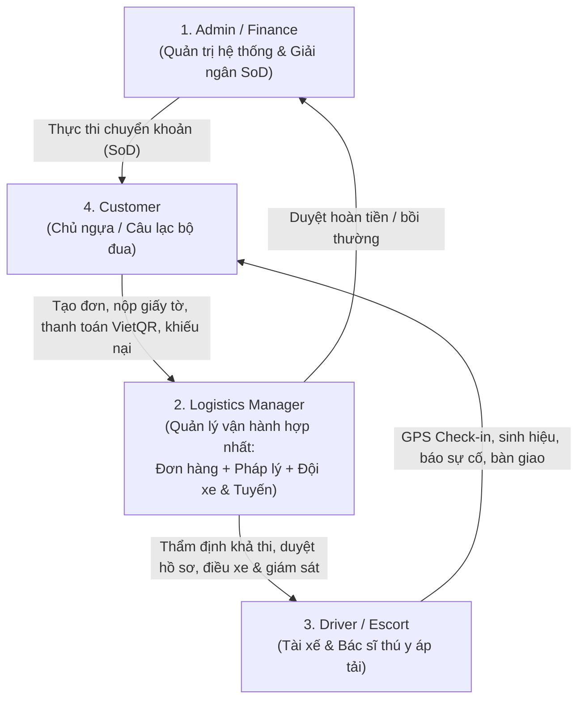
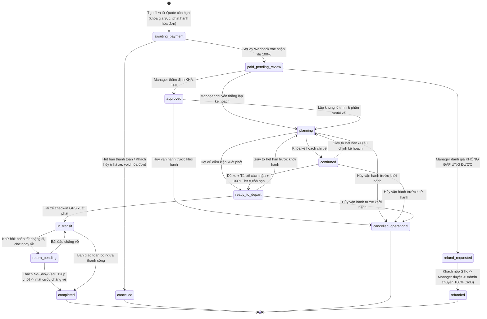
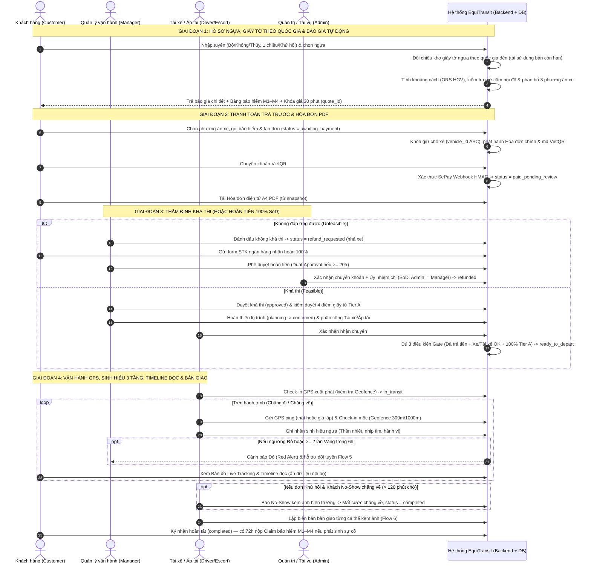

# TÀI LIỆU TOÀN DIỆN VỀ DỰ ÁN VẬN CHUYỂN NGỰA ĐUA XUYÊN QUỐC GIA (EQUITRANSIT / SWP391_GROUP1)

> **Dự án**: Cross-Border Racehorse Transport Management System  
> **Mã môn / Nhóm**: SWP391 - Nhóm 1  
> **Phiên bản**: Post-Review Release (Hoàn tất 100% Step 1 → Step 12 theo định hướng sau review hội đồng 11/2026)  
> **Cập nhật**: Tháng 11/2026 — Đồng bộ hoàn toàn với Mã nguồn thực tế, 38 Migrations (001–038), 11 Backend Modules, 3 Portal Frontend và Bộ Kiểm thử Tự động

---

## MỤC LỤC TỔNG QUAN

1. [Tổng quan Dự án & 12 Nhóm Nâng cấp Sau Review (G1–G12)](#1-tổng-quan-dự-án--12-nhóm-nâng-cấp-sau-review-g1g12)
2. [Kiến trúc Hệ thống & Ngăn xếp Công nghệ Thực tế](#2-kiến-trúc-hệ-thống--ngăn-xếp-công-nghệ-thực-tế)
3. [Các Tác nhân (4 Actors), Phân quyền (RBAC) & Tách biệt Trách nhiệm (SoD)](#3-các-tác-nhân-4-actors-phân-quyền-rbac--tách-biệt-trách-nhiệm-sod)
4. [Hồ sơ Cá thể Ngựa & Kho Giấy tờ Tập trung (Step 2)](#4-hồ-sơ-cá-thể-ngựa--kho-giấy-tờ-tập-trung-step-2)
5. [Vòng đời Đơn hàng & Máy trạng thái Trả trước (Prepaid State Machine)](#5-vòng-đời-đơn-hàng--máy-trạng-thái-trả-trước-prepaid-state-machine)
6. [Flow 1: Báo giá Tự động Đa phương thức, Khứ hồi & Bảo hiểm `equine-v2`](#6-flow-1-báo-giá-tự-động-đa-phương-thức-khứ-hồi--bảo-hiểm-equine-v2)
7. [Flow 2: Kiểm dịch, Giấy tờ Theo Quốc gia & Cảnh báo Runtime](#7-flow-2-kiểm-dịch-giấy-tờ-theo-quốc-gia--cảnh-báo-runtime)
8. [Flow 3: Trạm xe (Depot), Phân bổ Đa xe & Giờ cấm Đô thị](#8-flow-3-trạm-xe-depot-phân-bổ-đa-xe--giờ-cấm-đô-thị)
9. [Flow 4: GPS Geofence Check-in, Giả lập, Sinh hiệu 3 Tầng & Timeline Dọc](#9-flow-4-gps-geofence-check-in-giả-lập-sinh-hiệu-3-tầng--timeline-dọc)
10. [Flow 5 & Flow 6 (Optional Release 2): Quản lý Sự cố & Bàn giao Cá thể](#10-flow-5--flow-6-optional-release-2-quản-lý-sự-cố--bàn-giao-cá-thể)
11. [Cổng Thanh toán SePay VietQR, Hóa đơn PDF, Hoàn tiền 100% & Control Gate](#11-cổng-thanh-toán-sepay-vietqr-hóa-đơn-pdf-hoàn-tiền-100--control-gate)
12. [Động cơ Báo cáo Tài chính, OTD & Quản trị Chi phí Vận hành](#12-động-cơ-báo-cáo-tài-chính-otd--quản-trị-chi-phí-vận-hành)
13. [Cấu trúc Mã nguồn Frontend & Backend Thực tế](#13-cấu-trúc-mã-nguồn-frontend--backend-thực-tế)
14. [Lược đồ Cơ sở Dữ liệu & Chi tiết Toàn bộ 38 Bản Migrations (001–038)](#14-lược-đồ-cơ-sở-dữ-liệu--chi-tiết-toàn-bộ-38-bản-migrations-001038)
15. [An toàn Bảo mật, Kiểm thử Tự động & Dữ liệu Demo](#15-an-toàn-bảo-mật-kiểm-thử-tự-động--dữ-liệu-demo)
16. [Sơ đồ Luồng Nghiệp vụ Tổng thể Mới (End-to-End Sequence Diagram)](#16-sơ-đồ-luồng-nghiệp-vụ-tổng-thể-mới-end-to-end-sequence-diagram)

---

## 1. TỔNG QUAN DỰ ÁN & 12 NHÓM NÂNG CẤP SAU REVIEW (G1–G12)

### 1.1. Bối cảnh Nghiệp vụ Đặc thù
Vận chuyển ngựa đua xuyên quốc gia (**Cross-Border Racehorse Transport**) là lĩnh vực logistics có giá trị tài sản đặc biệt cao (hàng tỷ đến hàng chục tỷ VNĐ mỗi cá thể) và rủi ro sinh học nghiêm ngặt. **EquiTransit** được xây dựng tuân thủ các chuẩn mực quốc tế:
- **IATA Live Animals Regulations (LAR)**: Tiêu chuẩn vận chuyển ngựa đường hàng không trong *jet stall* chuyên dụng (tối đa 3 ngựa trưởng thành/stall, hỗ trợ tùy chọn stall riêng).
- **WOAH Terrestrial Code (Chương 7.2)**: Tiêu chuẩn vận chuyển động vật sống bằng đường biển (`sea_ferry` RoRo ≤ 12h và `sea_vessel` có cảnh báo rủi ro).
- **EU Regulation 1/2005**: Quy chuẩn thời gian lái xe liên tục (tối đa 8 giờ phải dừng nghỉ/uống nước, tổng hành trình 24 giờ phải dỡ ngựa nghỉ bắt buộc).
- **Quy định Kiểm dịch & Đô thị Việt Nam/ASEAN**: Kiểm dịch xuyên biên giới (7 quốc gia demo: VN, Campuchia, Lào, Thái Lan, Singapore, Malaysia, Hồng Kông) và khung giờ cấm xe tải nặng nội đô Hà Nội & TP.HCM.

### 1.2. Tổng hợp 12 Nhóm Thay đổi Trọng tâm Sau Review Hội đồng (Step 1 → Step 12)

| Mã góp ý | Step | Nội dung thay đổi đã triển khai trong mã nguồn |
| :---: | :---: | :--- |
| **G1** | Step 1 | **Gộp 3 actor nội bộ** (`Logistics Manager`, `Transport Specialist`, `Fleet & Route Coordinator`) thành duy nhất **`LOGISTICS_MANAGER` ("Quản lý vận hành")**; hợp nhất toàn bộ UI vào `/manager/*` và tự động redirect URL cũ. |
| **G2** | Step 2 | **Tinh gọn hồ sơ ngựa & Kho giấy tờ tập trung**: Bỏ giới tính và ngày sinh khỏi UI/API; thêm cờ `requires_private_stall` (chuồng riêng chiếm 2 khoang) và `temperament`; lưu giấy tờ trực tiếp trên hồ sơ ngựa (`horse_document` / `transport_document.horse_id`) để tái sử dụng cho nhiều đơn. |
| **G3** | Step 4 | **Bổ sung Đường thủy (`sea_ferry`, `sea_vessel`) & Chuẩn hóa Hàng không (`air`)**: Hỗ trợ đầy đủ 3 phương thức Bộ – Không – Thủy với bảng giá cấu hình phiên bản (`pricing_tariff`). |
| **G4** | Step 4 & 7 | **Báo giá tự động tức thì & Thanh toán trả trước (Prepaid Flow)**: Tính khoảng cách đường bộ thực tế bằng OpenRouteService (`driving-hgv`) + cache 24h + Haversine fallback; khóa giá 30 phút (`shipment_quote`); thanh toán ngay sau báo giá, bỏ nhập cước tay. |
| **G4a** | Step 7 | **Hóa đơn điện tử A4 in/tải PDF**: Phát hành ngay từ snapshot bất biến (`shipment_invoice`), hỗ trợ `@media print` / tải PDF trực tiếp trên trình duyệt. |
| **G4b** | Step 7 | **Thẩm định khả thi & Form hoàn tiền 100%**: Đơn sau thanh toán vào `paid_pending_review`; nếu không đáp ứng được → `refund_requested`, khách điền tài khoản ngân hàng, hoàn 100% qua SoD (Manager duyệt, Admin chuyển). |
| **G4c** | Step 8 | **Danh mục giấy tờ theo quốc gia trong luồng tạo đơn**: Chọn nước đến + phương thức sẽ tự đối chiếu kho giấy tờ của từng ngựa (6 trạng thái động), tự động tái sử dụng giấy còn hạn và cảnh báo `lead_time_days`. |
| **G5** | Step 5 | **Vận chuyển khứ hồi & Chính sách No-Show**: Giảm 10% cước chặng về; chính sách hủy/đổi ngày theo mốc 168h/72h; tài xế xác nhận No-Show sau 120 phút chờ kèm ảnh chụp → mất 100% cước chặng về. |
| **G6** | Step 6 | **Bảo hiểm `equine-v2` & Khiếu nại M1–M4**: 3 gói Cơ bản (0%) / Tiêu chuẩn (1.5%, tối thiểu 1tr) / Toàn diện (3%, tối thiểu 2tr); bảng quyền lợi bồi thường M1–M4 tính bằng tiền thật; cửa sổ claim 72 giờ + duyệt kép SoD (≥ 20 triệu). |
| **G7** | Step 3 & 9 | **Quản lý Trạm xe (`depot`) nội địa & đối tác nước ngoài**: 4 trạm nội địa (`own`) và 3 trạm đối tác nước ngoài (`partner`), tự động điều xe từ trạm gần điểm đón/giao nhất. |
| **G8** | Step 10 | **GPS Geofence Check-in, Chế độ Giả lập & Live Tracking**: Kiểm tra bán kính geofence (300m/1.000m), gắn cờ check-in ngoài vùng, giả lập di chuyển polyline do Admin bật/tắt, bản đồ live + sinh hiệu 3 tầng. |
| **G9** | Step 9 | **Giờ cấm xe tải nặng nội đô (HN, TP.HCM) & ETA có nghỉ**: Cấu hình vùng tròn cấm + ngoại lệ ngày lễ; tự động dời giờ đón/giao ra khung đêm (22:00–06:00) + phụ phí đêm; chèn điểm nghỉ chuẩn EU 1/2005. |
| **G10** | Step 3 | **Loại bỏ hoàn toàn ghép chuyến (`shared_stall`)**: 100% đơn mới là bao nguyên xe chuyên dụng (`dedicated_charter`) để đảm bảo an toàn sinh học; chặn `shared_stall` (`400`) và `POST /fleet/road-trips` (`410 Gone`). |
| **G11** | Step 3 & 9 | **Phân hạng xe & Thuật toán phân bổ đa xe (tối đa 3 phương án)**: Trả lời bài toán nhiều ngựa/xe nhỏ bằng cách tự đề xuất tối đa 3 phương án (`Rẻ nhất`, `Ít xe nhất`, `Đến sớm nhất`, hoặc `Chia nhiều ngày` / `Ghép xe 2 trạm`) kèm giá từng phương án. |
| **G12** | Step 11 | **Timeline tiến độ dọc (`VerticalTimeline`)**: Component dùng chung đồng bộ cho cả Customer, Driver và Manager qua API `GET /tracking/shipments/:shipmentId/timeline`, tự động ẩn dữ liệu nội bộ cho khách. |

---

## 2. KIẾN TRÚC HỆ THỐNG & NGĂN XẾP CÔNG NGHỆ THỰC TẾ

### 2.1. Công nghệ & Thư viện (Đồng bộ `package.json`)

| Thành phần | Công nghệ / Thư viện thực tế | Vai trò & Cấu hình |
| :--- | :--- | :--- |
| **Frontend Framework** | Next.js `14.2.18` (App Router), React `18.3.1`, TypeScript `5.7` | Client/Server Components, 3 Portal tách biệt (`customer`, `manager`, `driver`), chạy cổng `3001` |
| **Frontend UI & Bản đồ** | Tailwind CSS `3.4`, Lucide React, Leaflet `1.9.4` (Esri tiles), React Hot Toast | Giao diện Responsive, bản đồ Depot & Live Tracking, Vertical Timeline, Hóa đơn in A4 PDF |
| **Frontend Form & Data** | SWR `2.5`, React Hook Form `7.89`, Zod `3.25`, `@react-oauth/google` | Quản lý cache/polling, validate form, đa ngôn ngữ VI/EN (`LanguageContext`) |
| **Backend Framework** | NestJS `10.4.15`, Express, TypeScript `5.7`, `@nestjs/swagger` | REST API (prefix `/api`, cổng `5000`), Swagger Docs (`/api/docs`), 11 domain modules |
| **Database** | MySQL 8.0+ (InnoDB, `utf8mb4`), `mysql2` `3.24` | Truy vấn **raw SQL** qua connection pool (không dùng ORM), 38 migrations idempotent |
| **Xác thực & Bảo mật** | `@nestjs/jwt`, `bcryptjs`, `google-auth-library`, `nodemailer` | JWT Token (`24h`), OTP qua SMTP, Rate Limiting, Magic-bytes Upload Sniffing |
| **Định tuyến & Thanh toán** | OpenRouteService API (`driving-hgv`), SePay VietQR Webhook (HMAC SHA-256) | Tính khoảng cách thực tế (cache 24h + Haversine fallback), đối soát chuyển khoản tự động |
| **Kiểm thử** | Node.js `node:test` + `node:assert/strict` (Node 22+) | 24 test suites backend (`npm test` build + chạy toàn bộ unit & auth matrix tests) |

### 2.2. Biến Môi trường Quan trọng (`.env.example`)
Toàn bộ cấu hình được quản lý tập trung tại file `.env.example` ở thư mục gốc repo (không hard-code secret):
- **Database & Auth**: `DB_HOST`, `DB_PORT`, `DB_NAME`, `DB_USER`, `DB_PASSWORD`, `JWT_SECRET` (≥ 32 ký tự), `JWT_EXPIRES_IN`, `GOOGLE_CLIENT_ID`.
- **SePay & MoMo**: `SEPAY_ENABLED`, `SEPAY_BANK_CODE`, `SEPAY_ACCOUNT_NUMBER`, `SEPAY_WEBHOOK_SECRET`, `SEPAY_PAYMENT_PREFIX`, `MOMO_SANDBOX_ENABLED` (chỉ dùng thử nghiệm, không mở Gate).
- **Khoảng cách & Báo giá (Step 4)**: `ORS_API_KEY`, `ORS_BASE_URL`, `DISTANCE_FALLBACK_FACTOR` (mặc định `1.3`), `QUOTE_TTL_MINUTES` (mặc định `30`).
- **Bảo hiểm (Step 6)**: `INSURANCE_USD_TO_VND`, `INSURANCE_CLAIM_WINDOW_HOURS` (mặc định `72`).
- **GPS & Demo (Step 10 & 12)**: `TRACKING_SIMULATION_ENABLED` (mặc định `false`), `DEMO_ACCOUNT_PASSWORD`.

---

## 3. CÁC TÁC NHÂN (4 ACTORS), PHÂN QUYỀN (RBAC) & TÁCH BIỆT TRÁCH NHIỆM (SoD)

### 3.1. Mô hình 4 Actor Sau Khi Gộp (Step 1)
Theo góp ý **G1**, ba vai trò nội bộ cũ (`Logistics Manager`, `Transport Specialist`, `Fleet & Route Coordinator`) đã được gộp thành **1 vai trò vận hành duy nhất: `LOGISTICS_MANAGER` ("Quản lý vận hành")**.



1. **Customer (`CUSTOMER` — Role ID: 2)**:
   - Quản lý danh bạ ngựa đua và kho giấy tờ gắn trực tiếp theo từng ngựa.
   - Tạo đơn một chiều hoặc khứ hồi (Road / Air / Sea), xem bảng so sánh phương án xe & gói bảo hiểm theo tiền thật, khóa báo giá 30 phút và thanh toán ngay qua SePay VietQR.
   - Tải hóa đơn điện tử PDF, điền form nhận hoàn tiền 100% nếu đơn không khả thi.
   - Theo dõi live tracking trên bản đồ & Timeline dọc; ký xác nhận hoặc tranh chấp bàn giao; gửi yêu cầu bồi thường bảo hiểm trong 72 giờ.
   - *Ranh giới bảo mật*: Cô lập tuyệt đối dữ liệu theo `customer_id = user.id` (truy cập tài nguyên người khác trả `403 Forbidden`); ẩn tên nhân sự nội bộ và trạm trung chuyển kỹ thuật trên timeline.

2. **Logistics Manager / Quản lý vận hành (`LOGISTICS_MANAGER` — Role ID: 1)**:
   - Đảm nhiệm toàn bộ nghiệp vụ của 3 vai trò cũ:
     - **Đơn hàng & Khả thi**: Thẩm định khả thi đơn đã thanh toán (`paid_pending_review`), phê duyệt hoặc chuyển hoàn tiền 100%, xử lý hủy vận hành.
     - **Pháp lý & Kiểm dịch**: Cấu hình quy định theo quốc gia/cửa khẩu/phương thức, kiểm duyệt hồ sơ theo checklist 4 điểm, kích hoạt quét hết hạn (`POST /compliance/run-expiry-sweep`).
     - **Đội xe, Trạm & Điều phối**: Quản lý trạm xe (`depot`), đội xe, bảng giá (`pricing_tariff`), giờ cấm đô thị (`city_truck_restriction`), tham số nghỉ EU 1/2005; lập kế hoạch lộ trình, đổi xe giữ chỗ có lý do, phân công tài xế/áp tải.
     - **Giám sát, Sự cố & Bồi thường**: Theo dõi bản đồ `live-overview`, xử lý cảnh báo đỏ sinh hiệu/geofence, duyệt đổi tuyến Flow 5, giải quyết tranh chấp Flow 6, thẩm định & duyệt claim bảo hiểm / hoàn tiền, xem báo cáo OTD & tài chính.
   - *Tương thích ngược*: Role cũ `TRANSPORT_SPECIALIST` (ID 3) và `FLEET_ROUTE_COORDINATOR` (ID 4) được giữ trong DB ở trạng thái `deprecated`, migration `028` chuyển user sang Role 1, `normalizeUserRole` chuẩn hóa token cũ về `LOGISTICS_MANAGER`, và frontend tự redirect `/specialist/*`, `/coordinator/*` → `/manager/*`.

3. **Vehicle Driver / Escort (`DRIVER_ESCORT` — Role ID: 5)**:
   - Phân tách chuyên môn `driver` (ưu tiên lái xe & check-in mốc đường bộ) và `escort` (ưu tiên hộ tống chặng bay & ghi nhận sinh hiệu thú y); được check-in chéo dự phòng và luôn ghi `updated_by_role`.
   - Xác nhận/từ chối chuyến, gửi ping GPS định kỳ, check-in mốc hành trình có kiểm tra geofence, ghi nhật ký sinh hiệu, báo cáo No-Show chặng về (sau 120 phút chờ), báo sự cố Flow 5 và lập biên bản bàn giao Flow 6.

4. **Admin / Finance (`ADMIN` — Role ID: 6)**:
   - Quản trị tài khoản nội bộ và cấu hình hệ thống.
   - Độc quyền bật/tắt chế độ giả lập GPS và cấu hình hiển thị sinh hiệu (`PATCH /system-settings/tracking`).
   - Thực thi giải ngân chuyển khoản hoàn tiền vận hành & bồi thường bảo hiểm theo nguyên tắc SoD.

### 3.2. Ma trận RACI (Sau khi Gộp Actor)

| Quy trình / Hành động | Customer | Logistics Manager | Driver / Escort | Admin / Finance |
| :--- | :---: | :---: | :---: | :---: |
| Quản lý hồ sơ ngựa & kho giấy tờ của ngựa | **A / R** | C | — | — |
| Yêu cầu báo giá, chọn phương án xe & bảo hiểm, thanh toán VietQR | **A / R** | I | — | I |
| Thẩm định khả thi đơn trả trước (`paid_pending_review`) | I | **A / R** | — | — |
| Gửi form STK nhận hoàn tiền 100% khi không khả thi | **A / R** | I | — | I |
| Quản trị bảng giá, trạm xe, giờ cấm đô thị, quy định quốc gia | — | **A / R** | — | C |
| Thẩm định hồ sơ kiểm dịch 4 điểm & quét hết hạn | C | **A / R** | — | — |
| Dựng lộ trình, điều xe theo trạm, phân công tài xế/áp tải | — | **A / R** | R *(Xác nhận)* | — |
| Check-in mốc GPS/Geofence, sinh hiệu, báo No-Show | I | A *(Giám sát/Override)* | **R** | — |
| Cấu hình bật/tắt giả lập GPS (`system-settings/tracking`) | — | I | I | **A / R** |
| Báo sự cố & Đổi lộ trình khẩn cấp (Flow 5) | I | **A / R** | R *(Báo cáo)* | I |
| Lập biên bản bàn giao & Ký nghiệm thu / Tranh chấp (Flow 6) | **A / R** *(Ký/Khiếu nại)* | A *(Giải quyết tranh chấp)* | R *(Bàn giao)* | C |
| Nộp & Thẩm định yêu cầu bồi thường bảo hiểm (M1–M4) | R *(Nộp claim 72h)* | **A / R** *(Thẩm định/Duyệt)* | — | R *(Chi trả)* |
| Phê duyệt hoàn tiền / bồi thường (Dual-Approval nếu ≥ 20tr) | I | **A / R** | — | C |
| Thực thi chuyển khoản hoàn tiền / bồi thường (SoD) | I | I | — | **A / R** |

### 3.3. Nguyên tắc Tách biệt Trách nhiệm (Segregation of Duties — SoD)
- **Đã bỏ SoD vận hành** ("Coordinator dựng tuyến ≠ Manager duyệt tuyến") do đã gộp vào một vai trò `LOGISTICS_MANAGER`; toàn bộ thao tác vẫn ghi audit đầy đủ (ai làm, lúc nào, lý do).
- **Giữ chặt SoD Tài chính (Hoàn tiền & Bồi thường Bảo hiểm)**:
  - Người thực hiện chuyển khoản giải ngân (`transferred_by`, vai trò `ADMIN`) **bắt buộc khác** người phê duyệt (`approved_by` và `second_approved_by`). Trùng `user_id` trả `HTTP 403 Forbidden`.
  - Mọi khoản hoàn tiền hoặc bồi thường **≥ 20.000.000 VNĐ** (`DUAL_APPROVAL_THRESHOLD_VND`) bắt buộc trải qua **phê duyệt kép (Dual-Approval)** bởi 2 tài khoản quản lý độc lập (`second_approved_by != approved_by`).

---

## 4. HỒ SƠ CÁ THỂ NGỰA & KHO GIẤY TỜ TẬP TRUNG (STEP 2)

Theo góp ý **G2**, hồ sơ ngựa đua được tái cấu trúc để phục vụ xếp xe an toàn và tái sử dụng giấy tờ xuyên suốt nhiều chuyến đi:
- **Bỏ giới tính & ngày sinh**: Không còn hiển thị hoặc nhận `gender`, `date_of_birth` trong form tạo/sửa ngựa (cột cũ vẫn giữ trong MySQL để bảo toàn dữ liệu lịch sử). Giữ ô nhập tuổi (`age`, 1–35), tên, giống, màu lông, cân nặng, số microchip, số hộ chiếu, ảnh nhận diện, tình trạng y tế và yêu cầu đặc biệt.
- **Cờ chuồng riêng & tính khí**:
  - `requires_private_stall` (`BOOLEAN DEFAULT FALSE`): Ngựa tính khí mạnh hoặc cần tách biệt. Khi tính sức chứa đường bộ, ngựa này **chiếm 2 khoang tiêu chuẩn** (và chiếm **trọn 1 jet stall riêng** nếu đi đường hàng không).
  - `temperament`: `ENUM('calm', 'normal', 'difficult') DEFAULT 'normal'`.
- **Kho giấy tờ trên hồ sơ ngựa (`document_type` & `transport_document`)**:
  - Danh mục chuẩn hóa `document_type`: `horse_passport`, `microchip_certificate`, `vaccination_influenza`, `vaccination_tetanus`, `vaccination_certificate`, `eia_coggins_test`, `health_certificate`, `export_quarantine_certificate`, `quarantine_certificate`, `import_permit`, `customs_declaration`, `ownership_certificate`.
  - Giấy tờ gắn trực tiếp vào `horse_id` (cho phép `regulation_id IS NULL` đối với giấy tờ định danh dùng chung như hộ chiếu).
  - API chuyên biệt: `GET/POST /horses/:horseId/documents`, `GET /horses/:horseId/documents/:docId/history`, `GET /horses/:horseId/documents/:docId/file` (streaming có kiểm tra quyền sở hữu & magic-bytes).
  - Trạng thái hạn tính động khi đọc (`document-validity.policy.ts`): `valid`, `expiring_soon` (< 30 ngày), `expired`, `no_expiry`.
  - **Append-Only**: Nộp phiên bản mới tự động lưu trữ bản cũ (`is_archived = true`, `superseded_by_document_id`), tuyệt đối không ghi đè.

---

## 5. VÒNG ĐỜI ĐƠN HÀNG & MÁY TRẠNG THÁI TRẢ TRƯỚC (PREPAID STATE MACHINE)

Toàn bộ chuyển đổi trạng thái được tập trung tại một nguồn sự thật duy nhất `backend/src/modules/orders/order-state-machine.ts` (`transitionShipment`), khóa dòng `FOR UPDATE`, ghi lịch sử `shipment_status_history`, và tự động giải phóng xe giữ chỗ (`releaseShipmentReservations`) khi đơn kết thúc/hủy/hoàn tiền.



### 5.1. Bảng Chi tiết Các Trạng thái Chính (Luồng Prepaid & Legacy)

| Mã trạng thái | Ý nghĩa nghiệp vụ | Ghi chú chuyển đổi |
| :--- | :--- | :--- |
| `awaiting_payment` | Chờ thanh toán trả trước | Đơn mới tạo từ `quote_id` còn hạn; đã sinh `shipment_invoice` & mã VietQR. |
| `paid_pending_review` | Đã thanh toán, chờ duyệt khả thi | Webhook SePay xác nhận đủ 100%; ngựa chuyển `in_transit` (giữ chỗ). |
| `refund_requested` | Yêu cầu hoàn tiền 100% | Manager từ chối khả thi (hết xe, sự cố tuyến...); khách gửi STK ngân hàng. |
| `refunded` | Đã hoàn tiền | Admin xác nhận chuyển khoản kèm ủy nhiệm chi (SoD). Trạng thái kết thúc. |
| `approved` | Đã duyệt khả thi | Bắt đầu/tiếp tục chuẩn bị kế hoạch vận hành chi tiết và hồ sơ kiểm dịch. |
| `planning` | Đang lập kế hoạch | Dựng chặng (`route_leg`), điểm dừng (`route_stop`), gán xe & tài xế/áp tải. |
| `confirmed` | Đã khóa kế hoạch lộ trình | Kế hoạch chi tiết đã xác nhận; chờ đủ điều kiện hồ sơ/tài xế để sẵn sàng. |
| `ready_to_depart` | Sẵn sàng xuất phát | Đạt Control Gate: Kế hoạch OK + Tài xế xác nhận + 100% Tier A còn hạn + Đã thanh toán. |
| `in_transit` | Đang vận chuyển | Cấm hủy vận hành (`409 Conflict`); kích hoạt GPS tracking, geofence & sinh hiệu. |
| `return_pending` | Chờ khởi hành chặng về | Chỉ áp dụng cho đơn khứ hồi (`round_trip`) đã hoàn tất chặng đi. |
| `completed` | Hoàn thành | Bàn giao xong toàn bộ ngựa (hoặc đóng đơn do No-Show chặng về). |
| `cancelled` | Đã hủy trước thanh toán/duyệt | Hết hạn thanh toán hoặc khách tự hủy khi chưa vào vận hành; tự động nhả xe & ngựa. |
| `cancelled_operational` | Hủy vận hành | Hủy sau khi đã duyệt (`approved`..`ready_to_depart`), áp dụng ma trận hoàn tiền. |
| `requested`, `change_requested`, `rejected` | Trạng thái lịch sử (Legacy) | Chỉ giữ trong `LEGACY_TRANSITIONS` để xem lại đơn cũ; đơn mới không dùng. |

---

## 6. FLOW 1: BÁO GIÁ TỰ ĐỘNG ĐA PHƯƠNG THỨC, KHỨ HỒI & BẢO HIỂM `equine-v2`

### 6.1. Đặt chỗ Chuyên biệt — Loại bỏ Hoàn toàn Ghép chuyến (G10)
Để bảo vệ an toàn sinh học và ngăn lây nhiễm chéo giữa ngựa đua các chủ sở hữu khác nhau:
- **100% đơn hàng mới** bắt buộc sử dụng hình thức **`dedicated_charter` (Bao nguyên xe chuyên dụng)**.
- Gửi `bookingType = 'shared_stall'` bị backend từ chối `HTTP 400 Bad Request` (`booking-policy.ts`).
- Endpoint tạo chuyến xe ghép `POST /fleet/road-trips` trả về `HTTP 410 Gone`. Bảng `road_trip` chỉ dùng nội bộ cho từng chặng riêng và xem lại dữ liệu lịch sử.

### 6.2. Dịch vụ Khoảng cách & 3 Phương thức Vận chuyển (Step 4)
1. **Đường bộ (`road`)**:
   - `DistanceService` gọi **OpenRouteService API** profile xe tải nặng **`driving-hgv`**, timeout 5 giây, tự động cache kết quả 24 giờ theo tọa độ làm tròn.
   - Khi API lỗi hoặc không có key: tự động chuyển dự phòng **Haversine × hệ số đường vòng** (`DISTANCE_FALLBACK_FACTOR`, mặc định `1.25`–`1.3`), gắn nhãn `distance_source = 'estimated'`.
2. **Đường hàng không (`air`)**:
   - Gồm 3 chặng: **Xe bộ ra sân bay (`to_hub`) → Bay (`flight`, Haversine giữa 2 sân bay) → Xe bộ từ sân bay đến nơi giao (`from_hub`, dùng trạm đối tác nước ngoài)**.
   - Sức chứa theo chuẩn IATA LAR: 1 *jet stall* chứa tối đa 3 ngựa (ngựa có `requires_private_stall = true` chiếm trọn 1 stall riêng, nhân hệ số `privateStallMultiplier`).
3. **Đường thủy (`sea`)**:
   - **`sea_ferry` (RoRo / Phà)**: Ngựa ở nguyên trên xe tải chuyên dụng lên phà (VD: Rạch Giá ↔ Phú Quốc), giới hạn thời gian biển ≤ 12 giờ.
   - **`sea_vessel` (Tàu chở gia súc)**: Ngựa đi trong ô chuồng tàu theo cặp cảng đã cấu hình (VD: Cát Lái ↔ Singapore, Cát Lái ↔ Laem Chabang), hệ thống bắt buộc hiển thị cảnh báo rủi ro sức khỏe và khuyến nghị đường hàng không cho ngựa đua thi đấu.

### 6.3. Công thức Tính giá Tự động Cấu hình Phiên bản (`pricing_tariff` & `pricing-policy.ts`)
Giá **luôn do server tính**, mọi số tiền là số nguyên VNĐ, làm tròn lên bội `roundingUnit` (mặc định `1.000 VNĐ`). Bảng giá lưu theo từng `version` bất biến trong `pricing_tariff` (sửa bảng giá sinh version mới, không làm thay đổi báo giá cũ).

- **Đường bộ (`road` — tham số demo mặc định)**:
  - Phí mở chuyến: `2.000.000 VNĐ / xe`.
  - Cước km bậc lũy tiến (nhân hệ số loại xe: 1–2 chỗ `×1.0`, 3–4 chỗ `×1.3`, 6 chỗ `×1.6`):
    - Bậc 1 (0–100 km): `45.000 VNĐ / km`
    - Bậc 2 (101–500 km): `35.000 VNĐ / km`
    - Bậc 3 (> 500 km): `28.000 VNĐ / km`
  - Chạy rỗng từ trạm đến điểm đón (`deadhead`): `15.000 VNĐ / km / xe`.
  - Phụ phí chăm sóc & bốc xếp: `500.000 VNĐ / ngựa`.
  - Phụ phí ca đêm (khi điểm đón/giao rơi vào vùng giờ cấm phải chạy đêm): `1.000.000 VNĐ / xe`.
  - Phí qua cửa khẩu đường bộ: `3.000.000 VNĐ / cửa khẩu`.
- **Đường hàng không (`air`)**: Phí cơ bản `60.000.000 / ngựa` + `25.000 / km / ngựa` + phí xử lý sân bay `5.000.000 / ngựa` (nhân hệ số stall riêng `+50%` nếu có) + cước 2 chặng đường bộ ra/vào sân bay.
- **Đường thủy (`sea`)**:
  - `sea_ferry`: Vé phà `3.000.000 / xe` + cước đường bộ toàn tuyến.
  - `sea_vessel`: `15.000.000 / ngựa` + `8.000 / km / ngựa` + cước 2 chặng đường bộ ra/vào cảng.
- **Khóa giá 30 phút (`shipment_quote`)**: API `POST /quotes` trả về các phương án xe, breakdown chi tiết từng dòng, `quote_id` và `expires_at` (mặc định 30 phút). Đơn hàng chỉ được tạo từ `quote_id` còn hạn.

### 6.4. Vận chuyển Khứ hồi & Chính sách No-Show (`return-policy.ts`, Step 5)
- Đơn khứ hồi (`trip_type = 'round_trip'`) tự động tính cước chặng về (đảo chiều) **giảm 10%** và bảo hiểm 2 chặng nhân hệ số **0.9**; sinh 2 nhóm lộ trình `direction = 'outbound'` và `'return'`.
- Khách hàng **bắt buộc tick đồng ý chính sách khứ hồi & No-Show** trước khi thanh toán (snapshot vào `return_policy_snapshot`):

| Tình huống chặng về | Tỷ lệ hoàn / Xử lý |
| :--- | :--- |
| Khách hủy chặng về **≥ 168 giờ (≥ 7 ngày)** trước giờ về | Hoàn **80%** cước chặng về + **100%** bảo hiểm chặng về |
| Khách hủy chặng về **72 giờ → < 168 giờ** | Hoàn **50%** cước chặng về + **100%** bảo hiểm chặng về |
| Khách hủy chặng về **< 72 giờ** | Hoàn **0%** cước chặng về + **100%** bảo hiểm chặng về |
| **No-Show**: Quá **120 phút** chờ tại điểm đón chặng về | Tài xế chụp ảnh hiện trường gọi `POST /tracking/shipments/:id/return/no-show` → **Mất 100% cước chặng về**, `return_no_show = true`, đơn chuyển `completed` |
| Công ty hủy không đáp ứng được chặng về | Hoàn **100%** cước chặng về + **100%** bảo hiểm chặng về |
| Đổi ngày về | Miễn phí nếu báo trước ≥ 7 ngày và còn xe; dưới 7 ngày thu **10%** cước chặng về |

### 6.5. Bảo hiểm Ngựa đua `equine-v2` & Khiếu nại Bồi thường M1–M4 (`insurance-policy.ts`, Step 6)
- Tính toán bằng `BigInt` và *basis points* ($1\% = 100$ bps), hỗ trợ khai báo VND hoặc USD (quy đổi theo `INSURANCE_USD_TO_VND` và snapshot vào `shipment_horse`). Khóa đổi gói khi đơn đã `in_transit`.
- **3 Gói Bảo hiểm & Bảng Quyền lợi M1–M4** (lưu cấu hình động trong `insurance_payout_rule`):

| Gói Bảo hiểm (`code`) | Tỷ lệ phí / Tối thiểu | **M1** (Nhẹ, < 7 ngày) | **M2** (Trung bình, 7–30 ngày) | **M3** (Nặng / Loss of Use) | **M4** (Tử vong / An tử 72h) | Thú y khẩn cấp trên đường |
| :--- | :---: | :--- | :--- | :--- | :--- | :--- |
| **Cơ bản** (`basic`) | 0% (0 VNĐ) | Chi phí thực tế ≤ 5.000.000 đ | Chi phí thực tế ≤ 10.000.000 đ | 20% giá trị (trần 50tr) | 100% giá trị (**trần 50.000.000 đ**) | Không |
| **Tiêu chuẩn** (`standard`) | 1.5% (tối thiểu 1tr) | Chi phí thực tế ≤ 1% giá trị | 15% giá trị khai báo | 50% giá trị khai báo | 80% giá trị khai báo | Tối đa 20.000.000 đ |
| **Toàn diện** (`premium`) | 3.0% (tối thiểu 2tr) | Chi phí thực tế ≤ 2% giá trị | 30% giá trị khai báo | 80% giá trị khai báo | **100% giá trị khai báo** | Toàn bộ chi phí thực tế |

- **Ví dụ thực tế**: Ngựa khai báo **2.000.000.000 VNĐ** mua gói **Tiêu chuẩn** → phí **30.000.000 VNĐ**; nếu sự cố M3 (mất khả năng thi đấu) → đền **1.000.000.000 VNĐ**; nếu M4 → đền **1.600.000.000 VNĐ**.
- **Quy trình Khiếu nại (`insurance_claim` & `insurance_claim_event`)**:
  - Khách nộp claim qua `POST /orders/:id/horses/:shId/claims` trong cửa sổ **72 giờ** sau bàn giao (riêng M4 được nộp ngay khi đang `in_transit`).
  - Hệ thống tự tính số tiền gợi ý (`suggestPayout`) theo rule; Manager thẩm định & phê duyệt; nếu số tiền duyệt **≥ 20.000.000 VNĐ** bắt buộc duyệt kép; Admin thực thi chuyển khoản theo quy tắc SoD.

---

## 7. FLOW 2: KIỂM DỊCH, GIẤY TỜ THEO QUỐC GIA & CẢNH BÁO RUNTIME

### 7.1. Quy chế Đa chiều & Đánh giá 6 Trạng thái Động (`requirement-policy.ts`, Step 8)
Bảng `regulation` mở rộng hỗ trợ đầy đủ 7 quốc gia mẫu × 3 phương thức (`road`, `air`, `sea`) × cửa khẩu, bổ sung `document_type_code` và `max_issue_age_days` (VD: giấy khám sức khỏe không được cấp quá sớm trước ngày đi).
Khi khách hàng chọn quốc gia đến và phương thức trong Wizard tạo đơn, API `GET /compliance/requirements` đối chiếu kho giấy tờ của từng cá thể ngựa và phân loại chính xác vào **6 trạng thái**:
1. **`reusable`**: Đã duyệt, còn hạn qua ngày kết thúc chuyến (kể cả ngày về khứ hồi) + `min_validity_buffer_hours` → Tự động tái sử dụng, không cần nộp lại.
2. **`expiring`**: Đã duyệt và đủ hạn cho chuyến đi, nhưng sẽ hết hạn trong vòng 30 ngày sau khi kết thúc chuyến.
3. **`pending_review`**: Đã nộp, ngày hợp lệ, đang chờ Logistics Manager duyệt.
4. **`expired`**: Đã hết hạn hoặc hết hạn trước `tripEndAt + buffer`.
5. **`issued_too_early`**: Cấp sớm hơn `departureAt - max_issue_age_days`.
6. **`missing`**: Chưa có giấy tờ hoặc bản trước bị từ chối.

Hệ thống đồng thời tính `earliestFeasibleDeparture` dựa trên `lead_time_days` lớn nhất của các giấy tờ còn thiếu và cảnh báo ngay trước khi khách thanh toán nếu chọn ngày đi quá gấp.

### 7.2. Kiểm duyệt 4 Điểm, Job Quét Hết hạn & Runtime Expiry
- **Checklist thẩm định 4 điểm**: Logistics Manager duyệt từng giấy tờ trên `/manager/compliance` với xác nhận `microchipMatches`, `passportMatches`, `issueDateOk`, `expiryOk`; khi từ chối bắt buộc nhập lý do (≥ 10 ký tự).
- **Job quét hết hạn tự động (`document-expiry-monitor.service.ts`)**: Chạy định kỳ hằng ngày (và có nút kích hoạt thủ công `POST /compliance/run-expiry-sweep`), tự động đánh dấu `expired`, gửi thông báo nhắc trước 30/7/1 ngày; nếu đơn đang `ready_to_depart` có giấy tờ hết hạn sẽ tự kéo về `planning`.
- **Runtime Expiry khi đang `in_transit` (`BR-F2-06`)**: Tuyệt đối **không rollback** trạng thái đơn về `planning`/`confirmed`; bật cờ `in_transit_compliance_alert = true`, phát Cảnh báo Đỏ tới Manager và **khóa thao tác `customs_cleared` (`HTTP 422`)** tại cửa khẩu kế tiếp cho đến khi bổ sung gia hạn hoặc xử lý sự cố Flow 5.

---

## 8. FLOW 3: TRẠM XE (DEPOT), PHÂN BỔ ĐA XE & GIỜ CẤM ĐÔ THỊ

### 8.1. Quản lý Trạm xe (`depot`) & Phân hạng Phương tiện (`vehicle_class`, Step 3)
- **Hệ thống Trạm xe (`depot`)**: Phân loại `own` (trạm nội địa: Thủ Đức – HCM, Long Biên – HN, Đà Nẵng, Cần Thơ) và `partner` (trạm đối tác nước ngoài: Phnom Penh, Bangkok, Singapore) phục vụ chặng giao cuối sau sân bay/cảng. Quản lý trực quan trên bản đồ Leaflet tại `/manager/fleet/depots`.
- **Phân hạng xe (`vehicle_class`)**:
  - Đường bộ: `truck_1` (1 chỗ, `×1.0`), `truck_2` (2 chỗ, `×1.0`), `truck_4` (4 chỗ, `×1.3`, xe tải nặng), `truck_6` (6 chỗ, `×1.6`, xe tải nặng).
  - Hàng không & Đường thủy: `jet_stall` (3 slot/stall), `ferry_slot` (theo xe lên phà), `vessel_pen` (1 ngựa/ô tàu).

### 8.2. Thuật toán Phân bổ Đa xe (`allocation-policy.ts`, Step 9)
Trả lời trực tiếp bài toán *"đặt 3 ngựa nhưng xe chỉ chở 1 con thì sao?"*:
1. Tính tổng số khoang yêu cầu: $\text{requiredSlots} = \sum (\text{ngựa thường} \times 1 + \text{ngựa chuồng riêng} \times 2)$.
2. Lọc các trạm có xe rảnh trong khung giờ chuyến, sắp xếp tăng dần theo khoảng cách chạy rỗng (`deadheadKm`).
3. Sinh các tổ hợp xe tối thiểu (`minimalVehicleCombos`) phủ đủ `requiredSlots`, tính giá bằng `pricing-policy.ts`.
4. Trả về **tối đa 3 phương án** cho khách lựa chọn ngay tại bước báo giá: **`cheapest` (Rẻ nhất)**, **`fewest_vehicles` (Ít xe nhất)**, **`earliest` (Đến sớm nhất)**; nếu 1 trạm thiếu xe sẽ đề xuất **`split_days` (Chia nhiều ngày)** hoặc **`two_depots` (Ghép xe 2 trạm)**.
5. **Khóa xe chống đặt trùng**: Giữ chỗ trong `vehicle_reservation` bằng transaction khóa thứ tự `vehicle_id ASC FOR UPDATE`. Manager có quyền đổi xe qua `POST /fleet/shipments/:id/reservations/swap` (bắt buộc ghi lý do).

### 8.3. Khung Giờ cấm Xe tải Nội đô & ETA Chuẩn EU 1/2005 (`city-restriction-policy.ts`, `journey-time-policy.ts`)
- **Giờ cấm đô thị (`city_truck_restriction` & `city_restriction_exception`)**: Cấu hình vùng tròn theo tâm thành phố & bán kính (`radius_km`) cho Hà Nội và TP.HCM (áp dụng với xe tải nặng `is_heavy_truck = true`), kèm bảng ngoại lệ ngày lễ và trường `legal_reference` (hiển thị cảnh báo *"Dữ liệu demo — cần đối chiếu văn bản gốc UBND/Sở GTVT"*).
- Nếu giờ đón/giao dự kiến rơi vào khung cấm (VD: 06:00–22:00 tại Quận 1 TP.HCM), hệ thống **tự động dời giờ** sang khung hợp lệ gần nhất (**22:00**) và cộng phụ phí ca đêm.
- **Tính ETA có chèn điểm nghỉ**: Tham số cấu hình qua `PATCH /system-settings/journey-rules` (`max_drive_hours_before_rest = 8h`, `max_journey_hours = 24h`, `mandatory_rest_hours`), tự động tính thời gian dừng uống nước/nghỉ ngơi vào ETA.

---

## 9. FLOW 4: GPS GEOFENCE CHECK-IN, GIẢ LẬP, SINH HIỆU 3 TẦNG & TIMELINE DỌC

### 9.1. GPS Check-in, Geofence & Chế độ Giả lập (`geofence-policy.ts`, Step 10)
- **Kiểm tra Geofence**: Khi tài xế bấm check-in mốc, trình duyệt lấy tọa độ thực (`navigator.geolocation`) và backend đánh giá khoảng cách Haversine tới tọa độ điểm dừng:
  - Bán kính mặc định: **`300 m`** (trạm, điểm nghỉ) và **`1.000 m`** (sân bay, cửa khẩu, cảng biển, trạm kiểm dịch).
  - Dung sai tín hiệu GPS: hợp lệ nếu $\text{distance} \le \text{radius} + \min(\text{accuracy}, 100)$, từ chối nếu độ lệch GPS > 200m (`low_accuracy`).
  - **Ngoài vùng geofence**: Cho phép check-in thủ công nhưng **bắt buộc nhập lý do + ảnh chụp hiện trường**, tự động gắn cờ `flagged = 1` và báo động về Logistics Manager.
- **Chế độ Giả lập GPS (Demo Mode)**:
  - Điều khiển độc quyền bởi `ADMIN` qua `PATCH /system-settings/tracking` (`simulation_enabled`).
  - Khi bật, ứng dụng tài xế có chế độ giả lập di chuyển dọc theo polyline tuyến (`interpolateAlongPolyline`). Mọi dữ liệu giả lập đều lưu `location_source = 'simulated'` và hiện badge **"Giả lập"** ở giao diện Manager.
- **Ping vị trí liên tục & Offline-First**: Bảng `vehicle_position_ping` ghi nhận tọa độ mỗi 30–60 giây khi `in_transit`. Khi mất sóng tại khu vực biên giới, dữ liệu lưu cục bộ và tự đồng bộ bù kèm cờ `is_backdated = true` (append-only, không sửa sự kiện cũ).

### 9.2. Động cơ Giám sát Sinh hiệu 3 Tầng Kín (`vitals-policy.ts`)
Cấu hình động qua bảng `equine_vital_config`:

| Hạng mục | Dải Xanh (Bình thường) | Dải Vàng (Cần theo dõi) | Dải Đỏ (Nguy kịch — Red Alert) |
| :--- | :---: | :---: | :---: |
| **Thân nhiệt (°C)** | $[37.5,\ 38.5]$ | $[37.0,\ 37.5) \cup (38.5,\ 39.3)$ | $< 37.0$ hoặc $\ge 39.3$ |
| **Nhịp tim (BPM)** | $[28,\ 44]$ | $[24,\ 28) \cup (44,\ 60)$ | $< 24$ hoặc $\ge 60$ |
| **Hành vi** | `stable` | *Escalatable*: `not_eating`, `stressed`<br/>*Observational*: `climate_change`, `other` | Kích hoạt từ ngưỡng sinh hiệu Đỏ hoặc leo thang |

- **Cơ chế Leo thang Đỏ**: Nếu cùng một cá thể ngựa ghi nhận **≥ 2 mốc `amber_escalatable` liên tiếp trong vòng 6 giờ** (`consecutive_alert_window_hours = 6`), hệ thống tự động leo thang thành **Cảnh báo Đỏ (`red`)** và thông báo khẩn cấp tới Tài xế, Áp tải, Logistics Manager và Khách hàng. (Nhóm `amber_observational` chỉ theo dõi, không tự leo thang Đỏ).

### 9.3. Timeline Tiến độ Dọc Dùng chung (`VerticalTimeline`, Step 11)
- Backend cung cấp endpoint hợp nhất `GET /tracking/shipments/:shipmentId/timeline` phục vụ đồng thời 3 actor (`customer/tracking`, `customer/requests/[id]`, `manager/monitoring`, `driver/trips/[id]`, `driver/status`).
- Phân chia 4 giai đoạn rõ ràng: **Trước chuyến đi → Chặng đi → Chặng về (nếu khứ hồi) → Sau chuyến đi**.
- Hiển thị trực quan 5 trạng thái mốc: `done` (tô vàng đồng `#A67C2E`), `current` (chấm nhấp nháy + đường nối tô theo `progressPercent`), `upcoming` (nét đứt), `failed` (đỏ), `skipped` (gạch ngang); kèm giờ dự kiến/thực tế, badge sớm/trễ, chip sinh hiệu, ảnh bằng chứng và nhãn nguồn vị trí (`GPS` / `Giả lập` / `Thủ công`).
- **Bảo mật phía Server**: Tự động ẩn điểm dừng kỹ thuật nội bộ và tên nhân sự vận hành khi trả về cho `Customer`.

---

## 10. FLOW 5 & FLOW 6 (OPTIONAL RELEASE 2): QUẢN LÝ SỰ CỐ & BÀN GIAO CÁ THỂ

Hai phân hệ mở rộng được cách ly hoàn toàn, không làm gián đoạn luồng vận hành cốt lõi (Flow 1–4):
- **Flow 5 — Quản lý Sự cố & Đổi tuyến (`incidents` module)**:
  - Báo cáo sự cố (`incident_report`): `breakdown`, `medical`, `customs_delay`, `weather`, `other` kèm tọa độ và ảnh hiện trường.
  - Đề xuất & phê duyệt đổi lộ trình (`shipment_change_request`): hỗ trợ `detour`, `vehicle_swap`, `delay`, `cancellation`, hạch toán chi phí phát sinh (`estimated_extra_cost`, `cost_allocation`).
  - **Bất biến nghiệp vụ**: Đổi tuyến qua cửa khẩu mới (`crosses_new_border = true`) tự động cảnh báo kiểm tra lại hồ sơ kiểm dịch Flow 2; chỉ cho phép hạch toán `emergency_vet_covered` nếu đơn có gói bảo hiểm Toàn diện (`premium`) — nếu sai trả `HTTP 422`.
- **Flow 6 — Bàn giao Cá thể & Giải quyết Tranh chấp (`handover.*`)**:
  - Lập biên bản bàn giao riêng từng cá thể (`delivery_handover`): đối chiếu CMND/CCCD người nhận (`identity_verified`), bàn giao hồ sơ gốc (`documents_handed_over`), đánh giá thể trạng (`healthy`, `minor_injury`, `sick`, `critical`) và tối đa 5 ảnh bằng chứng.
  - Hỗ trợ hoàn thành toàn phần (`completed`) hoặc một phần (`partial_completion`).
  - Khách hàng có **24 giờ** để ký xác nhận hoặc khởi tạo tranh chấp (`disputed`); Manager đối chiếu nhật ký hành trình/sinh hiệu và phán quyết bồi thường (`resolved`).

---

## 11. CỔNG THANH TOÁN SEPAY VIETQR, HÓA ĐƠN PDF, HOÀN TIỀN 100% & CONTROL GATE

### 11.1. Thanh toán Trả trước SePay VietQR & Hóa đơn Điện tử A4 PDF (Step 7)
- Ngay khi khách xác nhận báo giá (`POST /orders` kèm `quoteId`), đơn vào trạng thái `awaiting_payment`, hệ thống phát hành hóa đơn chính (`shipment_invoice` lưu snapshot bất biến) và sinh mã VietQR động kèm nội dung chuyển khoản chuẩn hóa (`SEPAY_PAYMENT_PREFIX`).
- Webhook SePay được xác thực bằng API Key + chữ ký **HMAC SHA-256**, hỗ trợ cộng dồn nhiều lần chuyển khoản nếu khách bị giới hạn hạn mức ngân hàng. Khi đủ 100%, đơn tự động chuyển `paid_pending_review`.
- Trang `/customer/requests/[id]/invoice` và `/manager/requests/[id]/invoice` hiển thị hóa đơn chuẩn A4 từ snapshot (mã hóa đơn, breakdown cước, bảo hiểm, chính sách khứ hồi/hủy, mã giao dịch SePay, múi giờ `UTC+7`), cho phép in/tải PDF trực tiếp bằng `@media print`.
- Hóa đơn bổ sung (`supplemental`) được phát hành riêng nếu phát sinh chi phí đổi tuyến Flow 5.

### 11.2. Form Hoàn tiền 100% Khi Không Đáp ứng Được & Hủy Vận hành
- Nếu đơn ở `paid_pending_review` bị Manager đánh giá không khả thi → chuyển `refund_requested`. Khách truy cập `/customer/requests/[id]/refund` điền thông tin tài khoản ngân hàng (hoàn **100%** cước + bảo hiểm, SLA xử lý **3–5 ngày làm việc** tính qua `addBusinessDays`).
- Với các đơn hủy vận hành sau khi đã duyệt (`cancelled_operational` — cấm khi `in_transit`, trả `409`): áp dụng ma trận hoàn cước (`company_fault`: 100%; `vet_unfit_certified`: 100% credit 30 ngày / 80% tiền mặt; `customer_request_post_approval`: ≥72h 90%, 24–72h 50%, <24h 0%; luôn hoàn 100% bảo hiểm trước khởi hành; trừ các khoản ứng trước cơ quan nhà nước `shipment_disbursement` trừ trường hợp lỗi công ty).
- Mọi hồ sơ hoàn tiền đi qua `shipment_refund_record` với quy trình SoD (Manager duyệt, Dual-Approval nếu ≥ 20 triệu, Admin chuyển khoản & tải ủy nhiệm chi).

### 11.3. Cơ chế Kiểm soát Khởi hành (Control Gate)
Trong luồng Prepaid mới, đơn hàng chỉ được phép chuyển sang `ready_to_depart` (mở khóa nút xuất phát cho tài xế) khi đồng thời thỏa mãn:
1. **Tài chính**: Đã thanh toán 100% qua SePay VietQR (`status = 'succeeded'`; MoMo sandbox không được tính).
2. **Kế hoạch & Nhân sự**: Lộ trình đã xác nhận (`confirmed`), đủ xe/sức chứa theo phương án đã chọn và Tài xế/Áp tải đã xác nhận nhận chuyến.
3. **Pháp lý & Kiểm dịch**: 100% hồ sơ Tier A của tất cả ngựa đã được duyệt và còn hiệu lực qua ngày kết thúc chuyến + buffer.

---

## 12. ĐỘNG CƠ BÁO CÁO TÀI CHÍNH, OTD & QUẢN TRỊ CHI PHÍ VẬN HÀNH

Module `reports` (`reports-calculator.ts`) tính toán KPI trực tiếp từ dữ liệu thực MySQL:
- **Tỷ lệ Giao hàng Đúng giờ (OTD)**:
  - Ngưỡng dung sai: **≤ 60 phút** (đường bộ nội địa) và **≤ 120 phút** (quốc tế & hàng không).
  - **Gross OTD** = $\frac{\text{Số chuyến đúng giờ}}{\text{Tổng số chuyến hoàn thành}} \times 100\%$.
  - **Adjusted OTD** = $\frac{\text{Số chuyến đúng giờ}}{\text{Tổng chuyến hoàn thành} - \text{Chuyến trễ được miễn trừ (excused\_delay)}} \times 100\%$.
  - Manager chỉ được đánh dấu `excused_delay = true` kèm bằng chứng trong vòng **48 giờ** sau `actual_arrival_date` (sau 48 giờ khóa bất biến, trả `409 Conflict`).
- **7 Hạng mục Chi phí Vận hành (`shipment_operating_cost`)**: `fuel`, `toll_border`, `airline_freight`, `quarantine_fee`, `staff_allowance`, `incident_absorbed`, `disbursement_absorbed_on_company_fault`.
- **Đối soát Tài chính Thực tế**:
  - `Quoted Active Revenue` = Cước vận tải + Phí bảo hiểm các đơn đang hoạt động/hoàn thành.
  - `Retained Cancellation Revenue` = Tiền SePay giữ lại từ đơn hủy sau khi trừ tiền hoàn, số dư bảo lưu 30 ngày (`creditLiabilityBalance`) và phí ứng cơ quan.
  - `Gross Profit` = (`Quoted Active Revenue` + `Retained Cancellation Revenue`) − `Tổng Chi phí Vận hành`.

---

## 13. CẤU TRÚC MÃ NGUỒN FRONTEND & BACKEND THỰC TẾ

### 13.1. Cấu trúc Frontend (`frontend/src/`)
Chỉ còn **3 Portal vận hành** (`customer`, `manager`, `driver`) cùng nhóm `(auth)`. Toàn bộ route cũ `/specialist/*` và `/coordinator/*` được tự động redirect sang `/manager/*` tại `middleware.ts` và `auth-redirect.ts`.

```text
frontend/src/
├── app/
│   ├── (auth)/                          # Đăng nhập, Đăng ký (Customer), Quên mật khẩu & OTP
│   ├── customer/                        # Portal Khách hàng
│   │   ├── page.tsx                     # Dashboard tổng quan
│   │   ├── horses/ & horses/[id]/       # Danh bạ ngựa & Kho giấy tờ trên từng ngựa (Step 2)
│   │   ├── requests/new/                # Wizard đặt đơn: Địa chỉ -> Giấy tờ theo nước -> Báo giá 3 phương án -> Bảo hiểm M1-M4
│   │   ├── requests/[id]/               # Chi tiết đơn, Timeline dọc, Claim bảo hiểm
│   │   │   ├── payment/                 # Thanh toán SePay VietQR
│   │   │   ├── invoice/                 # Hóa đơn điện tử A4 in/tải PDF (Step 7)
│   │   │   └── refund/                  # Form gửi STK nhận hoàn tiền 100% (Step 7)
│   │   ├── tracking/ & tracking/[id]/   # Bản đồ Live Tracking + VerticalTimeline (Step 10, 11)
│   │   ├── documents/, reports/, notifications/, settings/
│   ├── manager/                         # Portal Quản lý vận hành hợp nhất (Step 1)
│   │   ├── requests/ & requests/[id]/   # Duyệt khả thi đơn trả trước, hóa đơn, hoàn tiền
│   │   ├── compliance/                  # Phân hệ Pháp lý: orders, documents, approval, missing, regulations
│   │   ├── dispatch/                    # Phân hệ Điều phối: routes, schedule
│   │   ├── fleet/                       # Đội xe & Trạm: vehicles, depots (bản đồ Leaflet)
│   │   ├── planning/                    # Lập kế hoạch tổng hợp
│   │   ├── monitoring/ & alerts/        # Bản đồ giám sát live-overview & cảnh báo đỏ
│   │   ├── insurance/claims/            # Thẩm định & phê duyệt bồi thường bảo hiểm M1-M4 (Step 6)
│   │   ├── incidents/                   # Xử lý sự cố & đổi tuyến Flow 5
│   │   ├── staff/, reports/, notifications/
│   │   └── settings/                    # Cấu hình hệ thống, bảng giá (pricing), giờ cấm đô thị (city-restrictions)
│   └── driver/                          # Portal Tài xế & Bác sĩ thú y áp tải
│       ├── trips/ & trips/[id]/         # Danh sách chuyến, xác nhận nhận chuyến, VerticalTimeline
│       ├── status/                      # GPS Geofence Check-in, Chế độ giả lập, Báo No-Show (Step 5, 10)
│       ├── health/                      # Nhập sinh hiệu ngựa 3 tầng
│       ├── incidents/, profile/, notifications/
├── components/                          # UI dùng chung (Modal, Button, CommandPalette, maps/DepotMap...)
├── features/                            # Logic & UI theo domain (documents, fleet, incidents, notifications, orders, routes, tracking/timeline)
└── lib/                                 # api-client.ts, auth-redirect.ts, geo-corridors.ts, i18n/translations.ts
```

### 13.2. Cấu trúc Backend (`backend/src/modules/` — 11 Modules)
1. **`auth`**: Đăng nhập JWT, đăng ký Customer, OTP email, Google OAuth 2.0, chuẩn hóa role cũ (`normalizeUserRole`).
2. **`horses`**: Quản lý cá thể ngựa (`requires_private_stall`, `temperament`, trạng thái giữ chỗ `active` ↔ `in_transit`).
3. **`documents`**: Kho giấy tờ ngựa (`horse-documents.controller.ts`), quy định theo quốc gia (`compliance.controller.ts`, `requirement-policy.ts`), kiểm duyệt 4 điểm, job quét hết hạn (`document-expiry-monitor.service.ts`). *(Không tách module `compliance` riêng)*.
4. **`orders`**: Máy trạng thái (`order-state-machine.ts`), báo giá tự động (`quotes.*`, `pricing.*`, `pricing-policy.ts`, `quote-allocation.service.ts`), khứ hồi (`return-policy.ts`), bảo hiểm & claim (`insurance-policy.ts`, `insurance-claim.*`), thanh toán SePay/MoMo, hủy vận hành & hoàn tiền SoD (`orders-ops.*`, `refund-policy.ts`, `prepaid-policy.ts`), giám sát SLA (`sla-monitor.service.ts`).
5. **`fleet`**: Trạm xe (`depot`), phân hạng & sức chứa (`capacity-policy.ts`), phân bổ đa xe (`allocation-policy.ts`, `allocation.service.ts`, `vehicle-reservation.ts`), giờ cấm đô thị (`city-restrictions.controller.ts`, `city-restriction-policy.ts`), tham số nghỉ (`journey-time-policy.ts`), quản lý nhân sự.
6. **`routes`**: Khoảng cách ORS/Haversine (`distance.service.ts`, `geo-policy.ts`), lộ trình chi tiết `route_leg` / `route_stop` (hỗ trợ `direction: outbound/return`), xác nhận nhận chuyến.
7. **`tracking`**: GPS check-in & geofence (`geofence-policy.ts`), ping vị trí, giả lập (`system-settings.controller.ts`), sinh hiệu 3 tầng (`vitals-policy.ts`), Timeline dọc hợp nhất, bàn giao Flow 6 (`handover.*`).
8. **`incidents`**: Sự cố trên đường & phê duyệt đổi tuyến 2 bước (Flow 5).
9. **`reports`**: Tính toán OTD (`excused_delay`), chi phí vận hành, đối soát tài chính (`reports-calculator.ts`).
10. **`notifications`**: Thông báo theo user và theo vai trò (tự động định tuyến thông báo role cũ về `LOGISTICS_MANAGER`).
11. **`health`**: Endpoint kiểm tra sức khỏe hệ thống (`/api/health`).

### 13.3. Guards, Decorators & Chuẩn Mã lỗi HTTP
- **Bảo vệ tuyến**: `@UseGuards(JwtAuthGuard, RolesGuard)`, `@Roles(...)`, `@CurrentUser()`. Global `ValidationPipe({ whitelist: true, transform: true })`.
- **Mã lỗi RESTful chuẩn hóa**: `400 Bad Request` (sai DTO / chọn `shared_stall`), `401 Unauthorized`, `403 Forbidden` (truy cập chéo khách hàng / vi phạm SoD / không phải Admin chỉnh giả lập GPS), `404 Not Found`, `409 Conflict` (sai chuyển trạng thái / hủy khi `in_transit` / quá 48h `excused_delay` / trùng lịch xe), `410 Gone` (endpoint ghép chuyến `POST /fleet/road-trips`), `422 Unprocessable Entity` (chưa đạt Gate / khóa `customs_cleared` khi hết hạn runtime / hạch toán thú y khẩn cấp không có gói Toàn diện).

---

## 14. LƯỢC ĐỒ CƠ SỞ DỮ LIỆU & CHI TIẾT TOÀN BỘ 38 BẢN MIGRATIONS (001–038)

Cơ sở dữ liệu MySQL 8.0+ (InnoDB, `utf8mb4`), thực thi qua `cd backend && npm run migrate:all` (`database/migrate.cjs` có bảng `schema_migrations`, tất cả migration đều viết **idempotent**, không DROP cột có dữ liệu):

| Số | Tệp Migration | Nội dung & Tác động Nghiệp vụ |
| :---: | :--- | :--- |
| **001–008** | `001` → `008` | OTP hash, lý do từ chối đơn, tuổi ngựa, ghi chú yêu cầu sửa, nhận xét thẩm định hồ sơ, số lượng ngựa, trạng thái ngựa, ảnh nhận diện ngựa. |
| **009–011** | `009` → `011` | Seed đội xe mẫu, bảng lộ trình Flow 3 (`route`, `route_leg`, `route_stop`), chuyên môn nhân sự (`driver`/`escort`). |
| **013–016** | `013`, `014`, `015a/b`, `016` | Thanh toán MoMo sandbox, loại vận chuyển (`domestic`/`international`), bảng SePay VietQR, liên kết hóa đơn & payment gate. |
| **017–021** | `017` → `021` | Bảo hiểm ngựa v1 (`shipment_horse`), `booking_type`, `road_trip` (lịch sử), tách `transport_mode` theo chặng, điểm dừng `transfer_hub`. |
| **022–023** | `022`, `023` | Thêm và gỡ bỏ hoàn toàn cột mật khẩu dev không băm. |
| **024–027** | `024` → `027` | Wave 0–3: `customs_cleared`, audit lịch trình, chi phí vận hành, `excused_delay`, quy chế đa chiều, hủy vận hành, hoàn tiền SoD, sinh hiệu 3 tầng (`equine_vital_config`), Flow 5 (`incident_report`, `shipment_change_request`) & Flow 6 (`delivery_handover`). |
| **028** | `028_merge_internal_roles.sql` | **Step 1**: Chuyển user từ Role 3 (Specialist) & Role 4 (Coordinator) sang Role 1 (`LOGISTICS_MANAGER`), đánh dấu role cũ là `deprecated`. |
| **029** | `029_horse_profile_after_review.sql` | **Step 2**: Thêm `horse.requires_private_stall`, `horse.temperament`; tạo bảng `document_type`; mở rộng `transport_document` cho kho giấy tờ gắn trực tiếp vào ngựa. |
| **030** | `030_depots_vehicle_classes.sql` | **Step 3**: Tạo bảng `depot` (4 trạm VN + 3 trạm đối tác) và `vehicle_class` (`truck_1/2/4/6`, `jet_stall`, `ferry_slot`, `vessel_pen`); gắn `vehicle.depot_id` và `vehicle_class_code`. |
| **031** | `031_pricing_distance_sea.sql` | **Step 4**: Thêm mode `sea`, bảng `seaport`, `sea_route`, bảng giá phiên bản `pricing_tariff`, bảng khóa báo giá `shipment_quote` và cache khoảng cách. |
| **032** | `032_round_trip.sql` | **Step 5**: Thêm `trip_type`, `return_departure_at`, `return_wait_minutes`, `return_policy_snapshot`, `return_no_show`, bảng `shipment_return_change`, cột `direction` (`outbound`/`return`) cho `route_leg` & `route_stop`. |
| **033** | `033_insurance_payout_claims.sql` | **Step 6**: Tạo bảng `insurance_payout_rule` (M1–M4), `insurance_claim` và `insurance_claim_event` cho chính sách `equine-v2`. |
| **034** | `034_prepaid_flow.sql` | **Step 7**: Mở rộng `shipment.status` (`awaiting_payment`, `paid_pending_review`, `refund_requested`, `refunded`, `return_pending`), thêm `payment_flow`, `shipment_status_history`, cho phép `shipment_invoice.route_id` NULL để phát hành hóa đơn ngay khi tạo đơn. |
| **035** | `035_country_document_requirements.sql` | **Step 8**: Mở rộng `regulation` với `document_type_code`, `max_issue_age_days`, mode `sea`; seed dữ liệu kiểm dịch mẫu cho 7 quốc gia. |
| **036** | `036_allocation_city_restrictions.sql` | **Step 9**: Tạo bảng `vehicle_reservation`, `city_truck_restriction` (HN, TP.HCM), `city_restriction_exception` (ngày lễ) và bảng cấu hình quy tắc nghỉ dọc đường. |
| **037** | `037_gps_tracking.sql` | **Step 10**: Thêm tọa độ & `geofence_radius_m` cho `route_stop`, mở rộng `route_stop_update` (`lat`, `lng`, `accuracy_m`, `location_source`, `distance_to_stop_m`, `flagged`), tạo bảng `vehicle_position_ping` và `system_setting`. |
| **038** | `038_route_actual_times.sql` | **Hotfix đồng bộ**: Bổ sung trực tiếp các cột `actual_departure`, `actual_arrival`, `updated_by`, `notes` vào `route_leg` và `route_stop` để DB dựng mới khớp 100% với truy vấn Fleet/Reports/Routes. |

---

## 15. AN TOÀN BẢO MẬT, KIỂM THỬ TỰ ĐỘNG & DỮ LIỆU DEMO

### 15.1. Bảo mật & Phi chức năng
- **Upload Security**: Xác thực *Magic-Bytes* đầu tệp (PDF, JPEG, PNG, WEBP), chặn tuyệt đối tệp thực thi, giới hạn 10MB (hồ sơ) / 5MB (ảnh); toàn bộ tệp được phục vụ qua **Authenticated Streaming** có `JwtAuthGuard` và kiểm tra quyền sở hữu (không mở static public).
- **Rate Limiting & Password**: Băm mật khẩu bằng `bcryptjs`, giới hạn tốc độ gọi API đăng nhập/OTP (tạm khóa sau 5 lần nhập sai liên tiếp).
- **Múi giờ**: Lưu 100% timestamp dạng **UTC** trong MySQL; quy đổi tường minh sang **`Asia/Ho_Chi_Minh` (UTC+7)** cho giờ cấm đô thị, hạn nộp giấy tờ, ngày làm việc SLA và hiển thị trên hóa đơn PDF.

### 15.2. Bộ Kiểm thử Tự động (24 Test Suites — `npm test`)
Lệnh `cd backend && npm test` biên dịch TypeScript và chạy toàn bộ 24 bộ kiểm thử tự động (171+ test cases), bao phủ toàn bộ logic thuần (`*-policy.ts`) và bảo mật:
- **Phân quyền toàn hệ thống**: `authorization-matrix.test.cjs` (tự động quét 25 controller bảo đảm không còn role cũ, cô lập dữ liệu Customer A vs B, chặn Driver check-in chuyến không được gán, kiểm tra SoD tài chính & quyền Admin giả lập GPS).
- **Nghiệp vụ Post-Review (Steps 1–11)**: `merge-actors`, `horse-documents`, `depots-capacity`, `pricing-quotes`, `round-trip`, `insurance-v2`, `prepaid-flow`, `country-requirements`, `allocation-city-ban`, `gps-tracking`, `timeline`.
- **Nghiệp vụ Nền tảng & Wave 0–4**: `booking-policy`, `insurance-policy`, `road-trips-policy`, `tracking-road-trip-sync`, `wave0-hotfixes`, `wave1-g1-g2`, `wave2-g3-g4`, `wave3-flow5-flow6`, `wave4-closure`, `controlled-fixes`, `sepay-webhook`.

### 15.3. Dữ liệu Demo & 8 Kịch bản Bảo vệ (Step 12)
- Khởi tạo dữ liệu demo idempotent qua lệnh `cd backend && npm run seed:demo` (`database/seed-demo.cjs`, dùng mật khẩu từ biến `DEMO_ACCOUNT_PASSWORD`): tạo sẵn 4 trạm VN + 3 trạm đối tác, đội xe đủ phân hạng, bảng giá v1, 7 quốc gia kiểm dịch, tài khoản mẫu (`customer_a`, `customer_b`, `manager_a`, `manager_b`, `admin_demo`, `driver_demo1`, `driver_demo2`, `escort_demo`) cùng bộ đơn hàng đủ mọi trạng thái.
- Tài liệu kịch bản chi tiết (< 3 phút/kịch bản) tại `docs/demo-scenarios.md` và tài liệu nguồn bảo vệ tại `docs/bao-ve-do-an.md`.

---

## 16. SƠ ĐỒ LUỒNG NGHIỆP VỤ TỔNG THỂ MỚI (END-TO-END SEQUENCE DIAGRAM)



---

*Tài liệu này phản ánh chính xác mã nguồn thực tế của dự án **EquiTransit (SWP391_GROUP1)** sau khi hoàn tất toàn bộ lộ trình nâng cấp Step 1 → Step 12 hậu review hội đồng (11/2026).*
