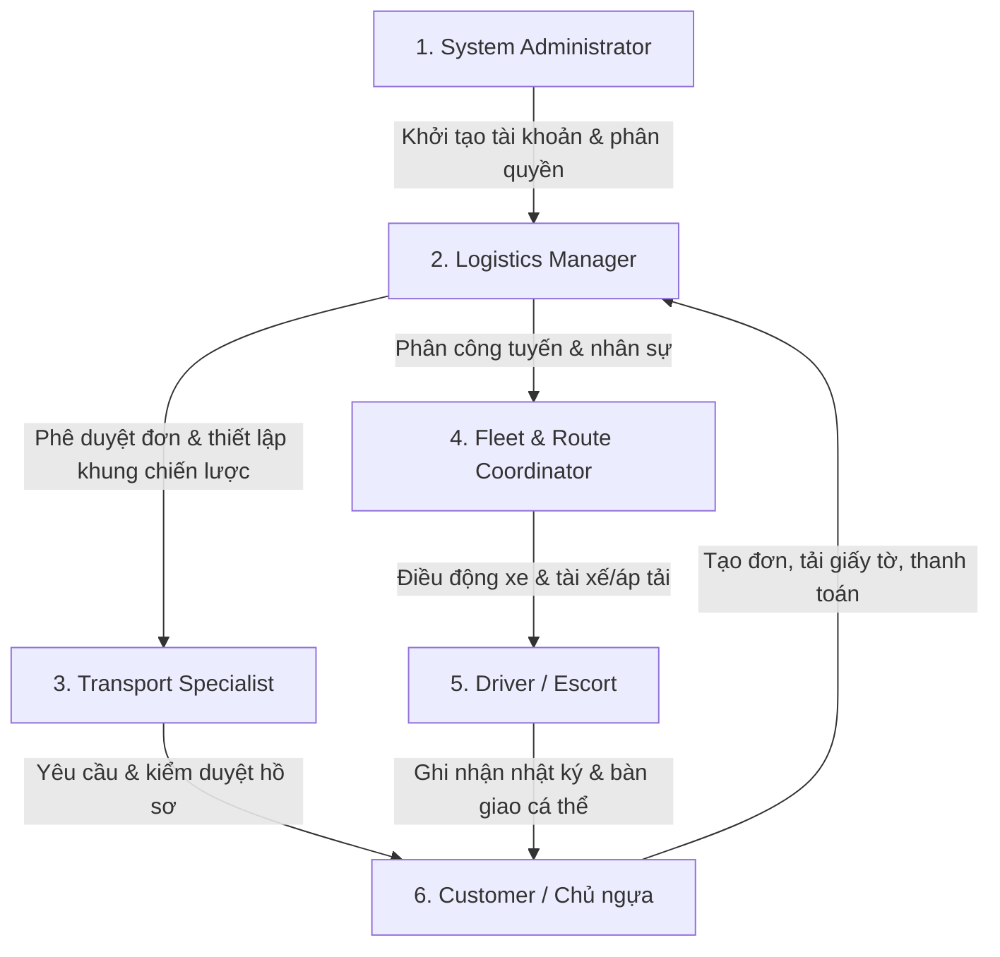
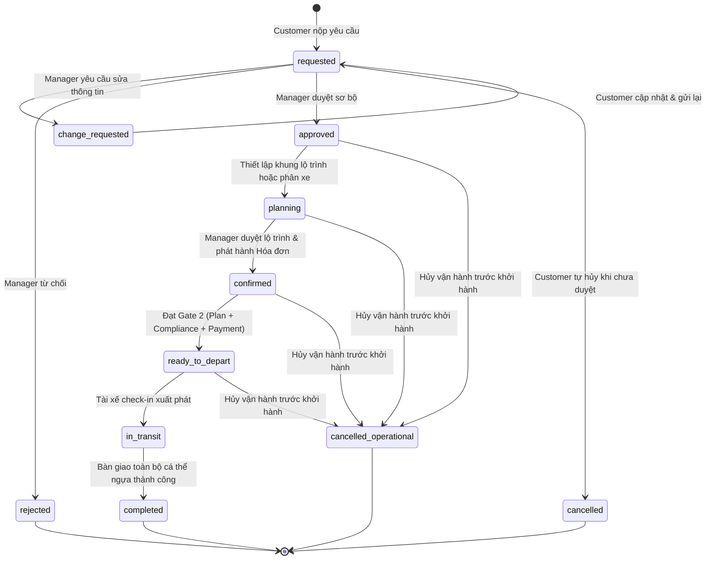
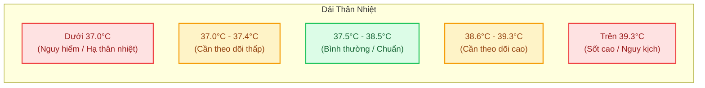
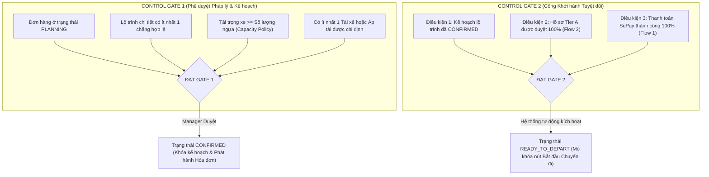
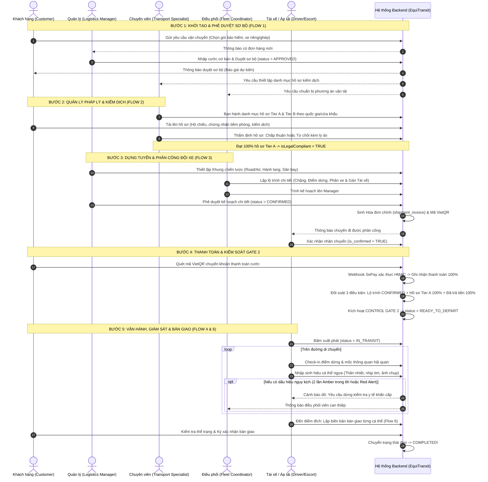

# TÀI LIỆU TOÀN DIỆN VỀ DỰ ÁN VẬN CHUYỂN NGỰA ĐUA XUYÊN QUỐC GIA (EQUITRANSIT / SWP391_GROUP1)

> **Dự án**: Cross-Border Racehorse Transport Management System  
> **Mã môn / Nhóm**: SWP391 - Nhóm 1  
> **Cập nhật**: Tháng 11/2026 (Đồng bộ với BA Specification v3.1, Database Wave 0–3 và Mã nguồn thực tế)

---

## MỤC LỤC TỔNG QUAN

1. [Tổng quan Dự án & Mục tiêu Nghiệp vụ](#1-tổng-quan-dự-án--mục-tiêu-nghiệp-vụ)
2. [Kiến trúc Hệ thống & Ngăn xếp Công nghệ](#2-kiến-trúc-hệ-thống--ngăn-xếp-công-nghệ)
3. [Các Tác nhân, Phân quyền & Nguyên tắc Tách biệt Trách nhiệm (RBAC & SoD)](#3-các-tác-nhân-phân-quyền--nguyên-tắc-tách-biệt-trách-nhiệm-rbac--sod)
4. [Vòng đời Đơn hàng & Máy trạng thái Hoàn chỉnh (Order State Machine)](#4-vòng-đời-đơn-hàng--máy-trạng-thái-hoàn-chỉnh-order-state-machine)
5. [Chi tiết Nghiệp vụ Flow 1: Tiếp nhận, Báo giá, Bảo hiểm & Hủy vận hành](#5-chi-tiết-nghiệp-vụ-flow-1-tiếp-nhận-báo-giá-bảo-hiểm--hủy-vận-hành)
6. [Chi tiết Nghiệp vụ Flow 2: Kiểm dịch, Hồ sơ Pháp lý Đa chiều & Cảnh báo Runtime](#6-chi-tiết-nghiệp-vụ-flow-2-kiểm-dịch-hồ-sơ-pháp-lý-đa-chiều--cảnh-báo-runtime)
7. [Chi tiết Nghiệp vụ Flow 3: Lập kế hoạch Tuyến, Đội xe & Chuyến xe ghép](#7-chi-tiết-nghiệp-vụ-flow-3-lập-kế-hoạch-tuyến-đội-xe--chuyến-xe-ghép)
8. [Chi tiết Nghiệp vụ Flow 4: Vận hành, Giám sát Sinh hiệu 3 Tầng & Check-in](#8-chi-tiết-nghiệp-vụ-flow-4-vận-hành-giám-sát-sinh-hiệu-3-tầng--check-in)
9. [Chi tiết Nghiệp vụ Flow 5 (Release 2): Quản lý Sự cố & Đổi tuyến 2 Bước](#9-chi-tiết-nghiệp-vụ-flow-5-release-2-quản-lý-sự-cố--đổi-tuyến-2-bước)
10. [Chi tiết Nghiệp vụ Flow 6 (Release 2): Bàn giao Cá thể & Giải quyết Tranh chấp](#10-chi-tiết-nghiệp-vụ-flow-6-release-2-bàn-giao-cá-thể--giải-quyết-tranh-chấp)
11. [Cơ chế Kiểm soát Khởi hành Kép: Control Gate 1 & Control Gate 2](#11-cơ-chế-kiểm-soát-khởi-hành-kép-control-gate-1--control-gate-2)
12. [Cổng Thanh toán SePay VietQR, Hóa đơn & Cửa sổ Thanh toán (D-3 Rule)](#12-cổng-thanh-toán-sepay-vietqr-hóa-đơn--cửa-sổ-thanh-toán-d-3-rule)
13. [Động cơ Báo cáo Tài chính, OTD & Quản trị Chi phí Vận hành](#13-động-cơ-báo-cáo-tài-chính-otd--quản-trị-chi-phí-vận-hành)
14. [Cấu trúc Frontend & Chi tiết Từng Actor Portal](#14-cấu-trúc-frontend--chi-tiết-từng-actor-portal)
15. [Kiến trúc Backend: Guards, Decorators, Xử lý Lỗi & Bảo mật](#15-kiến-trúc-backend-guards-decorators-xử-lý-lỗi--bảo-mật)
16. [Lược đồ Cơ sở Dữ liệu & Chi tiết 27 Bản Migrations](#16-lược-đồ-cơ-sở-dữ-liệu--chi-tiết-27-bản-migrations)
17. [Tiêu chuẩn Phi chức năng & Cơ chế Phòng ngừa Rủi ro](#17-tiêu-chuẩn-phi-chức-năng--cơ-chế-phòng-ngừa-rủi-ro)
18. [Quy trình Git & Nguyên tắc Phát triển Nhóm](#18-quy-trình-git--nguyên-tắc-phát-triển-nhóm)
19. [Sơ đồ Kiến trúc & Luồng nghiệp vụ (Mermaid Diagrams)](#19-sơ-đồ-kiến-trúc--luồng-nghiệp-vụ-mermaid-diagrams)

---

## 1. TỔNG QUAN DỰ ÁN & MỤC TIÊU NGHIỆP VỤ

### 1.1. Bối cảnh Nghiệp vụ Đặc thù
Vận chuyển ngựa đua xuyên quốc gia (Cross-Border Racehorse Transport) là một lĩnh vực logistics đặc thù với độ rủi ro cực kỳ cao và giá trị tài sản rất lớn (mỗi cá thể ngựa đua có thể trị giá hàng tỷ đến hàng chục tỷ đồng). Quá trình vận chuyển phải tuân thủ nghiêm ngặt:
- **Quy định Vận chuyển Động vật Sống của Hiệp hội Vận tải Hàng không Quốc tế (IATA Live Animals Regulations - LAR)**.
- **Tiêu chuẩn Vận chuyển Thú y ASEAN (ASEAN Standards on Cross-Border Animal Movement)**.
- **Quy chuẩn Kiểm dịch & Hải quan đa phương** của từng quốc gia xuất phát, quá cảnh và nhập cảnh (Việt Nam, Campuchia, Lào, Thái Lan, Singapore, Malaysia, v.v.).

### 1.2. Mục tiêu Xây dựng Hệ thống
Hệ thống **EquiTransit** được phát triển nhằm số hóa toàn diện quy trình vận tải ngựa đua từ đầu đến cuối:
1. Tự động hóa tiếp nhận nhu cầu, khảo sát đặc điểm sinh học và tính toán phí vận chuyển/bảo hiểm minh bạch.
2. Quản lý danh mục hồ sơ kiểm dịch đa tầng theo quốc gia, phương thức và cửa khẩu.
3. Lập kế hoạch hành trình đa phương thức (Road/Air), tối ưu hóa tải trọng chuồng đơn lập và ghép chuyến (Consolidation).
4. Giám sát tình trạng sức khỏe cá thể ngựa (thân nhiệt, nhịp tim) theo dải chuẩn kín 3 tầng và định vị hành trình thời gian thực.
5. Kiểm soát tài chính nghiêm ngặt với cổng thanh toán SePay VietQR (HMAC Webhook), hóa đơn điện tử và cơ chế phê duyệt hoàn tiền 2 cấp (Dual-Approval SoD).
6. Xử lý sự cố linh hoạt trên đường và bàn giao cá thể nghiêm ngặt kèm xác thực danh tính người nhận.

---

## 2. KIẾN TRÚC HỆ THỐNG & NGĂN XẾP CÔNG NGHỆ

Hệ thống được xây dựng theo mô hình Client-Server phân tầng, tách biệt hoàn toàn giữa giao diện người dùng và lõi xử lý nghiệp vụ:

| Thành phần | Công nghệ / Thư viện | Vai trò & Cấu hình |
| :--- | :--- | :--- |
| **Frontend Framework** | Next.js 15+ (App Router), React 19, TypeScript | Server & Client Components, Route Groups theo Actor |
| **Frontend Styling & UI** | Tailwind CSS v4, Lucide React, HTML5 Canvas | Giao diện Responsive, Dark/Light mode, In ấn Báo giá chuẩn PDF |
| **Backend Framework** | NestJS 10+, Express, TypeScript | REST API, Dependency Injection, Modular Architecture (Port: `5000`) |
| **Database & ORM** | MySQL 8.0+ (InnoDB, `utf8mb4_unicode_ci`), `mysql2` | Cơ sở dữ liệu quan hệ, Connection Pool, Raw SQL an toàn tránh lỗi ORM |
| **Xác thực & Bảo mật** | JWT (JSON Web Token), `bcryptjs`, Google OAuth 2.0 | Access Token (1h), HTTP-Only Cookies, OTP 6 chữ số lưu SHA-256 |
| **Cổng Thanh toán** | SePay Webhook (API Key + HMAC SHA-256), VietQR | Tạo mã QR động kèm mã hóa đơn, đối soát ngân hàng tự động |
| **Quản lý Tệp tải lên** | Multer, Magic-bytes sniffing | Giới hạn 10MB/tệp, xác thực byte đầu (PDF, JPG, PNG, WEBP), chặn thực thi script |
| **API Documentation** | Swagger / OpenAPI 3.0 (`@nestjs/swagger`) | Tích hợp tại `/api/docs`, mô tả DTOs, Enums và Status Codes |
| **Môi trường Phát triển** | Node.js v20+, npm, Git | Frontend chạy port `3001`, Backend chạy port `5000` |

---

## 3. CÁC TÁC NHÂN, PHÂN QUYỀN & NGUYÊN TẮC TÁCH BIỆT TRÁCH NHIỆM (RBAC & SoD)

Hệ thống định nghĩa 5 vai trò nghiệp vụ chính và 1 vai trò kỹ thuật, thiết lập ranh giới bảo mật nghiêm ngặt ở tầng máy chủ:



### 3.1. Chi tiết Vai trò & Phạm vi Quyền hạn

1. **Customer (Chủ ngựa / Khách hàng - Role ID: 2)**
   - Tạo yêu cầu vận chuyển mới, khai báo thông tin cá thể ngựa.
   - Chọn gói bảo hiểm (Basic / Comprehensive / Premium) và hình thức chuồng (Private Charter / Shared Trip).
   - Tải lên hồ sơ, giấy chứng nhận tiêm phòng, hộ chiếu ngựa.
   - Quét mã VietQR thanh toán cước phí và nhận thông báo trạng thái đơn.
   - Giám sát vị trí chuyến đi, theo dõi sinh hiệu ngựa và xác nhận/tranh chấp biên bản bàn giao.
   - *Ranh giới bảo mật*: Chỉ được truy cập dữ liệu thuộc quyền sở hữu của chính mình (`customer_id = user.id`). Các điểm dừng kỹ thuật nội bộ (`transfer_hub`) và thông tin khách hàng khác trên chuyến ghép hoàn toàn bị ẩn (Redacted).

2. **Logistics Manager (Quản lý Vận hành - Role ID: 1)**
   - Tiếp nhận, xem xét và phê duyệt sơ bộ đơn hàng (`approved`), từ chối (`rejected`) hoặc yêu cầu bổ sung thông tin (`change_requested`).
   - Nhập báo giá cước cơ bản và thiết lập khung vận tải chiến lược (Chế độ Road/Air, hành lang chính, hãng bay, sân bay dự kiến).
   - Phê duyệt kế hoạch lộ trình chi tiết và phân công đội ngũ từ Coordinator.
   - Cấp ân hạn thanh toán (Payment Grace Extension, tối đa 2 lần).
   - Quản trị hủy vận hành (`cancelled_operational`), duyệt hồ sơ hoàn tiền (Dual-Approval khi giá trị $\ge 20.000.000$ VNĐ).
   - Xác nhận lý do trễ chuyến được miễn trừ (Excused Delay) trong vòng 48 giờ sau khi hoàn thành.
   - Xem toàn bộ báo cáo doanh thu, chi phí vận hành và tỷ lệ giao đúng giờ (OTD).

3. **Transport Specialist (Chuyên viên Pháp lý & Kiểm dịch - Role ID: 3)**
   - Quản lý kho quy chế kiểm dịch đa tầng theo quốc gia, phương thức và cửa khẩu.
   - Thiết lập bộ hồ sơ kiểm dịch yêu cầu cho từng đơn hàng (Gán mẫu quy chuẩn hoặc cấu hình tùy chỉnh).
   - Kiểm tra, đối soát giấy tờ khách hàng nộp: Duyệt (`approved`), từ chối kèm lý do (`rejected`) hoặc lưu vết gia hạn.
   - Cập nhật số giấy phép và thời hạn phê duyệt của cơ quan thú y/hải quan.
   - Nhận cảnh báo tức thời khi có giấy tờ hết hạn trên đường (`in_transit_compliance_alert`) hoặc khi hành trình đổi cửa khẩu mới (Flow 5).

4. **Fleet & Route Coordinator (Điều phối viên Đội xe & Tuyến đường - Role ID: 4)**
   - Nhận khung chiến lược từ Manager để lập kế hoạch chi tiết từng chặng (Legs) và điểm dừng (Stops).
   - Tính toán khoảng cách, thời gian di chuyển, thời gian nghỉ theo chuẩn IATA LAR.
   - Phân công phương tiện và kiểm tra tải trọng (Capacity Policy: mỗi chặng đường bộ phải có số ô chuồng $\ge$ số ngựa).
   - Điều động nhân sự (Tài xế, nhân viên áp tải), kiểm tra trùng lịch và phân công nhân sự dự phòng (Backup Pool).
   - Xử lý ghép chuyến (Consolidation) trên các chuyến xe đường bộ có sẵn.
   - Lập đề xuất thay đổi lộ trình 2 bước khi có sự cố phát sinh trên đường (Flow 5).

5. **Driver / Escort (Tài xế & Nhân viên Áp tải - Role ID: 5)**
   - Được phân công chuyên môn cụ thể (`specialization`: 'driver' hoặc 'escort').
   - Xem danh sách chuyến đi được phân công và xác nhận nhận chuyến (`confirmed`) hoặc từ chối kèm lý do.
   - Check-in điểm dừng thực tế: Ghi nhận thời gian đến, xuất phát, thông quan hải quan (`customs_cleared`).
   - Cập nhật nhật ký sức khỏe cá thể ngựa (Thân nhiệt, nhịp tim, trạng thái hành vi, ảnh chụp đính kèm).
   - Báo cáo sự cố khẩn cấp trên đường kèm tọa độ và hình ảnh hiện trường (Flow 5).
   - Lập biên bản bàn giao cá thể tại điểm đích kèm đối soát giấy tờ và danh tính người nhận (Flow 6).

6. **System Administrator (Quản trị viên Hệ thống - Role ID: 6)**
   - Quản lý danh mục tài khoản người dùng, phân quyền hệ thống.
   - Cấu hình các tham số kỹ thuật toàn cục và giám sát audit log.

### 3.2. Ma trận Trách nhiệm Nghiệp vụ (RACI Matrix)

| Quy trình / Hành động | Customer | Logistics Manager | Transport Specialist | Fleet Coordinator | Driver / Escort |
| :--- | :---: | :---: | :---: | :---: | :---: |
| Tạo đơn vận chuyển & chọn bảo hiểm | **A / R** | I | I | I | I |
| Duyệt sơ bộ đơn & nhập cước sơ bộ | I | **A / R** | C | C | I |
| Yêu cầu & thẩm định hồ sơ kiểm dịch | C | I | **A / R** | I | I |
| Lập khung chiến lược (Strategic Framework) | I | **A / R** | I | C | I |
| Dựng lộ trình chi tiết & phân công đội xe | I | C | I | **A / R** | I |
| Duyệt lộ trình chi tiết & phát hành hóa đơn | I | **A / R** | I | C | I |
| Xác nhận nhận chuyến vận chuyển | I | I | I | C | **A / R** |
| Thanh toán cước qua VietQR | **A / R** | I | I | I | I |
| Xác thực Control Gate 2 (Đủ 3 điều kiện) | I | **A** | C | C | R |
| Cập nhật mốc hành trình & sinh hiệu ngựa | I | I | I | C | **A / R** |
| Báo cáo sự cố trên đường | I | C | C | C | **A / R** |
| Đề xuất đổi tuyến khi có sự cố | I | C | C | **A / R** | I |
| Phê duyệt & xuất bản lộ trình đổi tuyến | I | **A / R** | C | C | I |
| Lập biên bản bàn giao cá thể ngựa | C | I | I | I | **A / R** |
| Xác nhận / Tranh chấp nhận ngựa | **A / R** | I | I | I | I |
| Giải quyết tranh chấp bàn giao | C | **A / R** | I | C | C |
| Phê duyệt hồ sơ hoàn tiền (Refund) | I | **A / R** | I | I | I |
| Thực hiện chuyển khoản hoàn tiền | I | C | I | I | I |

*Chú thích: R = Responsible (Thực hiện), A = Accountable (Chịu trách nhiệm chính/Phê duyệt), C = Consulted (Tham vấn), I = Informed (Nhận thông báo).*

### 3.3. Nguyên tắc Tách biệt Trách nhiệm (Segregation of Duties - SoD)
Để ngăn ngừa tuyệt đối gian lận tài chính và sai lệch vận hành, hệ thống cài đặt sẵn các ràng buộc cứng:
- **SoD Hoàn tiền (Refund Execution)**: Người bấm nút thực hiện lệnh chuyển khoản hoàn tiền (`transferred_by`) **bắt buộc không được trùng** với người đã phê duyệt hồ sơ (`approved_by` hoặc `second_approved_by`). Nếu cùng một `user_id`, hệ thống trả về mã lỗi `HTTP 403 Forbidden`.
- **Cơ chế Dual-Approval Hoàn tiền**: Mọi khoản hoàn tiền cước mặt $\ge 20.000.000$ VNĐ bắt buộc phải trải qua 2 cấp phê duyệt độc lập của 2 tài khoản quản lý khác nhau trước khi mở khóa chức năng giải ngân.
- **Tách biệt Tạo tuyến và Duyệt tuyến**: Fleet Coordinator dựng chi tiết chặng và gán tài xế, nhưng chỉ Logistics Manager mới có quyền phê duyệt xuất bản (`confirmed`) để khóa kế hoạch và phát hành hóa đơn.

---

## 4. VÒNG ĐỜI ĐƠN HÀNG & MÁY TRẠNG THÁI HOÀN CHỈNH (ORDER STATE MACHINE)

Đơn hàng vận chuyển trải qua 11 trạng thái với các điều kiện chuyển đổi nghiêm ngặt:



### 4.1. Bảng Chi tiết Trạng thái Đơn hàng

| Mã trạng thái | Tên trạng thái | Diễn giải nghiệp vụ | Thao tác được phép |
| :--- | :--- | :--- | :--- |
| `requested` | Chờ tiếp nhận | Đơn mới được Customer tạo, đang chờ Manager rà soát | Duyệt sơ bộ, Từ chối, Yêu cầu sửa, Khách tự hủy |
| `change_requested` | Yêu cầu chỉnh sửa | Manager phản hồi thông tin đơn chưa rõ ràng hoặc thiếu | Khách cập nhật lại thông tin đơn |
| `rejected` | Đã từ chối | Đơn bị từ chối tiếp nhận (kèm lý do chính thức) | Đóng hồ sơ, không thể kích hoạt lại |
| `approved` | Đã duyệt sơ bộ | Đơn được chấp thuận; bắt đầu luồng Flow 2 và Flow 3 | Bắt đầu thẩm định hồ sơ, Tạo khung tuyến |
| `planning` | Đang lập kế hoạch | Coordinator đang dựng chặng, phân xe và gán nhân sự | Phân xe, Gán tài xế, Dựng chặng/điểm dừng |
| `confirmed` | Đã xác nhận kế hoạch | Manager duyệt lộ trình chi tiết, chốt cước & mở cổng thanh toán | Thanh toán cước, Nhân sự xác nhận chuyến |
| `ready_to_depart` | Sẵn sàng xuất phát | Đạt Control Gate 2: Kế hoạch OK, Hồ sơ 100%, Đã trả tiền | Tài xế kiểm tra xe và bấm xuất phát |
| `in_transit` | Đang vận chuyển | Đoàn xe/máy bay đang trên đường di chuyển | Check-in mốc, Cập nhật sinh hiệu, Báo sự cố |
| `completed` | Hoàn thành | Đã bàn giao toàn bộ số ngựa tại điểm đích | Xem báo cáo, Giải quyết tranh chấp nếu có |
| `cancelled` | Khách tự hủy | Customer hủy đơn khi đơn còn ở trạng thái `requested` | Đóng hồ sơ |
| `cancelled_operational` | Hủy vận hành | Đơn bị hủy sau khi đã duyệt (do thú y, thanh toán, bất khả kháng) | Tính toán hoàn tiền, Tạo biên bản khấu trừ |

---

## 5. CHI TIẾT NGHIỆP VỤ FLOW 1: TIẾP NHẬN, BÁO GIÁ, BẢO HIỂM & HỦY VẬN HÀNH

### 5.1. Khởi tạo Đơn hàng & Thuật toán Bảo hiểm (Equine Insurance Engine v2)
Khi khách hàng gửi yêu cầu, hệ thống tiếp nhận thông tin lộ trình, danh sách cá thể ngựa (Tên, giống, tuổi, giá trị khai báo, tình trạng tiêm phòng, microchip).
- **Tránh sai số làm tròn số thực**: Giá trị khai báo của ngựa và phí bảo hiểm được tính toán bằng số nguyên lớn (BigInt / Basis Points, $1\% = 100$ bps) để đảm bảo độ chính xác tài chính tuyệt đối.
- **3 Gói Bảo hiểm Chuẩn hóa theo % và Mức tối thiểu (C4.2)**:

| Tên Gói Bảo hiểm | Mã gói | Tỷ lệ phí (bps / %) | Mức tối thiểu | Mức độ sự cố M1–M4 & Mức bồi thường | Chi phí thú y khẩn cấp trên đường |
| :--- | :---: | :---: | :---: | :--- | :--- |
| **Cơ bản** | `basic` | 0 bps (0%) | 0 VNĐ | M1: Chi phí thực tế ≤ 5tr; M2: ≤ 10tr; M3: 20% (trần 50tr); M4: 100% (trần 50.000.000 VNĐ) | Không |
| **Tiêu chuẩn** | `standard` | 150 bps (1.5%) | 1.000.000 VNĐ | M1: Chi phí thực tế ≤ 1% giá trị; M2: 15% giá trị; M3: 50% giá trị; M4: 80% giá trị | Tối đa 20.000.000 VNĐ |
| **Toàn diện** | `premium` | 300 bps (3.0%) | 2.000.000 VNĐ | M1: Chi phí thực tế ≤ 2% giá trị; M2: 30% giá trị; M3: 80% giá trị; M4: 100% giá trị | Toàn bộ chi phí thực tế |

- **Công thức tính phí chuyến**:
$$\text{Phí Bảo hiểm Cá thể} = \max\left(\text{Phí tối thiểu}, \frac{\text{Giá trị khai báo (VNĐ)} \times \text{Tỷ lệ bps}}{10.000}\right)$$
- **Vận chuyển khứ hồi**: Phí 2 chặng tính bằng $\text{Phí một chiều} \times 2 \times 0.9$.
- **Cửa sổ yêu cầu bồi thường (Claim Window)**: Khách hàng được gửi yêu cầu bồi thường trong vòng **72 giờ** sau khi hoàn tất bàn giao ngựa (riêng sự cố tử vong M4 được gửi ngay trong lúc vận chuyển). Khoản bồi thường $\ge 20.000.000$ VNĐ yêu cầu phê duyệt 2 cấp (Dual-Approval) và Admin chuyển khoản (SoD).

### 5.2. Lựa chọn Hình thức Đặt chỗ (Booking Choice)
- **Private Charter (Thuê chuyến chuyên biệt)**: Khách hàng bao trọn phương tiện. Phương tiện chỉ phục vụ duy nhất đơn hàng này, khởi hành theo lịch trình yêu cầu của khách hàng.
- **Shared Trip (Ghép chuyến tiết kiệm)**: Ngựa của khách hàng được bố trí chung chuyến xe chuyên dụng với các chủ ngựa khác có cùng hành lang di chuyển. Chi phí tối ưu hơn, lịch khởi hành phụ thuộc vào chuyến xe gom.

### 5.3. Quy trình Báo giá & Phê duyệt Sơ bộ
1. Logistics Manager xem xét tính khả thi của lộ trình và số lượng ngựa.
2. Manager nhập cước phí vận chuyển cơ bản (`transport_cost`). Cước này cộng với phí bảo hiểm (`insurance_fee`) tạo thành tổng giá trị dự kiến ban đầu.
3. Thông báo tự động gửi tới Customer với nội dung thông báo rõ: *Báo giá hiện tại là sơ bộ; hóa đơn chính thức và cổng thanh toán chỉ mở sau khi kế hoạch chi tiết (Flow 3) được xác nhận*.

### 5.4. Quy trình Hủy Vận hành & Ma trận Hoàn tiền (DEC-04 & AC-F1-05)
Trạng thái `cancelled_operational` được áp dụng khi hủy đơn từ các trạng thái `approved`, `planning`, `confirmed`, hoặc `ready_to_depart`. **Tuyệt đối cấm hủy vận hành khi đơn đã `in_transit`** (Hệ thống trả về lỗi `HTTP 409 Conflict`).

#### Ma trận Tỷ lệ Hoàn tiền theo Lý do Hủy:

| Nhóm lý do hủy (`cancellation_category`) | Phương thức hoàn tiền (`refund_mode`) | Tỷ lệ hoàn cước vận chuyển | Hoàn phí bảo hiểm | Xử lý chi phí ứng trước của cơ quan (`disbursement`) |
| :--- | :---: | :---: | :---: | :--- |
| **Do lỗi công ty vận chuyển (`company_fault`)** | Tiền mặt / Chuyển khoản | **100%** | **100%** | Công ty chịu 100% chi phí, **không khấu trừ** vào tiền hoàn của khách. |
| **Ngựa không đủ sức khỏe có chứng nhận thú y (`vet_unfit_certified`)** | Bảo lưu cước 30 ngày (`credit_30d`) | **100%** | **100%** | Khấu trừ các khoản phí cơ quan thực tế đã chi trả. |
| | Hoàn tiền mặt (`cash_refund`) | **80%** | **100%** | Khấu trừ phí vé máy bay không hoàn lại + Phí cơ quan đã chi. |
| **Ngựa không đủ sức khỏe không chứng nhận (`vet_unfit_uncertified`)** | Bảo lưu cước 30 ngày (`credit_30d`) | **80%** | **100%** | Khấu trừ các khoản phí cơ quan thực tế đã chi trả. |
| | Hoàn tiền mặt (`cash_refund`) | **50%** | **100%** | Khấu trừ các khoản phí cơ quan thực tế đã chi trả. |
| **Khách tự yêu cầu hủy sau duyệt (`customer_request_post_approval`)** | Báo trước $\ge 72$ giờ | **90%** | **100%** | Khấu trừ chi phí cơ quan thực tế đã chi trả. |
| | Báo trước từ 24h đến $< 72$h | **50%** | **100%** | Khấu trừ chi phí cơ quan thực tế đã chi trả. |
| | Báo trước $< 24$ giờ | **0%** | **100%** | Khấu trừ chi phí cơ quan thực tế đã chi trả. |
| **Quá hạn thanh toán (`payment_overdue_expired`)** | Theo khung giờ trước khởi hành | Tương tự khách hủy | **100%** | Khấu trừ chi phí cơ quan thực tế đã chi trả. |
| **Trường hợp bất khả kháng (`force_majeure`)** | Hoàn tiền mặt / Bảo lưu | **100%** | **100%** | Khấu trừ chi phí bên thứ ba không hoàn lại đã phát sinh. |

*Lưu ý cốt lõi*: Phí bảo hiểm luôn được hoàn lại $100\%$ trong mọi kịch bản hủy trước giờ xuất phát vì dịch vụ bảo hiểm chưa phát sinh hiệu lực vận tải.

---

## 6. CHI TIẾT NGHIỆP VỤ FLOW 2: KIỂM DỊCH, HỒ SƠ PHÁP LÝ ĐA CHIỀU & CẢNH BÁO RUNTIME

### 6.1. Cấu trúc Quy chế Đa chiều (Multi-dimensional Regulations)
Quy định pháp lý và thú y được quản lý linh hoạt trong bảng `regulation` với các chiều dữ liệu:
- **Quốc gia (`country`)**: Quốc gia áp dụng quy chuẩn.
- **Cửa khẩu áp dụng (`border_gate`)**: Cụ thể hóa theo từng cửa khẩu (Mộc Bài, Hữu Nghị, Lao Bảo, Sân bay Tân Sơn Nhất, Sân bay Suvarnabhumi, v.v.).
- **Phương thức vận chuyển (`transport_mode`)**: `road` (đường bộ), `air` (hàng không), hoặc `both` (áp dụng cho cả hai).
- **Phân hạng hồ sơ (`doc_tier`)**:
  - **Tier A (Bắt buộc tiên quyết - Gate 1)**: Bắt buộc phải có để được phê duyệt sẵn sàng xuất phát (VD: Giấy chứng nhận kiểm dịch xuất khẩu, Giấy phép nhập khẩu, Hộ chiếu ngựa có chứng nhận tiêm sốc nhiệt/dại).
  - **Tier B (Hồ sơ bổ trợ / Thủ tục hải quan tại mốc)**: Giấy tờ có thể bổ sung trong quá trình di chuyển hoặc khi đến trạm kiểm dịch cửa khẩu (VD: Tờ khai hải quan điện tử, Chứng thư xác nhận sức khỏe 24h trước khi lên máy bay).
- **Thời gian chuẩn bị tối thiểu (`lead_time_days`)**: Số ngày khách cần nộp trước ngày xuất phát.
- **Thời gian đệm hiệu lực (`min_validity_buffer_hours`)**: Thời hạn giấy phép còn lại tối thiểu tại thời điểm xuất phát (mặc định 24 giờ).

### 6.2. Cơ chế Lưu vết Bổ sung Hồ sơ (BR-F2-04: Append-Only History)
Hệ thống nghiêm cấm hành vi cập nhật đè (`UPDATE` ghi đè URL) lên hồ sơ giấy tờ cũ đã bị từ chối:
1. Khi Transport Specialist từ chối một giấy tờ, hồ sơ đó được giữ nguyên để phục vụ kiểm toán pháp lý.
2. Khách hàng tải lên phiên bản mới, hệ thống tạo bản ghi `transport_document` mới.
3. Bản ghi cũ được đánh dấu lưu trữ (`is_archived = true`) và bản ghi mới trỏ ngược lại bản ghi cũ qua trường `superseded_by_document_id`.

### 6.3. Xử lý Hồ sơ Hết hạn trong Vận chuyển (BR-F2-06: In-Transit Runtime Expiry)
Khi chuyến đi đang diễn ra (`in_transit`), nếu một giấy tờ bị hết hạn hoặc bị cơ quan chức năng thu hồi:
1. Hệ thống **tuyệt đối không rollback** trạng thái đơn hàng về `planning` hay `approved` để tránh làm vỡ lịch trình vận hành và hỏng dữ liệu giám sát.
2. Đánh dấu cờ khẩn cấp: `shipment.in_transit_compliance_alert = true`.
3. Hệ thống tự động phát **Cảnh báo Đỏ** đồng thời tới 3 vai trò: Transport Specialist, Fleet Coordinator và Logistics Manager.
4. **Khóa thao tác thông quan**: Chặn tài xế/áp tải cập nhật trạng thái `customs_cleared` tại các điểm dừng kiểm dịch/cửa khẩu tiếp theo cho đến khi chuyên viên hoàn tất gia hạn điện tử hoặc kích hoạt luồng xử lý sự cố (Flow 5).

---

## 7. CHI TIẾT NGHIỆP VỤ FLOW 3: LẬP KẾ HOẠCH TUYẾN, ĐỘI XE & CHUYẾN XE GHÉP

### 7.1. Phân định Trách nhiệm 2 Bước (Strategic / Operational Separation)
- **Bước 1 (Manager đặt Khung Chiến lược)**: Chọn hình thức vận tải chính (Road / Flight), chọn hành lang giao thông (Corridor), chỉ định hãng hàng không (`airline_id`), sân bay cất cánh/hạ cánh và phân công Fleet Coordinator phụ trách.
- **Bước 2 (Coordinator dựng Kế hoạch Vận hành Chi tiết)**: Dựng chi tiết từng chặng (`route_leg`), điểm dừng nghỉ theo chuẩn IATA LAR (`route_stop`), phân công biển số xe chuyên dụng và danh sách nhân sự (Tài xế + Áp tải).

### 7.2. Chính sách Sức chứa Phương tiện (Capacity Policy)
Mỗi cá thể ngựa bắt buộc phải có một ô chuồng độc lập (Stall) đạt chuẩn an toàn:
- Ràng buộc cứng: Với mỗi chặng đường bộ, tổng sức chứa của xe được gán bắt buộc phải $\ge$ số lượng ngựa của đơn hàng (`vehicle.capacity >= order.requestedHorseCount`).
- Nếu sử dụng nhiều xe, hệ thống tính tổng dung tích và đảm bảo mỗi cá thể ngựa được định danh cụ thể trên từng phương tiện.

### 7.3. Ghép Chuyến Đường bộ & Bảo mật Thông tin Khách hàng (Privacy Redaction)
Khi Coordinator xếp các đơn hàng lẻ vào chung một chuyến xe đường bộ (`road_trip_id`):
- Hệ thống tự động tính toán tổng số ngựa của tất cả các đơn ghép để không vượt quá sức chứa tối đa của xe.
- **Thuật toán Che giấu Dữ liệu (Server-side Redaction)**:
  - Khi Customer xem hành trình, hệ thống tự động loại bỏ các điểm dừng trung chuyển kỹ thuật (`transfer_hub`).
  - Điểm xuất phát và đích đến của các chặng ghép được điều chỉnh hiển thị liền mạch theo lộ trình riêng của khách hàng đó.
  - Mã chuyến ghép nội bộ và thông tin của các khách hàng khác bị ẩn hoàn toàn để bảo mật tuyệt đối danh tính chủ sở hữu ngựa đua.

### 7.4. Phân công Nhân sự & Nhân sự Dự phòng (Backup Staff Pool)
- Kiểm tra tính hợp lệ của nhân sự: Tài xế phải có bằng lái phù hợp; Nhân viên áp tải phải có chứng chỉ chăm sóc ngựa.
- Kiểm tra trùng lịch: Nhân sự đang thực hiện chuyến đi khác trong cùng khoảng thời gian sẽ bị hệ thống cảnh báo và từ chối phân công.
- Nhân sự được quyền nhận chuyến (`is_confirmed = true`) hoặc từ chối kèm lý do. Nếu từ chối, Coordinator phải chọn nhân sự thay thế từ **Hồ dự phòng (Backup Pool)**.

---

## 8. CHI TIẾT NGHIỆP VỤ FLOW 4: VẬN HÀNH, GIÁM SÁT SINH HIỆU 3 TẦNG & CHECK-IN

### 8.1. Động cơ Giám sát Sinh hiệu Ngựa 3 Tầng Khép kín (Equine Vitals Policy)
Hệ thống sử dụng bảng tham số cấu hình động `equine_vital_config` để đánh giá tức thời sức khỏe cá thể ngựa khi nhân viên áp tải nhập nhật ký:



#### Bảng Phân hoạch Ngưỡng Sinh hiệu:

| Hạng mục Sinh hiệu | Dải Bình thường (Green) | Dải Cần theo dõi (Amber) | Dải Nguy kịch (Red Alert) |
| :--- | :---: | :---: | :---: |
| **Thân nhiệt (°C)** | $37.5^\circ\text{C} - 38.5^\circ\text{C}$ | $37.0^\circ\text{C} - <37.5^\circ\text{C}$ hoặc $>38.5^\circ\text{C} - 39.3^\circ\text{C}$ | $< 37.0^\circ\text{C}$ hoặc $> 39.3^\circ\text{C}$ |
| **Nhịp tim (BPM)** | $28 - 44$ lần/phút | $24 - <28$ hoặc $>44 - 60$ lần/phút | $< 24$ hoặc $> 60$ lần/phút |
| **Hành vi sinh học** | Bình thường (`stable`) | Không chịu ăn (`not_eating`), Căng thẳng (`stressed`) | Co giật, Khó thở cấp tính, Chấn thương |

- **Cơ chế Leo thang Cảnh báo (Consecutive Alert Escalation)**: Cửa sổ thời gian quy định là $6$ giờ (`consecutive_alert_window_hours = 6`). Nếu một cá thể ngựa ghi nhận $\ge 2$ lần liên tiếp ở mức `amber_escalatable` trong vòng 6 giờ, hệ thống sẽ **tự động kích hoạt Cảnh báo Đỏ (Red Alert)**.
- **Hành động phản ứng khi có Red Alert**:
  - Gửi thông báo khẩn cấp đến ứng dụng của Tài xế và Áp tải yêu cầu giảm tốc độ và dừng tại điểm nghỉ có cơ sở thú y gần nhất.
  - Gửi cảnh báo tức thời đến Coordinator và Manager để chuẩn bị phương án điều phối bác sĩ thú y lưu động hoặc chuyển hướng cấp cứu (Flow 5).

### 8.2. Check-in Tiến độ Hành trình & Cơ chế Hỗ trợ Ngoại tuyến (Offline-First)
- Tài xế ghi nhận tiến độ tại từng mốc: Xuất phát chặng (`leg_departure`), Đến điểm dừng (`arrived`), Thông quan hải quan (`customs_cleared`), Đến đích (`leg_arrival`).
- **Xử lý Mất sóng / Ngoại tuyến**: Khi di chuyển qua các vùng biên giới hoặc đèo núi không có mạng viễn thông, ứng dụng lưu tạm thời gian check-in vào bộ nhớ cục bộ (Local Cache). Khi có kết nối trở lại, dữ liệu được gửi lên kèm cờ đánh dấu bổ sung (`is_backdated = true`) nhằm đảm bảo tính toàn vẹn của lịch sử kiểm toán hành trình.

---

## 9. CHI TIẾT NGHIỆP VỤ FLOW 5 (RELEASE 2): QUẢN LÝ SỰ CỐ & ĐỔI TUYẾN 2 BƯỚC

Flow 5 là phân hệ mở rộng (Optional Scope Release 2), được thiết kế độc lập và **không làm gián đoạn hay ảnh hưởng tiêu cực** đến luồng vận hành cốt lõi (Flow 1 đến Flow 4).

### 9.1. Phân loại Sự cố & Tiếp nhận Báo cáo
Sự cố trên đường được báo cáo thông qua bảng `incident_report` với 5 nhóm chính:
1. `breakdown`: Hư hỏng phương tiện vận tải (nổ lốp, hỏng động cơ, hỏng hệ thống làm mát).
2. `medical`: Sự cố sức khỏe cá thể ngựa (sốt cao, mất nước, chấn thương).
3. `customs_delay`: Ách tắc tại cửa khẩu do thủ tục kiểm dịch phát sinh hoặc phía hải quan kiểm tra kéo dài.
4. `weather`: Thời tiết cực đoan (bão lũ, sạt lở đèo, đình chỉ chuyến bay).
5. `other`: Các nguyên nhân ngoại cảnh khác.

### 9.2. Quy trình Phê duyệt Đổi tuyến 2 Bước (2-Step Change Request)
Khi sự cố đòi hỏi phải thay đổi lộ trình, thay xe hoặc ghé trạm thú y khẩn cấp:
- **Bước 1 (Coordinator đề xuất)**: Tạo bản ghi `shipment_change_request`, nêu rõ loại thay đổi (`change_type`: detour, vehicle_swap, delay, cancellation), giá trị cũ, giá trị mới, chi phí phát sinh ước tính (`estimated_extra_cost`) và nguồn chi trả (`cost_allocation`: công ty chịu, bảo hiểm chi trả, hoặc phụ lục khách trả).
- **Bước 2 (Manager thẩm định & Phê duyệt)**: Logistics Manager xem xét tính hợp lý của phương án và chi phí để ra quyết định `approved` hoặc `rejected`.
- **Bước 3 (Xuất bản lộ trình mới - Publish)**: Coordinator bấm xuất bản lộ trình mới. Hệ thống cập nhật các chặng và điểm dừng tương ứng trong bảng `route_leg` và `route_stop`.

### 9.3. Ba Bất biến Nghiệp vụ Bắt buộc của Flow 5 (3 Flow Invariants)
1. **Bất biến 1 (Rà soát Cửa khẩu Mới)**: Nếu việc đổi lộ trình khiến đoàn xe phải đi qua một quốc gia hoặc cửa khẩu mới (`crosses_new_border = true`), hệ thống tự động phát thông báo khẩn yêu cầu Transport Specialist rà soát lại toàn bộ quy chuẩn kiểm dịch Flow 2 cho cửa khẩu mới đó.
2. **Bất biến 2 (Hạch toán Chi phí Thú y Khẩn cấp)**: Chỉ được phép phân bổ chi phí phát sinh sang nguồn `emergency_vet_covered` nếu đơn hàng có mua gói bảo hiểm Premium. Nếu khách dùng gói Basic hoặc Comprehensive, chi phí phải được phân bổ sang quỹ vận hành nội bộ hoặc lập phụ lục thanh toán bổ sung cho khách.
3. **Bất biến 3 (Hiệu ứng Gợn sóng trên Chuyến Ghép - Shared Trip Ripple Effect)**: Khi thay đổi lộ trình của một chuyến xe ghép chở ngựa của nhiều khách hàng, hệ thống gửi thông báo cập nhật lộ trình tới tất cả các khách hàng bị ảnh hưởng. **Nghiêm cấm làm lộ thông tin cá nhân hoặc lý do riêng của khách hàng khác** trong nội dung thông báo.

---

## 10. CHI TIẾT NGHIỆP VỤ FLOW 6 (RELEASE 2): BÀN GIAO CÁ THỂ & GIẢI QUYẾT TRANH CHẤP

Flow 6 là phân hệ mở rộng quản lý việc giao nhận cá thể ngựa tại điểm đến cuối cùng một cách minh bạch và có tính pháp lý cao.

### 10.1. Quy trình Lập Biên bản Bàn giao Từng Cá thể (Per-Horse Handover)
Biên bản bàn giao (`delivery_handover`) được lập riêng cho từng cá thể ngựa (`shipment_horse_id`):
1. Tài xế/Áp tải kiểm tra giấy tờ tùy thân của người nhận thực tế tại điểm đích (`received_by_name`, `identity_verified = true`).
2. Kiểm tra hồ sơ gốc bàn giao kèm theo ngựa (Hộ chiếu, chứng thư kiểm dịch - `documents_handed_over = true`).
3. Đánh giá thể trạng thực tế của ngựa lúc dắt xuống xe: `healthy` (khỏe mạnh), `minor_injury` (trầy xước nhẹ), `sick` (mệt mỏi/sốt), `critical` (nguy kịch).
4. Chụp tối đa 5 bức ảnh chụp rõ thể trạng ngựa và các góc xung quanh làm bằng chứng tải lên hệ thống.
5. Hệ thống gửi thông báo yêu cầu Customer ký xác nhận điện tử.

### 10.2. Xác nhận Đơn hàng Hoàn thành Toàn phần hay Một phần
- **Hoàn thành Toàn phần (`completed`)**: Toàn bộ cá thể ngựa trong đơn hàng đều được khách hàng ký nhận không có khiếu nại.
- **Hoàn thành Một phần (`partial_completion`)**: Một số cá thể ngựa đã được bàn giao an toàn, trong khi các cá thể khác còn lại đang trong quá trình chuyển viện điều trị thú y hoặc đang chờ xử lý thủ tục kiểm dịch bổ sung.

### 10.3. Cơ chế Khởi tạo & Giải quyết Tranh chấp Bàn giao (Dispute Resolution)
1. **Khách hàng Khiếu nại (`disputed`)**: Nếu phát hiện ngựa bị thương tích, ốm nặng hoặc thiếu hồ sơ gốc, khách hàng từ chối ký nhận và nhập lý do tranh chấp (`dispute_reason`) kèm ảnh chụp đối chứng trong vòng 24 giờ.
2. **Manager Thẩm định Tranh chấp**: Logistics Manager đối chiếu nhật ký hành trình, nhật ký sinh hiệu của áp tải và ảnh chụp hiện trường lúc bàn giao.
3. **Phán quyết Bồi thường & Đóng Tranh chấp**: Manager nhập kết luận giải quyết (`resolution_notes`), số tiền bồi thường bảo hiểm nếu có (`compensation_amount`), và chuyển trạng thái biên bản thành `resolved`.

---

## 11. CƠ CHẾ KIỂM SOÁT KHỞI HÀNH KÉP: CONTROL GATE 1 & CONTROL GATE 2

Để loại trừ hoàn toàn các rủi ro bị tạm giữ tại biên giới hoặc tranh chấp pháp lý, hệ thống triển khai hai cổng kiểm soát nghiệp vụ nghiêm ngặt:



### 11.1. Control Gate 1 (Kế hoạch Lộ trình Hoàn chỉnh)
Điều kiện tiên quyết để Logistics Manager có thể bấm nút duyệt lộ trình (`confirmed`):
- [x] Đơn hàng đang ở trạng thái `planning`.
- [x] Đã cấu hình ít nhất 1 chặng vận tải (`legs.length >= 1`).
- [x] Tổng tải trọng của các phương tiện phân công $\ge$ số lượng ngựa yêu cầu của đơn.
- [x] Đã phân công ít nhất 1 tài xế (`driver`) hoặc 1 nhân viên áp tải (`escort`).

### 11.2. Control Gate 2 (Sẵn sàng Xuất phát Thực tế)
Là chốt chặn an toàn tối cao trước khi phương tiện lăn bánh. Hệ thống tự động chuyển trạng thái đơn hàng sang `ready_to_depart` khi và chỉ khi **đồng thời thỏa mãn cả 3 điều kiện**:
1. **Kế hoạch Lộ trình**: Đã được Logistics Manager duyệt và ở trạng thái `confirmed`.
2. **Pháp lý & Kiểm dịch**: $100\%$ các danh mục hồ sơ kiểm dịch thuộc Phân hạng Tier A của đơn hàng đã được Chuyên viên Pháp lý phê duyệt (`isFullyCompliant = true`).
3. **Tài chính & Thanh toán**: Khách hàng đã thanh toán $100\%$ số tiền cước trên hóa đơn qua cổng SePay VietQR (Giao dịch ghi nhận `status = 'succeeded'`).
- *Ngoại lệ*: Giao dịch qua môi trường thử nghiệm MoMo Sandbox **tuyệt đối không được tính hợp lệ** để mở khóa Gate 2.

---

## 12. CỔNG THANH TOÁN SEPAY VIETQR, HÓA ĐƠN & CỬA SỔ THANH TOÁN (D-3 RULE)

### 12.1. Tích hợp Thanh toán Tự động SePay VietQR
- **Tạo mã thanh toán**: Khi kế hoạch được duyệt (`confirmed`), hệ thống sinh hóa đơn chính thức (`shipment_invoice`) và tạo mã nộp tiền ngân hàng VietQR kèm nội dung chuyển khoản chuẩn hóa (VD: `SEPAY EQ105`).
- **Xác thực Webhook An toàn**: Webhook từ cổng SePay gửi về máy chủ backend được thẩm định qua API Key bí mật và mã băm chữ ký điện tử HMAC SHA-256.
- **Tính lũy kế**: Cho phép khách hàng chuyển khoản nhiều lần (nếu hạn mức chuyển tiền một ngày của ngân hàng bị giới hạn), hệ thống tự động cộng dồn số tiền đã nhận cho đến khi đủ giá trị hóa đơn.

### 12.2. Hóa đơn Chính & Hóa đơn Bổ sung (Primary & Supplemental Invoices)
- **Primary Invoice (Hóa đơn Chính)**: Mỗi lộ trình chỉ có duy nhất một hóa đơn chính có hiệu lực (`uq_active_primary_invoice_route`). Giá trị hóa đơn chính bao gồm: Cước vận tải + Phí bảo hiểm + Phụ phí chuồng tư nhân.
- **Supplemental Invoice (Hóa đơn Bổ sung)**: Được sinh ra khi phát sinh chi phí đổi lộ trình hoặc yêu cầu dịch vụ đột xuất trong quá trình vận hành (Flow 5).

### 12.3. Quy tắc Hạn chót Thanh toán D-3 & Cơ chế Ân hạn (Payment Due & Grace Window)
1. **Hạn chót Mặc định (D-3 Rule)**: Hạn cuối thanh toán hóa đơn chính là **3 ngày trước thời điểm xuất phát dự kiến** (`planned_departure - 3 days`). Nếu kế hoạch được duyệt cách ngày khởi hành $< 3$ ngày, hạn chót được ấn định là 24 giờ kể từ thời điểm duyệt.
2. **Ân hạn Thanh toán (Grace Extension)**:
   - Nếu khách hàng gặp khó khăn trong việc thu xếp tài chính, Logistics Manager có thể cấp quyền ân hạn thanh toán (`grant_payment_grace`).
   - Ràng buộc: Mỗi đơn hàng **chỉ được ân hạn tối đa 2 lần** (`grace_count <= 2`). Mỗi lần gia hạn đều ghi nhận rõ thời điểm, người cấp và lý do bằng văn bản.
3. **Cơ chế Phản ứng khi Quá hạn Thanh toán (SLA Fallback Option)**:
   - Đến thời điểm D-3, nếu khách hàng không thanh toán và không được cấp ân hạn, đơn hàng tự động kích hoạt cờ `payment_overdue = true`.
   - Với đơn xe riêng (Private Charter): Kích hoạt hủy vận hành tự động theo diện `payment_overdue_expired` để giải phóng phương tiện và nhân sự cho đơn khác.
   - Với chuyến ghép (Shared Trip): Fleet Coordinator có quyền thực hiện điều chuyển dời lịch chuyến ghép (`reschedule_shared`) để đảm bảo không làm đình trệ lịch trình của các khách hàng khác trên cùng chuyến xe.

---

## 13. ĐỘNG CƠ BÁO CÁO TÀI CHÍNH, OTD & QUẢN TRỊ CHI PHÍ VẬN HÀNH

Hệ thống tích hợp bộ công cụ tính toán phân tích chỉ số kinh doanh theo thời gian thực (Real-time Analytics Engine) tại module `reports`:

### 13.1. Thuật toán Đo lường Tỷ lệ Giao Hàng Đúng Giờ (On-Time Delivery - OTD)
OTD được tính toán tự động dựa trên thời điểm đến dự kiến (`planned_arrival`) và thời điểm check-in thực tế (`actual_arrival`) tại điểm đích cuối:
- **Ngưỡng Sai số Cho phép (Tolerance Window)**:
  - Vận chuyển Quốc tế hoặc Hàng không (`air` / `international`): Cho phép dung sai **120 phút** (do thủ tục kiểm dịch sân bay và hải quan biên giới kéo dài).
  - Vận chuyển Đường bộ Nội địa (`road domestic`): Cho phép dung sai **60 phút**.

$$\text{Độ Trễ Phút} = \frac{\text{Thời điểm đến thực tế} - \text{Thời điểm đến dự kiến}}{60.000\text{ ms}}$$

- **Chuyến đi Hợp lệ Đúng giờ**: Khi $\text{Độ Trễ Phút} \le \text{Ngưỡng Dung sai}$.
- **Cơ chế Trễ chuyến Được Miễn trừ (Excused Delay)**:
  - Nếu chuyến đi bị trễ do các nguyên nhân khách quan được chứng thực (Bão lũ, hải quan đóng cửa đột xuất, khám nghiệm thú y khẩn cấp).
  - Logistics Manager có quyền kích hoạt cờ `excused_delay = true` trong **cửa sổ thời gian tối đa 48 giờ** kể từ thời điểm đến thực tế. Sau 48 giờ, tính năng khóa vĩnh viễn nhằm chống gian lận số liệu KPI.
- **Công thức Tính 2 Chỉ số OTD**:

$$\text{Gross OTD Rate} = \frac{\text{Số chuyến đúng giờ}}{\text{Tổng số chuyến hoàn thành}} \times 100\%$$

$$\text{Adjusted OTD Rate} = \frac{\text{Số chuyến đúng giờ}}{\text{Tổng số chuyến} - \text{Số chuyến trễ được miễn trừ}} \times 100\%$$

### 13.2. Quản trị Chi phí Vận hành Thực tế (Shipment Operating Costs)
Chi phí vận hành thực tế của mỗi chuyến đi được ghi nhận độc lập vào bảng `shipment_operating_cost` với 7 nhóm chi phí rõ ràng:
1. `fuel`: Chi phí nhiên liệu (xăng, dầu).
2. `toll_border`: Phí cầu đường, BOT, lệ phí qua trạm cửa khẩu.
3. `airline_freight`: Tiền cước thuê khoang máy bay chở động vật (Cargo Freight).
4. `quarantine_fee`: Chi phí thú y, xét nghiệm, phun khử trùng và kiểm dịch.
5. `staff_allowance`: Công tác phí, phụ cấp ăn ở của tài xế và nhân viên áp tải.
6. `incident_absorbed`: Chi phí khắc phục sự cố do công ty chịu (sửa xe, cứu hộ).
7. `disbursement_absorbed_on_company_fault`: Phí cơ quan nhà nước công ty phải tự chịu khi chuyến đi bị hủy do lỗi vận hành của công ty.

### 13.3. Đối soát Tài chính Chuyên sâu (Executive Financial Reconciliation)
Hệ thống tính toán lợi nhuận gộp thực tế dựa trên dòng tiền đã đối soát từ SePay và các khoản khấu trừ hủy đơn:
- **Doanh thu Hoạt động Đã báo giá (Quoted Active Revenue)**:

$$\text{Quoted Active Revenue} = \text{Doanh thu cước vận tải} + \text{Doanh thu phí bảo hiểm}$$

- **Doanh thu Giữ lại từ Hủy đơn (Retained Cancellation Revenue)**: Doanh thu thực nhận từ các đơn bị hủy vận hành sau khi đã trừ đi tiền đã hoàn trả, số dư bảo lưu cước và các khoản phí cơ quan đã khấu trừ:

$$\text{Retained Revenue} = \max(0, \text{Tiền SePay đơn hủy} - \text{Tiền hoàn đã chuyển} - \text{Số dư bảo lưu 30d} - \text{Phí ứng cơ quan})$$

- **Doanh thu Ghi nhận Toàn bộ (Total Recognized Revenue)**:

$$\text{Total Recognized Revenue} = \text{Quoted Active Revenue} + \text{Retained Cancellation Revenue}$$

- **Lợi nhuận Gộp (Gross Profit) & Biên Lợi nhuận Gộp (Gross Margin)**:

$$\text{Gross Profit} = \text{Total Recognized Revenue} - \text{Tổng Chi phí Vận hành Thực tế}$$

$$\text{Gross Margin (\%)} = \frac{\text{Gross Profit}}{\text{Total Recognized Revenue}} \times 100\%$$

---

## 14. CẤU TRÚC FRONTEND & CHI TIẾT TỪNG ACTOR PORTAL

Mã nguồn Frontend được tổ chức theo kiến trúc chuẩn Next.js App Router, chia tách thư mục theo vai trò người dùng (Actor-based Route Isolation):

```
frontend/src/
├── app/
│   ├── (auth)/                  # Xác thực: Đăng nhập, Đăng ký, Quên mật khẩu, Xác thực OTP
│   ├── customer/                # Portal dành cho Khách hàng / Chủ ngựa
│   │   ├── dashboard/           # Thống kê cá nhân, danh sách đơn hoạt động
│   │   ├── requests/new/        # Biểu mẫu tạo đơn vận chuyển mới đa bước
│   │   ├── requests/[id]/       # Chi tiết đơn, xem báo giá, quét QR thanh toán, nộp giấy tờ
│   │   ├── horses/              # Quản lý danh bạ hồ sơ cá thể ngựa của khách
│   │   └── tracking/            # Giám sát hành trình thời gian thực & ký biên bản bàn giao
│   ├── manager/                 # Portal dành cho Logistics Manager
│   │   ├── requests/            # Tiếp nhận, rà soát, duyệt sơ bộ, hủy vận hành
│   │   ├── routes/              # Thiết lập khung chiến lược, duyệt kế hoạch chi tiết
│   │   ├── fleet/               # Giám sát đội xe, định mức tải trọng
│   │   ├── finances/            # Quản trị hoàn tiền, ân hạn thanh toán, sổ thu chi
│   │   └── reports/             # Báo cáo OTD, doanh thu, phân tích chi phí vận hành
│   ├── coordinator/             # Portal dành cho Fleet & Route Coordinator
│   │   ├── planning/            # Dựng chặng, điểm dừng, ghép chuyến, phân xe & tài xế
│   │   └── fleet-status/        # Tình trạng ca kíp, độ khả dụng của tài xế và xe
│   ├── specialist/              # Portal dành cho Transport Specialist
│   │   ├── regulations/         # Quản trị thư viện quy chế kiểm dịch theo quốc gia/cửa khẩu
│   │   └── compliance/          # Thẩm định hồ sơ khách nộp, cấp duyệt Tier A/Tier B
│   └── driver/                  # Portal dành cho Tài xế & Nhân viên Áp tải
│       ├── trips/               # Danh sách chuyến được phân công, xác nhận nhận chuyến
│       ├── status/              # Check-in mốc hành trình, cập nhật thông quan hải quan
│       ├── vitals/              # Nhập nhật ký thân nhiệt, nhịp tim cá thể ngựa
│       ├── incidents/           # Báo cáo sự cố khẩn cấp trên đường kèm ảnh
│       └── handover/            # Lập biên bản bàn giao từng cá thể tại điểm đích
├── components/                  # UI Components dùng chung (Button, Modal, Input, Badge, Table)
├── features/                    # Domain logic & UI nghiệp vụ dùng chung
│   ├── orders/                  # Biểu mẫu bảo hiểm, đặt chỗ, hóa đơn, SePay VietQR, in ấn báo giá
│   ├── routes/                  # Chọn chuyến ghép (RoadTripPicker), hiển thị chặng
│   ├── tracking/                # Bản đồ hành trình, sinh hiệu, panel bàn giao cá thể
│   ├── documents/               # Modal tải lên hàng loạt, xem trước và thẩm định giấy tờ
│   └── incidents/               # Panel đề xuất thay đổi lộ trình 2 bước
└── lib/                         # Tiện ích dùng chung
    ├── api-client.ts            # Axios/Fetch client kèm interceptor gắn JWT tự động
    ├── geo-corridors.ts         # Động cơ tính khoảng cách, tọa độ sân bay/cửa khẩu
    └── formatters.ts            # Định dạng tiền tệ VNĐ, ngày giờ, biển số xe
```

---

## 15. KIẾN TRÚC BACKEND: GUARDS, DECORATORS, XỬ LÝ LỖI & BẢO MẬT

### 15.1. Danh mục Mô-đun Nghiệp vụ Backend (`backend/src/modules/`)
1. **`auth`**: Đăng nhập, đăng ký, refresh token, xác thực mã OTP, tích hợp Google OAuth.
2. **`orders`**: Vòng đời đơn hàng, bảo hiểm, đặt chỗ, hủy vận hành, hoàn tiền SoD, SePay Webhook.
3. **`documents`**: Quản lý quy chế kiểm dịch, tải lên và thẩm định hồ sơ, kiểm soát Gate 1.
4. **`routes`**: Dựng khung chiến lược, lập lộ trình chi tiết, ghép chuyến, tra cứu sân bay/cửa khẩu.
5. **`fleet`**: Quản lý phương tiện, phân công nhân sự, quản lý ca kíp và hồ dự phòng.
6. **`tracking`**: Cập nhật mốc hành trình, giám sát sinh hiệu 3 tầng, kiểm soát Gate 2, bàn giao Flow 6.
7. **`incidents`**: Báo cáo sự cố trên đường, quy trình đề xuất đổi tuyến 2 bước (Flow 5).
8. **`reports`**: Động cơ báo cáo chỉ số OTD, chi phí vận hành, đối soát tài chính thực tế.
9. **`horses`**: Quản lý thông tin hồ sơ, microchip, thể trạng cá thể ngựa.
10. **`notifications`**: Hệ thống thông báo thời gian thực theo vai trò và người dùng.

### 15.2. Hệ thống Guards & Custom Decorators
- **`JwtAuthGuard`**: Kiểm tra tính hợp lệ và thời hạn của JWT Token trong tiêu đề `Authorization: Bearer <token>`.
- **`RolesGuard`**: So khớp vai trò của người dùng với danh sách vai trò cho phép được khai báo qua Decorator `@Roles(...)`.
- **`@CurrentUser()`**: Tự động giải mã Payload của Token và inject thông tin đối tượng người dùng (`id`, `email`, `role`) vào tham số của hàm điều khiển (Controller Handler).

### 15.3. Chuẩn hóa Mã Lỗi HTTP & Ngoại lệ
Backend sử dụng hệ thống mã lỗi chuẩn RESTful của NestJS:
- **`400 Bad Request`**: Dữ liệu đầu vào không hợp lệ, sai cú pháp DTO hoặc vi phạm quy tắc logic (VD: Ngưỡng sinh hiệu không đúng trật tự).
- **`401 Unauthorized`**: Thiếu Token xác thực hoặc Token đã hết hạn.
- **`403 Forbidden`**: Không có quyền truy cập dữ liệu của khách hàng khác hoặc vi phạm nguyên tắc SoD hoàn tiền.
- **`404 Not Found`**: Không tìm thấy đơn hàng, lộ trình hoặc tệp đính kèm tương ứng.
- **`409 Conflict`**: Xung đột trạng thái máy (VD: Duyệt đơn khi đơn không ở `requested`, hoặc hủy vận hành khi đơn đã `in_transit`).
- **`422 Unprocessable Entity`**: Vi phạm ràng buộc nghiệp vụ sâu (VD: Hạch toán chi phí thú y khẩn cấp cho đơn không mua bảo hiểm Premium).

---

## 16. LƯỢC ĐỒ CƠ SỞ DỮ LIỆU & CHI TIẾT 27 BẢN MIGRATIONS

Hệ thống lưu trữ trên cơ sở dữ liệu MySQL 8.0+ với 25+ bảng quan hệ và 27 bản migration được thực thi tuần tự có tính năng kiểm tra trùng lặp (`IDEMPOTENT`):

### 16.1. Danh mục 27 Bản Migrations

| STT | Tên Tệp Migration | Nội dung & Tác động Nghiệp vụ |
| :---: | :--- | :--- |
| **001** | `001_add_otp_password_hash.sql` | Bổ sung cột lưu băm mật khẩu OTP phục vụ xác thực 2 bước. |
| **002** | `002_add_shipment_rejection_reason.sql` | Bổ sung lý do từ chối đơn hàng của Logistics Manager. |
| **003** | `003_add_horse_age.sql` | Thêm trường tuổi cá thể ngựa vào bảng `horse`. |
| **004** | `004_add_shipment_change_request_notes.sql` | Bổ sung ghi chú yêu cầu khách hàng sửa đơn. |
| **005** | `005_add_transport_document_reviewer_notes.sql` | Bổ sung lý do từ chối hoặc nhận xét thẩm định hồ sơ của Chuyên viên Thú y. |
| **006** | `006_add_horse_quantity.sql` | Bổ sung số lượng ngựa trên từng dòng đơn hàng. |
| **007** | `007_update_horse_status.sql` | Chuẩn hóa danh mục trạng thái ngựa (`active`, `in_transit`, `inactive`). |
| **008** | `008_add_horse_photo_url.sql` | Thêm trường ảnh đại diện nhận diện cá thể ngựa. |
| **009** | `009_seed_fleet_vehicles.sql` | Nạp dữ liệu mẫu đội xe chuyên dụng vận tải ngựa. |
| **010** | `010_create_flow3_fleet_route_planning_tables.sql` | Khởi tạo bảng lộ trình (`route`), chặng (`route_leg`), điểm dừng (`route_stop`). |
| **011** | `011_add_user_specialization.sql` | Thêm chuyên môn cho nhân sự vận hành (`driver` hoặc `escort`). |
| **013** | `013_momo_sandbox_payments.sql` | Tích hợp bảng thanh toán thử nghiệm qua ví MoMo. |
| **014** | `014_momo_atm_method.sql` | Bổ sung phương thức thẻ ATM nội địa vào cổng MoMo. |
| **015a**| `015_add_shipment_transportation_type.sql` | Thêm hình thức vận chuyển (`domestic` hoặc `international`). |
| **015b**| `015_sepay_payments.sql` | Khởi tạo bảng thanh toán SePay VietQR chính thức. |
| **016** | `016_route_payment_gate.sql` | Bổ sung liên kết hóa đơn và ràng buộc thanh toán cho lộ trình. |
| **017** | `017_equine_insurance.sql` | Tích hợp gói bảo hiểm, tỷ lệ phí basis points và mức trách nhiệm bồi thường. |
| **018** | `018_booking_type.sql` | Thêm lựa chọn hình thức thuê chuyến (`charter`) hoặc ghép chuyến (`shared`). |
| **019** | `019_road_trip_capacity.sql` | Bổ sung bảng quản lý chuyến xe ghép đường bộ và giới hạn tải trọng chuồng. |
| **020** | `020_separate_transport_mode.sql` | Tách biệt chế độ vận tải đường bộ và hàng không trên từng chặng. |
| **021** | `021_add_transfer_hub_stop_type.sql` | Bổ sung loại điểm dừng trung chuyển kỹ thuật (`transfer_hub`). |
| **022** | `022_add_plain_password.sql` | Bản vá tạm thời phục vụ kiểm thử môi trường dev (đã gỡ bỏ). |
| **023** | `023_drop_plain_password.sql` | Gỡ bỏ hoàn toàn cột mật khẩu không băm để bảo mật tuyệt đối. |
| **024** | `024_wave0_schema_hotfixes.sql` | Đồng bộ enum `customs_cleared`, tạo bảng audit lịch trình, hỗ trợ lưu vết hồ sơ. |
| **025** | `025_wave1_g1_g2_reports_compliance.sql` | Bổ sung bảng chi phí vận hành, cờ miễn trừ trễ chuyến, quy chế kiểm dịch đa chiều. |
| **026** | `026_wave2_g3_g4_ops_refunds_sla_vitals.sql` | Bổ sung hủy vận hành, hoàn tiền SoD, phí ứng trước, cấu hình sinh hiệu 3 tầng. |
| **027** | `027_wave3_flow5_incidents_and_flow6_handover.sql` | Bổ sung bảng xử lý sự cố Flow 5 và biên bản bàn giao giải quyết tranh chấp Flow 6. |

---

## 17. TIÊU CHUẨN PHI CHỨC NĂNG & CƠ CHẾ PHÒNG NGỪA RỦI RO

### 17.1. An toàn Tệp Tải lên & Ngăn chặn Mã độc (Upload Security)
Hệ thống tải tệp (hồ sơ kiểm dịch, ảnh sinh hiệu, bằng chứng sự cố, biên bản bàn giao) được bảo vệ đa lớp:
- **Xác thực Byte Nhận diện (Magic-Bytes Sniffing)**: Kiểm tra cấu trúc các byte đầu tiên của tệp tin tải lên (Header bytes) để đảm bảo tệp thực sự là PDF (`%PDF-`), JPEG (`\xFF\xD8\xFF`), PNG (`\x89PNG\r\n\x1a\n`) hoặc WebP. Không bao giờ tin tưởng đuôi mở rộng file do người dùng gửi lên.
- **Chặn Tệp Thực thi**: Tuyệt đối từ chối các định dạng có khả năng chứa mã độc (.exe, .sh, .bat, .js, .php, .html).
- **Phục vụ Tệp có Xác thực (Authenticated File Streaming)**: Các tệp giấy tờ và ảnh hiện trường **không được mở công khai (Static Serving)**. Mọi yêu cầu xem tệp đều phải đi qua Controller có gắn `JwtAuthGuard` để kiểm tra quyền sở hữu của người dùng trước khi stream tệp tin.

### 17.2. Chống Tấn công Dò Mật khẩu & Thắt nút Cổ chai (Rate Limiting)
- Triển khai bộ đếm lượt yêu cầu trượt theo thời gian (Sliding Window Rate Limiter) trên các tuyến xác thực `/api/auth/login`, `/api/auth/register`, `/api/auth/verify-otp`.
- Tự động tạm khóa IP và gửi cảnh báo khi phát hiện quá 5 lần nhập sai mã OTP liên tiếp trong vòng 10 phút.

---

## 18. QUY TRÌNH GIT & NGUYÊN TẮC PHÁT TRIỂN NHÓM

Theo quy định nghiêm ngặt tại `AGENTS.md` của dự án:
1. **Quy định Nhánh**: Nhánh làm việc chính của nhóm là `dev`. **Tuyệt đối không push trực tiếp lên `main`**. Mọi tính năng đều phải xuất phát từ nhánh con rẽ ra từ `dev` (VD: `feature/orders`, `feature/vitals-policy`, `fix/gate2-validation`).
2. **Quy ước Đặt tên Commit**: Tuân thủ định dạng Conventional Commits:
   - `feat(<scope>): <mô tả>` (VD: `feat(orders): add equine insurance calculation engine`)
   - `fix(<scope>): <mô tả>` (VD: `fix(tracking): correct vitals red alert escalation window`)
   - `docs(<scope>): <mô tả>` (VD: `docs(api): update flow 2 compliance contract`)
3. **Nguyên tắc Sửa đổi An toàn**:
   - Chỉ chỉnh sửa trong phạm vi mô-đun được giao.
   - Luôn kiểm tra `git status` và `git diff` trước khi commit.
   - Khi thay đổi biến môi trường, luôn đồng bộ vào `.env.example`. Không bao giờ commit file `.env` chứa mật khẩu thật lên repository.

---

## 19. SƠ ĐỒ KIẾN TRÚC & LUỒNG NGHIỆP VỤ (MERMAID DIAGRAMS)

### 19.1. Sơ đồ Luồng Tổng thể Toàn Hệ thống (End-to-End System Workflow)



---

*Tài liệu này được biên soạn độc quyền cho Dự án SWP391_GROUP1 nhằm phục vụ công tác phát triển, kiểm thử, tích hợp liên tục và bảo vệ đồ án tốt nghiệp.*
